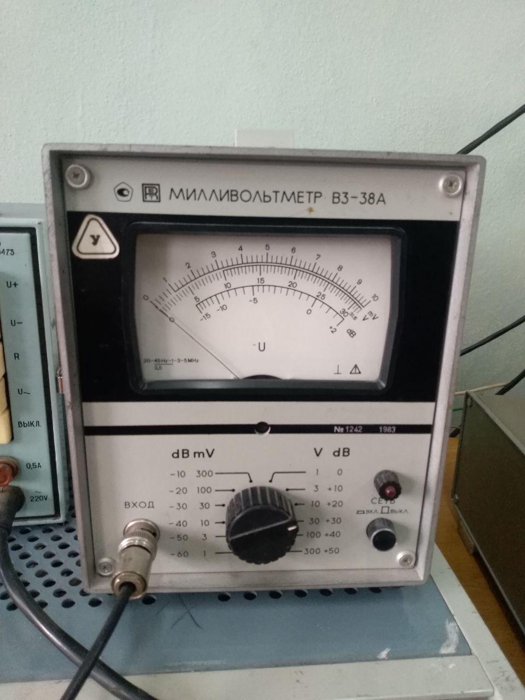

[← Back to Profile](../README.md)

# Education

## Secondary Education

**[Odesa General Education School №106](secondary-education/school-106/)** *(Aug 2006 – May 2017)* — Attestat, Svidoctvo, diploma supplement, and 2017 ZNO (external independent testing) results.

## Higher Education

*State University of Intellectual Technologies and Communications (Державний університет інтелектуальних технологій і зв'язку), Odesa — formerly O.S. Popov Odesa National Academy of Telecommunications*

### Bachelor's Degree, Automation and Computer-Integrated Technologies
*September 2017 – July 2021 · Diploma B21 №204484, issued 12 July 2021*

Strong foundation in designing and developing automation systems, integrating computer technologies with mechanical and electrical systems. Courses covered control systems, energy systems, and programming. Active in the scientific society — collaborated on research projects and presented findings at student conferences; participated in project groups focused on automation; volunteered organizing academic workshops and seminars.

### Master's Degree, Automation and Computer-Integrated Technologies
*August 2021 – December 2022 · Diploma M22 №075962, issued 31 December 2022 · 90 ECTS credits, 1 year 4 months full-time*

Specialized in advanced control systems and automation solutions. Graduate research focused on developing an optimal control system for a vacuum evaporation plant in the sugar industry — mathematical modeling, dynamic process analysis, and the design of decentralized control systems. Presented research at international conferences, conducted research in the automation laboratory with faculty and peers, and co-organized student scientific events.

**Academic Documentation:**
- [Diploma & Academic Records](telecommunication/telecommunication-education.pdf) — Complete diploma with grades and academic achievements
- [Theses](theses/) — Master's (vacuum evaporation plant control) and Bachelor's (cogeneration plant automation)
- [Coursework Projects](coursework/) — Course projects in automation systems design and process automation

### Laboratory Work

Hands-on work in the automation laboratory — calibrating sensors, testing circuit stability, and diagnosing automation systems on classic analog bench instruments such as the В3-38А millivoltmeter (a Soviet-era AC voltmeter, unit no. 1242, 1983) alongside DC power supplies and signal sources.

  

---

## Certifications

| Certification | Institution | Period | Level |
|---|---|---|---|
| [English Language](certifications/chkalov-english/) | Chkalov Language Courses, Odesa | Jan 2015 – Dec 2016 | B2 |

---

Meta: [meta.yaml](meta.yaml)

[← Back to Profile](../README.md)
