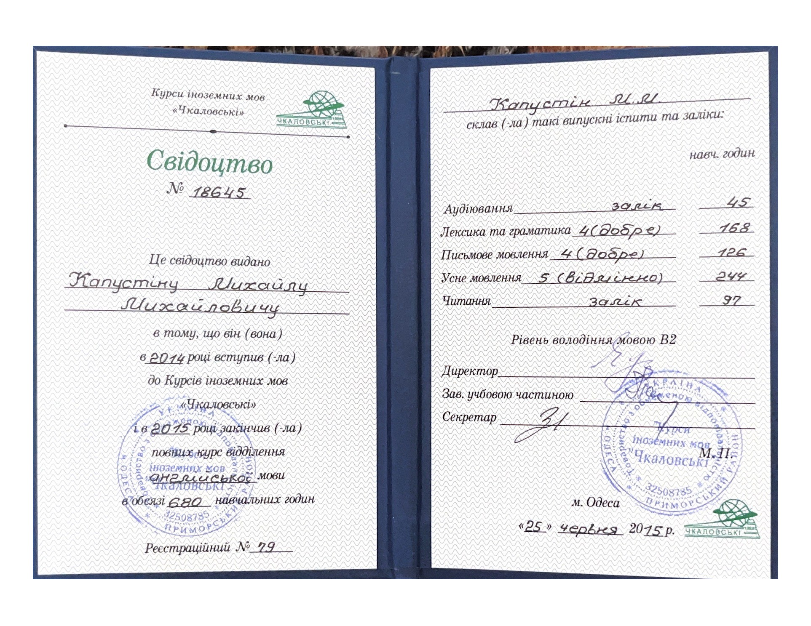
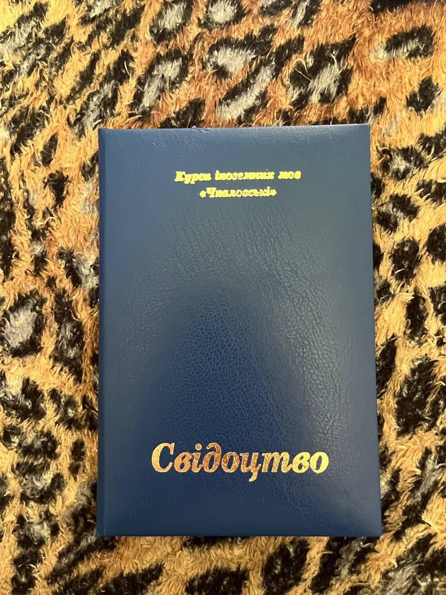

[← Education](../../README.md)

# Chkalov Courses in Foreign Languages — English, B2
*January 2015 – December 2016*

**Institution:** Chkalov Language Courses (Курси іноземних мов «Чкаловські»), Odesa, Ukraine
**Level:** B2 (Upper-Intermediate)
**Certificate No.:** 18645 · Registration No. 79
**Issued:** 25 June 2015 (registered start 2014, completed 2015 per certificate; course dates per owner: Jan 2015 – Dec 2016)
**Program:** 680 study hours, full course of the English language department

**Exam results:**
| Component | Result | Hours |
|---|---|---|
| Listening | Pass | 45 |
| Vocabulary & Grammar | 4 (Good) | 168 |
| Written Speech | 4 (Good) | 126 |
| Oral Speech | 5 (Excellent) | 244 |
| Reading | Pass | 97 |

**Documentation:**
- [Certificate (PDF)](chkalov-certificate.pdf) — completion record with exam grades

  
   
  

---

Meta: [meta.yaml](meta.yaml)

[← Education](../../README.md)
