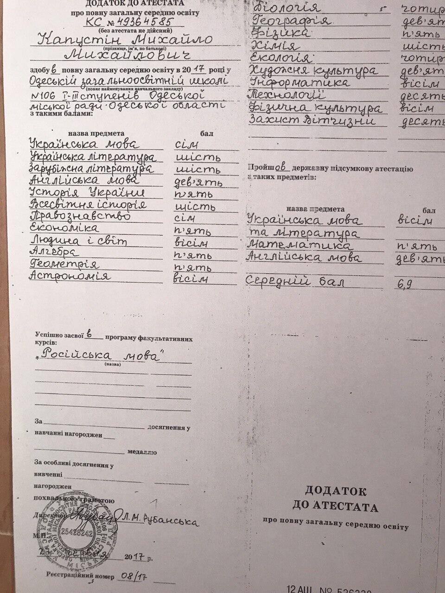

[← Education](../../README.md)

# Odesa General Education School №106
*August 2006 – May 2017*

**Institution:** Odesa General Education School №106 (Одеська загальноосвітня школа №106 I-III ступенів Одеської міської ради Одеської області)
**Location:** Odesa, Ukraine

Studied a wide range of subjects including Ukrainian language and literature, foreign literature, history, mathematics, and sciences, with an elective course in Russian. Was a member of the student council, helping organize school events and initiatives; took part in academic olympiads, representing the school in competitions; and contributed to cultural and sports events.

## Credentials

- **[Свідоцтво про базову загальну середню освіту](svidoctvo.jpg)** — basic general secondary education certificate (issued 2015, on completion of 9th grade)
- **[Атестат про повну загальну середню освіту](attestat.jpg), №CK 49364585** — full general secondary education certificate, issued 27 June 2017. [Digital record (Diia extract)](attestat-digital-record.pdf)
- **[Diploma Supplement (Додаток до атестата)](diploma-supplement.jpg)** — №49364585 (paired with the Attestat, not valid without it): full subject grades, average grade **6.9** (out of 12), state final exam results — Ukrainian language & literature 8, Mathematics 5, English 9

  

## ZNO 2017 (External Independent Testing)

The state exam used for university admission — see [How I Got Here, chapter 4](../../../how-i-got-here/chapters/04-all-in-on-math-and-popov-academy.md) for the story behind the math score.

| Subject | Raw score | ZNO result |
|---|---|---|
| Ukrainian Language & Literature | 65 / 104 | **158.0** |
| Mathematics | 18 / 62 | **121.0** |
| English | 40 / 56 | **167.0** |

---

Meta: [meta.yaml](meta.yaml)

[← Education](../../README.md)
