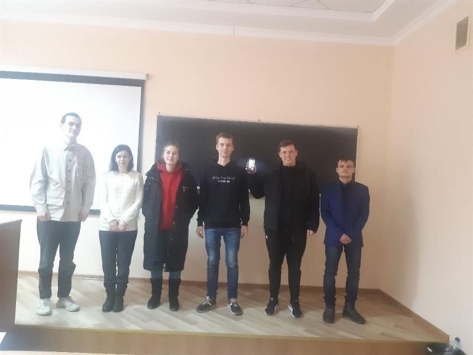
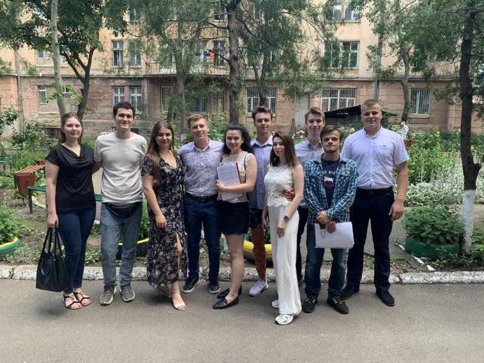
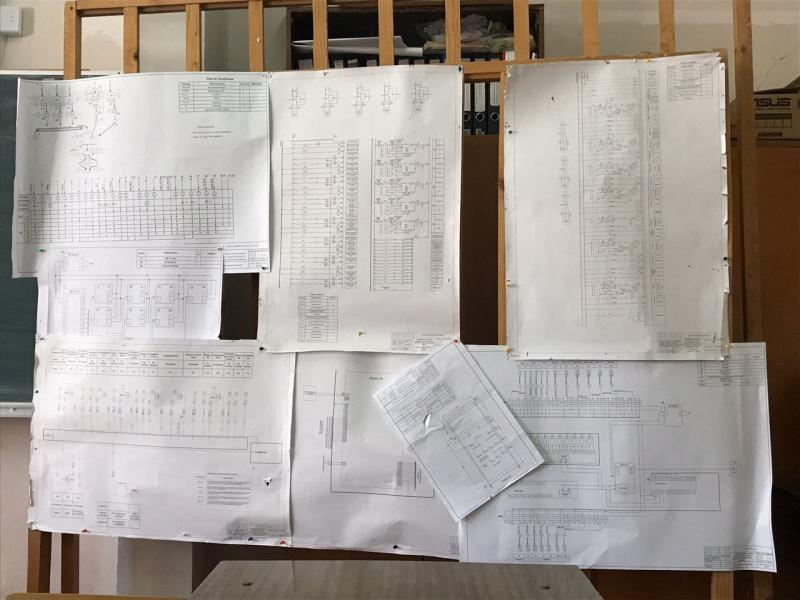

[← Education](../README.md)

# Theses

Both theses were supervised by Assoc. Prof. A.M. Tigariev at the Department of Computer-Integrated Technological Processes and Production.

## Master's Thesis — Optimal Control System for a Vacuum Evaporation Plant

**Дослідження та розробка оптимальної системи керування вакуум-випарною установкою**

*Group 601кт · 2022*

Research and synthesis of an optimal control system for the evaporation process in a five-stage vacuum evaporation plant used in sugar production. The plant is a multivariable control object — the study covers its regime parameters across all five stages (steam temperature and pressure, dry-matter concentration, level, juice temperature), mathematical modeling of the evaporation process, synthesis of the optimal controller, and analysis of system performance. Method: analytical, using computer technologies.

**Documents:** [Defense presentation (PPTX, 17 slides)](masters-thesis-defense-presentation.pptx)

  
   <em>With fellow graduates in the classroom, right after successfully defending our master's theses.</em>

## Bachelor's Thesis — Automation System for a Cogeneration Power Plant

**Розробка системи автоматизації когенераційної енергетичної установки**

*Group KT-4.19 · 2021 · 52 pages*

Design of an automation system for a cogeneration (combined heat and power) plant. The work covers a comparative analysis of cogeneration schemes (gas turbine, steam engine, piston engine), mathematical modeling of the plant dynamics as a control object (engine feed process, heat recovery unit), synthesis of a decentralized automatic control system with regulator parameter calculation, and the software/hardware architecture of the automation system.

The proposed control system is built around sensor networks — sensors, actuators, and the control computer are linked into a single network over an RS485 interface, minimizing the number of elements and interconnections for higher reliability.

**Documents:** [PDF](cogeneration-automation-thesis.pdf) · [DOCX](cogeneration-automation-thesis.docx)

  
   <em>With classmates right after successfully defending our bachelor's theses in Automation and Computer-Integrated Technologies.</em>

  
   <em>Defense demonstration material — process flow diagrams, automation schematics, control loop and equipment specification tables, and the software/hardware structure of the control system (Appendix B of the thesis, «Перелік копій демонстраційного матеріалу»).</em>

Related: [coursework projects](../coursework/) on the same cogeneration topic.

---

Meta: [meta.yaml](meta.yaml)

[← Education](../README.md)
