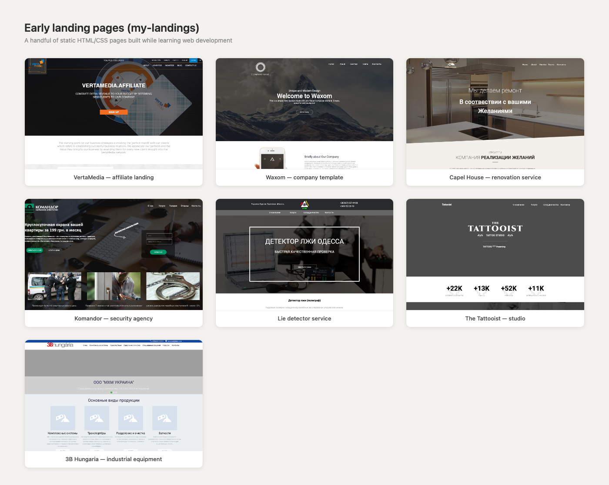

[← Professional Path](../README.md)

# Глава 1. Первые строчки кода

*8–9 класс*

*Источники: [_archive/part1.md](../_archive/part1.md), [_archive/part3.md](../_archive/part3.md)*

В школе я очень любил писать сочинения — возможно, именно это легло в основу моей будущей писательской деятельности: сейчас я регулярно выпускаю статьи (см. [Publications](../../publications/)).

Когда я был в 8-9 классе, мне нужно было определяться с будущей профессией — я активно думал стать юристом. Но мой старший брат настоял, что сейчас интересное и активно развивающееся направление — программирование, и рекомендовал пойти на курсы. Мы нашли курс фронтенда и SEO в Mobios — я ходил туда пару раз в неделю, и мне очень нравилось разрабатывать сайты. Писали на чистом HTML и CSS ([materializecss.com](https://materializecss.com)). Финальным экзаменом курса стал сайт, который мы реализовали: [my-landings/first_web_site](https://github.com/Kapustin2000/my-landings/tree/master/first_web_site).

Были и базовые лекции по SEO-оптимизации, но не очень глубокие. По окончании курса я договорился с директором компании и моим папой: сделал папе сайт [poligraph.com.ua](https://poligraph.com.ua), а Mobios занялись его SEO-продвижением — я мог присутствовать и помогать, так что для меня это стало дополнительными занятиями.

После курса я продолжал заниматься продвижением сайта и параллельно с большим увлечением учился вёрстке — сделал за это время много разных лендингов: [my-landings](https://github.com/Kapustin2000/my-landings/tree/master).

  

<!-- TODO: скрин сайта poligraph.com.ua -->

## Параллельно — английский

Эта линия шла не последовательно, а всё время рядом с остальным, начиная примерно с этого же периода. Практически всю жизнь я учил английский: 2-3 раза в неделю по часу-полтора, 4-5 лет. Когда я стал достаточно продвинутым, меня отправили в лучшую школу английского в городе — [chkalov-school.odessa.ua](https://www.chkalov-school.odessa.ua). Это был супер сложный период: там были занятия 2-3 раза в неделю по 3 часа, с серьёзными проверками, тестами и экзаменами. Мой день выглядел так: школа → 3 часа английского → 1-2 часа курсов в Mobios. У меня есть сертификаты Чкаловской школы, Grade B2.

<!-- TODO: дипломы/сертификаты из Чкаловской школы -->
