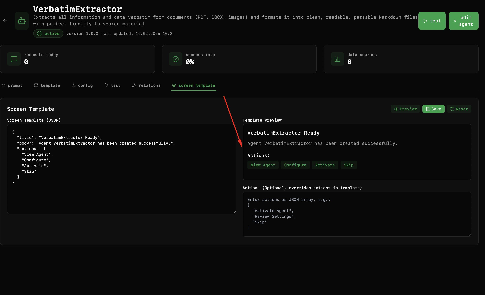

[← All Projects](../README.md)

# AI_ORG — Multi-Tenant AI Agent Platform

*October 2025 – March 2026 · Completed*

**Developed at:** [Osnova GmbH](../../experience/osnova/)

**Project Overview:**  
AI_ORG was the core backend platform for creating, configuring, and operating AI agents in a multi-tenant environment. It combined agent factories, tool registries, email-driven workflows, and model orchestration into one runtime layer.

## Key Features

- **Dynamic Agent Factory** – Meta-agents for creating other agents, prompts, configs, and templates from plain-language input
- **Registry Architecture** – Reusable tool and agent registries with dynamic loading and tenant-aware retrieval
- **Email Processing Pipeline** – Background email routing, classification, and execution for automated business workflows
- **Multi-Tenant Security** – JWT tenant scoping plus PostgreSQL Row-Level Security for platform isolation
- **Multi-LLM Runtime** – Support for OpenAI, Claude, Vertex AI, and other model-driven execution paths

## My Role and Contributions

- Designed and implemented core registry abstractions for tools and agents
- Built parts of the dynamic agent orchestration and email-processing pipeline
- Improved tenant-safe execution, logging, and scheduler-related flows
- Worked on model configuration, prompt-generation, and runtime reliability issues
- Helped shape the platform from prototype logic into a reusable AI operations backend

---

Meta: [meta.yaml](meta.yaml)

[← All Projects](../README.md)
