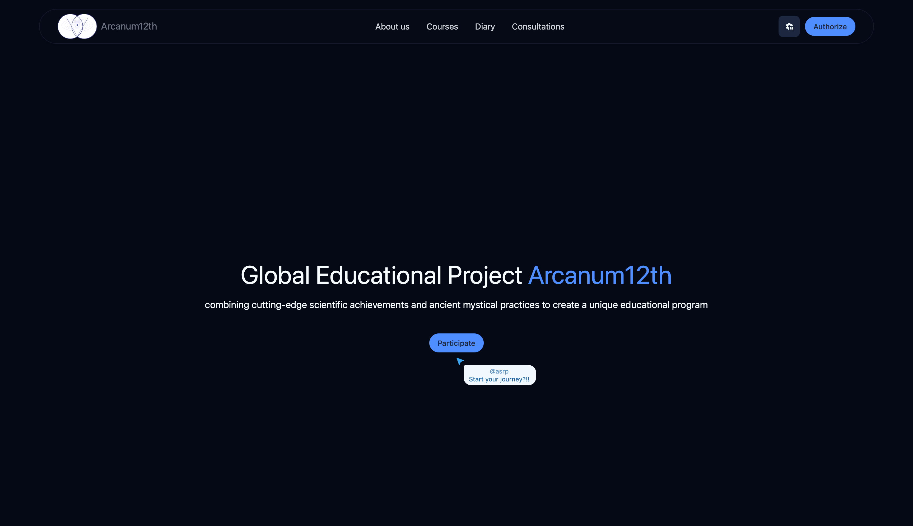

[← All Projects](../README.md)

# 🧘 Arcanum12th – Advanced Educational Platform for Consciousness and Cognitive Studies
*(April 2023 – Present)*

**Project Overview:**
Arcanum12th is a unique educational platform focused on consciousness studies, cognitive science, and mental training. It offers structured courses, research, and AI-driven analysis tools to help users develop self-awareness, master lucid dreaming, and enhance cognitive abilities.

**Live Website:** [https://arcanum12th.education/en](https://arcanum12th.education/en)

  

**Key Features:**
- **Specialized Learning Programs** – Courses on lucid dreaming, neurotraining, and meditation
- **AI-Powered Dream Analysis** – Integration with GMS for dream interpretation
- **Exclusive Research & Case Studies** – Scientific papers and experimental results
- **Practical Cognitive Training** – Mental state monitoring and neural optimization

**Technologies Used:**
- Vue.js · Nuxt.js
- LangChain · Docker
- Node.js · Nginx · PostgreSQL

---

[← All Projects](../README.md)
