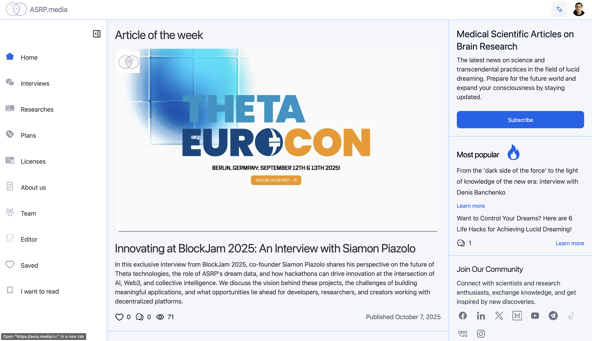

[← All Projects](../README.md)

# ASRP Media — Analytical & Research Media Platform

*May 2023 – September 2025*

**Developed at:** [ASRP](../../experience/asrp/)

**Project Overview:**
ASRP Media is an analytical and research platform dedicated to neuroscience, AI, cognitive science, and consciousness studies. As part of the ASRP ecosystem, it provides exclusive content, expert insights, and in-depth analyses of emerging technologies. The platform serves scientists, researchers, and technology enthusiasts interested in neurotechnology, lucid dreaming, and cognitive enhancement.

**Live Website:** [https://asrp.media/en](https://asrp.media/en)

  

**Key Features:**
- **Expert Interviews** – In-depth discussions with scientists, engineers, and industry leaders in neuroscience and AI
- **Scientific Research & Reviews** – Curated meta-analyses, reports, and case studies on neurotechnology and human cognition
- **Subscription-Based Access** – A flexible model offering premium articles, research papers, and expert discussions
- **Integration with ASRP Ecosystem** – Connected with AI-driven research, neurointerfaces, and dream analysis tools
- **Community & Knowledge Sharing** – A space for researchers and innovators to collaborate and exchange ideas

**My Role and Contributions:**
As a developer and strategist, I contributed to:
- **Website Development** – Designed and optimized the platform for seamless user experience
- **Custom CMS Implementation** – Developed an efficient system for publishing and managing research content
- **Monetization & Subscription Model** – Created a balanced content structure with exclusive premium access
- **SEO & Audience Growth** – Applied visibility strategies to expand reach and credibility
- **AI & Data Integration** – Integrated AI tools for automated research analysis and content organization

**Technologies Used:**
- Vue.js
- Pinia
- Nuxt.js
- Node.js
- LangChain
- ChatGPT
- PostgreSQL
- Nginx
- Docker

---

[← All Projects](../README.md)
