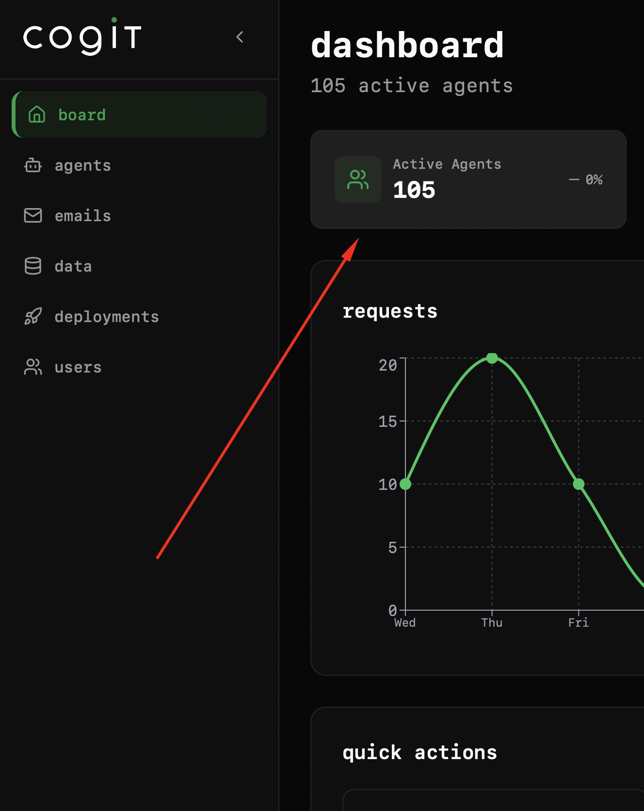

[← All Projects](../README.md)

# Cogit SaaS — Agent Operations Platform

*October 2025 – March 2026 · Completed*

**Developed at:** [Osnova GmbH](../../experience/osnova/)

**Project Overview:**  
Cogit SaaS was the customer-facing operations layer around the AI_ORG backend: a multi-tenant admin platform for creating, deploying, monitoring, and maintaining AI agents across web and email workflows.

## Key Features

- **React Admin Dashboard** – Agent management, activity views, execution feedback, and platform operations
- **Agent Chat Interface** – Frontend and backend flows for conversational agent creation and orchestration
- **Data Sources & RAG** – File ingestion, indexing, and tenant-scoped knowledge configuration
- **Execution & Email Operations** – Reporting, template editing, processing status, and manual recovery flows
- **Scheduling & Deployment** – Agent schedules, deployment channels, and Azure-based release automation

## My Role and Contributions

- Integrated the SaaS product with the AI_ORG backend for chat-driven agent creation
- Built and refined operational UI flows for templates, configs, scheduling, and execution visibility
- Improved tenant isolation, service contracts, and reliability around execution logging
- Contributed deployment and environment improvements for admin and backend delivery
- Helped turn internal agent runtime capability into a usable multi-tenant product surface

---

Meta: [meta.yaml](meta.yaml)

[← All Projects](../README.md)
