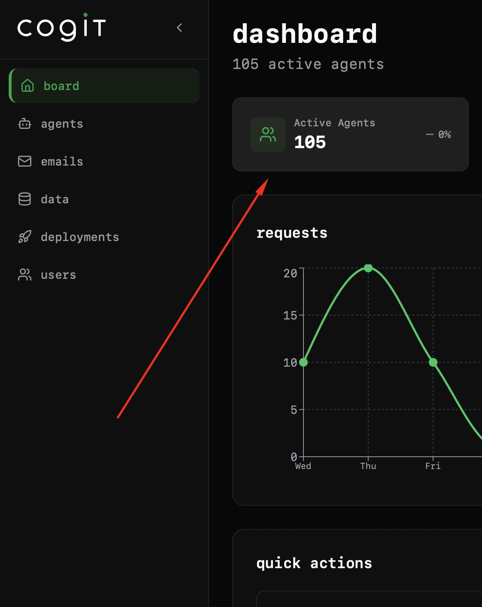
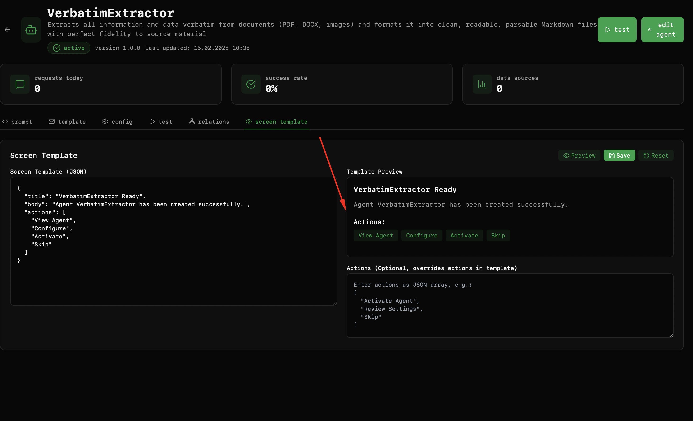

[← All Projects](../README.md)

# Cogit — Multi-Tenant AI Agent Platform

*October 2025 – July 2026 · Completed*

**Developed at:** [Osnova GmbH](../../experience/osnova/) · delivered through [ASRP](../../experience/asrp/) as a contracting engagement

**Project Overview:**  
Cogit is a multi-tenant SaaS platform for building and running AI agents. A business operator describes an agent in plain language — its purpose, instructions, tools, knowledge — and the platform turns that description into a configured, deployable agent, which then runs across three customer-facing channels: an embeddable website chat widget, an Outlook add-in, and an autonomous email processor that works with no human in the loop. The operator never writes code.

Architecturally it's two cooperating systems: a TypeScript SaaS (NestJS backend + React admin dashboard) that owns tenants, users, agents, deployments, and data, and a Python agent-authoring/execution service (`ai_org`) that generates agents from natural language and runs them. The spine runs operator dashboard → multi-tenant API → PostgreSQL with row-level isolation, with the backend delegating authoring and execution to the agent service, which scales independently. One agent definition fans out to three deployment surfaces. Agent reasoning runs on Google Gemini, Anthropic Claude, OpenAI, and Vertex AI behind an explicit model allow-list; the surrounding infrastructure is Azure-native (AI Search for RAG, Service Bus, Blob Storage, Communication Email, Container Apps).

## Key Features

- **Multi-tenant control plane** – Tenant isolation enforced at the database layer via PostgreSQL row-level security (`FORCE ROW LEVEL SECURITY`), with tenant identity carried on every request from the JWT
- **Agent builder** – A guided wizard plus a detail workspace (prompt, config, templates, schedules, sub-agents, relations) and a live Test playground scoped to a tenant
- **AgentMaker (natural language → agent)** – A Python meta-agent that decomposes a plain-text brief and dispatches specialized sub-makers into a full, validated agent configuration in roughly a minute
- **Three deployment channels from one agent** – Website chat widget with a per-tenant branding designer, an Outlook add-in, and an autonomous email agent that classifies inbound mail per-tenant and routes it accordingly
- **Knowledge / RAG** – File-based data sources ingested into Azure AI Search, tenant-tagged and attachable to any agent for grounded answers
- **Registry architecture** – A typed tool and agent registry with dynamic loading, tenant-aware retrieval, and per-agent, per-tenant encrypted secrets
- **The agent contract** – An explicit, machine-readable manifest of what an agent is and can do, so approval and tool visibility are properties of a declaration rather than decisions buried in code
- **Operational surface** – Activity and audit logs, execution logs with per-step traces, scheduled work, live updates over WebSockets, and log retention

## Engineering highlight — multi-tenancy that fails safe

One database, many businesses, and the isolation guarantee can't hinge on every query author remembering `WHERE tenantId = ?`. Tenant identity rides in the JWT, a per-request interceptor lifts it into an `AsyncLocalStorage` context, and every tenant table carries `FORCE ROW LEVEL SECURITY` — so the boundary holds even for the table owner and even when an application query forgets to filter. A row-level policy doesn't raise on a missing tenant context, though — it just returns fewer rows, often zero, so code without context can quietly do nothing while its logs report success; that's why a missing context is treated as an error rather than an empty result. Jobs that legitimately cross tenants (retention sweeps, cron fan-out) run through explicit `SECURITY DEFINER` functions on a separate connection rather than weakening the policies. RLS coverage was extended as the schema grew (email processing, execution logs), and the tenant-setting call was hardened into a parameterized `set_config` so the guarantee tracks the model instead of lagging behind it.

## Engineering highlight — an agent is data, not a deployment artifact

An agent here is not a set of files or a long-lived process — it's instructions plus configuration, which is to say, data, and data belongs in a database. That's the decision the rest of the platform rests on: it's what lets one runtime codebase serve many tenants, what lets the AgentMaker find an existing agent and compose it in as a sub-agent, and what makes behaviour changeable without a deploy. Runtime code stays static; behaviour changes purely through data — which pushed the routing problem in a specific direction too: candidate agents for a given inbound message aren't an enum a developer wrote down, they're rows a business operator adds at any moment, so an agent has to declare how it can be found, and "no agent matches" has to be a real outcome rather than a nearest-plausible guess.

## My Role and Contributions

- #1 contributor across both core repositories (~45% of commits each) and owned the staging → production release flow across three Azure environments
- Built the multi-tenant NestJS backend — DDD layering, JWT/tenant-context auth, PostgreSQL row-level security, Prisma schema/migrations, WebSocket gateways, cron scheduling
- Built the React admin dashboard — agent builder, Test playground, tenant/user management, deployment configuration including the widget branding designer
- Implemented the multi-channel deployment layer — website widget, Outlook add-in, and the stateful, dynamically-classified email-processing pipeline
- Integrated the Azure surface (AI Search, Service Bus, Blob Storage, Communication Email) and the Python `ai_org` agent-authoring/execution service as the generation backend
- Designed and implemented the core registry abstractions for tools and agents behind `ai_org`, and the dynamic agent orchestration and email-processing pipeline it runs
- Authored the agent-contract and capabilities design work — the manifest layer that lets the platform reason about an agent without running it
- Contributed the written architecture-decision practice used across the engagement

---

Meta: [meta.yaml](meta.yaml)

[← All Projects](../README.md)
