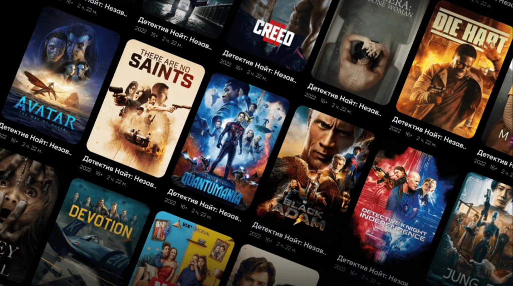
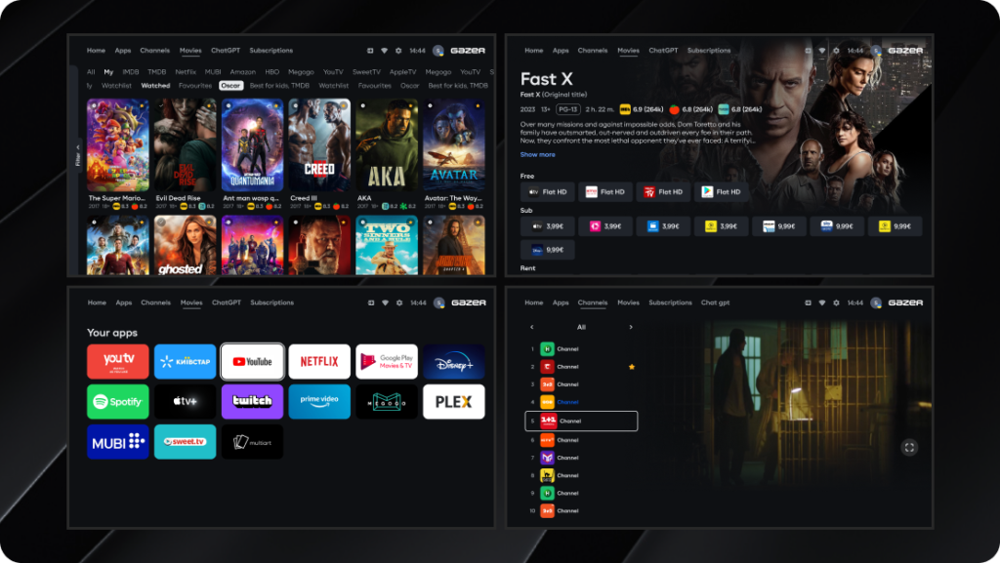

[← All Projects](../README.md)

# Gazer TV — Smart TV Companion Application

*April 2021 – July 2023*

**Project Overview:**
Gazer TV is a mobile application designed to enhance the user experience of Gazer Smart TVs by transforming smartphones and tablets into versatile remote controls. The app offers a range of features that provide users with intuitive and convenient ways to interact with their TVs.

  
  
  
  

**Key Features:**
- **Remote Control Functionality** – Operate your Gazer Smart TV using your mobile device, eliminating the need for traditional remote controls
- **Media Playback** – Stream videos, photos, and audio directly from your smartphone or tablet to the TV screen, facilitating seamless media sharing
- **Wireless Mouse and Touchpad** – Utilize the "mouse function" to navigate the TV interface with precision, using your device as a wireless mouse or touchpad
- **On-Screen Keyboard** – Simplify text input with the on-screen keyboard feature, making searches and data entry more efficient
- **Screen Mirroring** – Mirror your mobile device's screen onto the TV, allowing for a larger display of your apps, games, and other content

**My Role and Contributions:**
As a developer for Gazer TV, my responsibilities included:
- **Mobile Application Development** – Led the development of the app for both iOS and Android platforms, ensuring a consistent and user-friendly experience across devices
- **Integration with Gazer Smart TVs** – Implemented seamless connectivity between the app and Gazer Smart TVs, enabling efficient communication and control
- **User Interface Design** – Collaborated with designers to create an intuitive interface that enhances user engagement and accessibility
- **Feature Implementation** – Developed key functionalities such as media playback, wireless mouse control, and screen mirroring to enrich the user experience
- **Testing and Optimization** – Conducted thorough testing to ensure app stability, performance, and compatibility with various devices and TV models

**Technologies Used:**
- Node.js
- PostgreSQL
- MongoDB
- RESTful
- GraphQL
- Nginx
- Elasticsearch
- GPT-4
- OAuth2.0
- JWT
- Jenkins
- GitLab CI
- Docker
- Kubernetes
- Amazon Web Services (AWS)
- Grafana
- Terraform

---

[← All Projects](../README.md)
