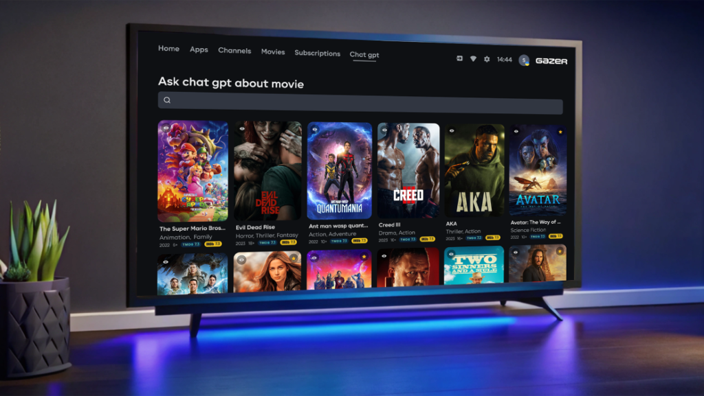
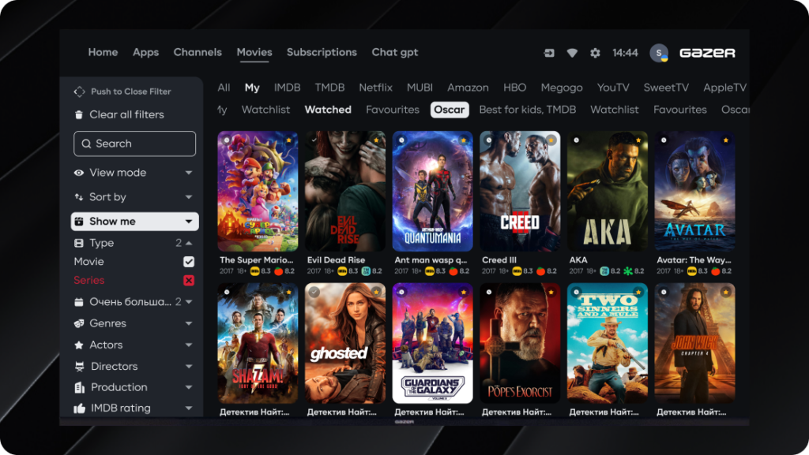

[← All Projects](../README.md)

# 📺 Gazer TV – Smart TV Companion Application
*(April 2021 – July 2023)*

**Project Overview:**
Gazer TV is a mobile application designed to enhance the user experience of Gazer Smart TVs by transforming smartphones and tablets into versatile remote controls.

  
  
  
  

**Key Features:**
- **Remote Control Functionality** – Operate your TV using your mobile device
- **Media Playback** – Stream videos, photos, and audio to the TV
- **Wireless Mouse and Touchpad** – Navigate the TV interface with precision
- **Screen Mirroring** – Mirror your mobile device's screen onto the TV

**Technologies Used:**
- Node.js
- PostgreSQL
- MongoDB
- GraphQL
- Elasticsearch
- Docker · Kubernetes
- AWS · Terraform
- Jenkins · GitLab CI

---

[← All Projects](../README.md)
