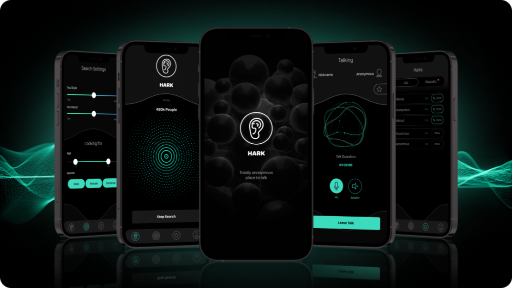
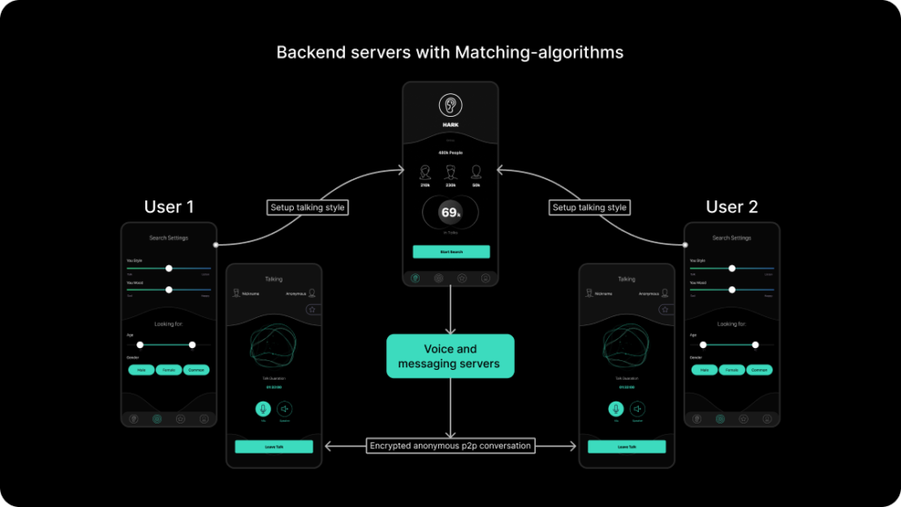

[← All Projects](../README.md)

# 💬 Hark – Global Anonymous Chat Platform
*(January 2022 – March 2022)*

**Project Overview:**
Hark is a mobile application designed to facilitate anonymous conversations between individuals worldwide. The platform provides a safe space for users to share their thoughts without revealing their identities.

  
  
  
  

**Key Features:**
- **Anonymous Communication** – Voice or text chats without disclosing personal information
- **Emotional Expression** – Various modes for genuine and heartfelt interactions
- **Favorites and Soul Mates** – Reconnect with meaningful connections

**Technologies Used:**
- Node.js
- Docker
- Nginx
- PostgreSQL
- GraphQL

---

[← All Projects](../README.md)
