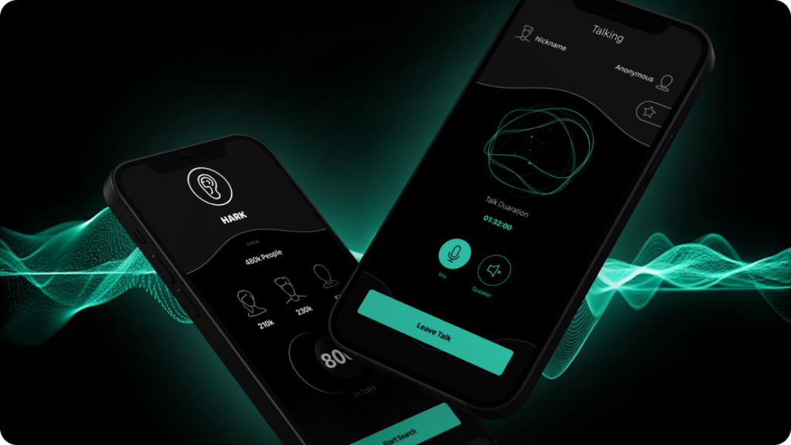

[← All Projects](../README.md)

# Hark — Global Anonymous Chat Platform

*January 2022 – March 2022*

**Project Overview:**
Hark is a mobile application designed to facilitate anonymous conversations between individuals worldwide. The platform provides a safe space for users to share their thoughts, discuss personal or professional challenges, and connect with others without revealing their identities.

  
  
  
  

**Key Features:**
- **Anonymous Communication** – Users can engage in voice or text chats without disclosing personal information, ensuring privacy and fostering open dialogue
- **Emotional Expression** – The app offers various modes for users to express their emotions, allowing for genuine and heartfelt interactions
- **Safe Environment** – Hark provides a secure space for users to vent about work or personal life, ensuring that conversations remain confidential and respectful
- **Favorites and Soul Mates** – Users can reconnect with individuals who have positively impacted them by adding them to their favorites, fostering meaningful connections
- **Community Building** – By rating conversations, users contribute to building an open-minded community that respects and supports each other

**My Role and Contributions:**
As a developer for Hark, my responsibilities included:
- **Mobile Application Development** – Led the development of the iOS and Android applications, ensuring a seamless and intuitive user experience across platforms
- **Anonymous Communication System** – Implemented secure and anonymous voice and text chat functionalities, prioritizing user privacy
- **User Interface Design** – Collaborated with designers to create an intuitive and visually appealing interface, enhancing user engagement and satisfaction
- **Favorites Feature** – Developed the functionality allowing users to add others to their favorites, enabling the re-establishment of meaningful connections
- **Community Rating System** – Implemented a rating system for conversations to help build a respectful and supportive community

**Technologies Used:**
- Node.js
- Docker
- Nginx
- PostgreSQL
- GraphQL

---

[← All Projects](../README.md)
