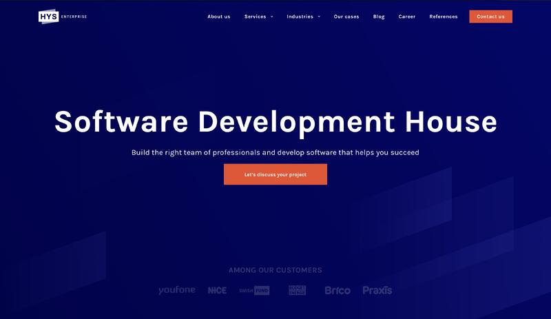

[← All Projects](../README.md)

# 🏢 HYS Enterprise – Corporate Website
*(September 2018 – February 2020)*

**Project Overview:**
The HYS Enterprise corporate website serves as the official digital portal for one of Ukraine's largest IT companies. It provides a comprehensive overview of the company's expertise, services, and values, acting as a primary point of contact for clients, partners, and potential employees.

**Live Website:** [https://www.hys-enterprise.com](https://www.hys-enterprise.com)

  

**Key Features:**
- **Company Presentation** – Showcasing HYS Enterprise's mission, services, and expertise in software development
- **Portfolio** – Highlighting completed projects in software development, business process automation, and IT consulting
- **Careers Section** – Listing job opportunities, work culture, and hiring process details
- **Contact Information** – Providing direct ways to reach company representatives

**My Role and Contributions:**
As a Full-Stack Web Developer, I was the key developer responsible for designing, developing, and maintaining the corporate website:
- Developing and implementing frontend and backend features for the site
- Ensuring responsive design and seamless user experience across devices
- Optimizing performance and security to maintain a high standard of quality
- Collaborating with designers, marketers, and stakeholders to align the website with company branding and business goals
- Performing regular maintenance, updates, and debugging to ensure smooth functionality

**Technologies Used:**
- WordPress
- React.js
- PostgreSQL

---

[← All Projects](../README.md)
