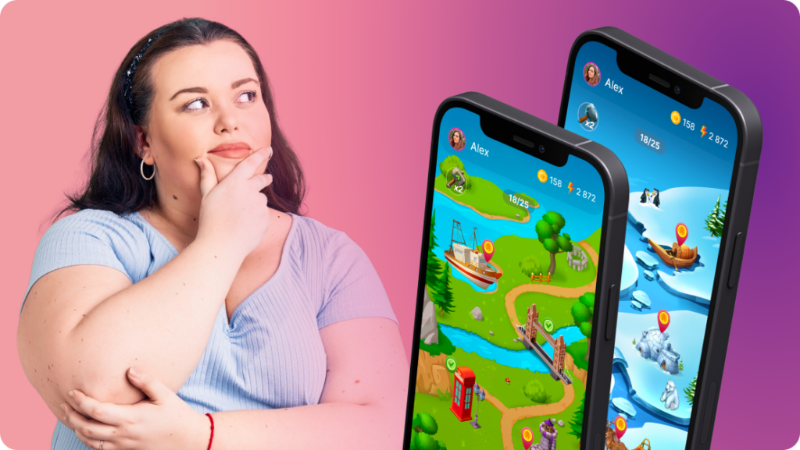
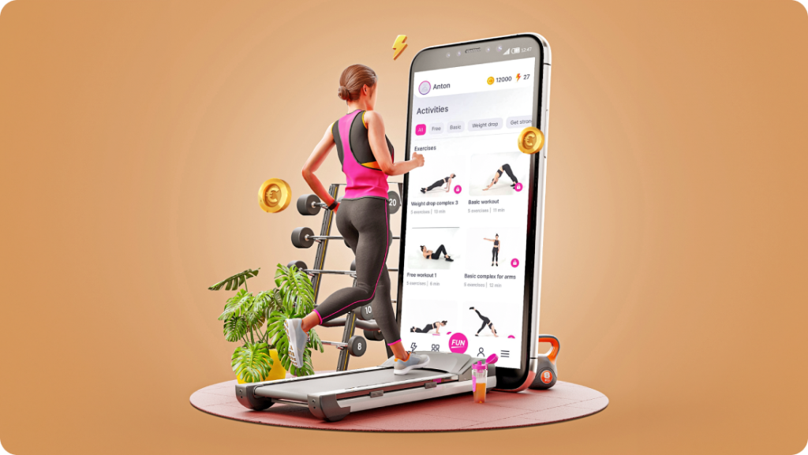

[← All Projects](../README.md)

# IzziFit — Smart Workout and Training Plan Application

*October 2021 – January 2022*

**Developed at:** [MOB.325](../../experience/mob325/)

**Project Overview:**
IzziFit is a mobile application designed to provide users with personalized workout routines and comprehensive fitness tracking tools. The app offers over 500 exercises tailored to individual needs, making it suitable for both beginners and fitness enthusiasts.

  
  
  
  

**Key Features:**
- **Personalized Workouts** – Access a vast library of exercises selected to match your fitness level and goals
- **Calorie Calculator** – Easily log your meals, and the app calculates your daily caloric intake to help you stay on track
- **Gamified Experience** – Turn your fitness journey into an engaging game by converting burned calories into energy, which can be used to earn rewards within the app
- **Additional Tools** – Utilize features like a mood tracker, water intake reminders, meal planning, and smart workout suggestions to support a holistic approach to health

**My Role and Contributions:**
As a developer for IzziFit, my responsibilities included:
- **Mobile Application Development** – Led the development of the iOS and Android applications, ensuring a seamless user experience across platforms
- **Backend Integration** – Implemented robust backend services to handle user data securely and efficiently
- **Gamification Features** – Developed the gamification elements that allow users to earn rewards based on their workout performance, enhancing user engagement
- **Performance Optimization** – Conducted thorough testing and optimization to ensure the app runs smoothly on various devices

**Technologies Used:**
- Node.js
- GraphQL
- Docker
- Nginx
- PostgreSQL
- ClickHouse

---

[← All Projects](../README.md)
