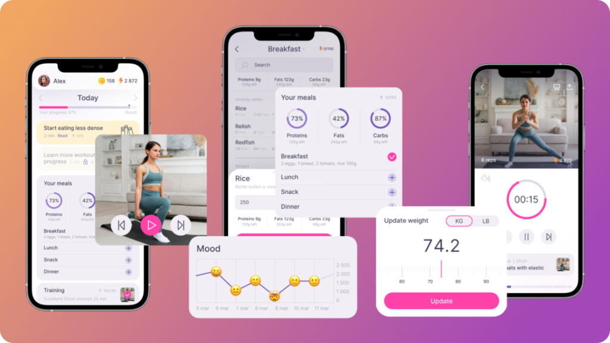

[← All Projects](../README.md)

# 💪 IzziFit – Smart Workout and Training Plan Application
*(October 2021 – January 2022)*

**Project Overview:**
IzziFit is a mobile application designed to provide users with personalized workout routines and comprehensive fitness tracking tools. The app offers over 500 exercises tailored to individual needs.

  
  
  
  

**Key Features:**
- **Personalized Workouts** – Vast library of exercises matched to your fitness level
- **Calorie Calculator** – Log meals and track daily caloric intake
- **Gamified Experience** – Earn rewards based on workout performance

**Technologies Used:**
- Node.js
- GraphQL
- Docker
- Nginx
- PostgreSQL
- ClickHouse

---

[← All Projects](../README.md)
