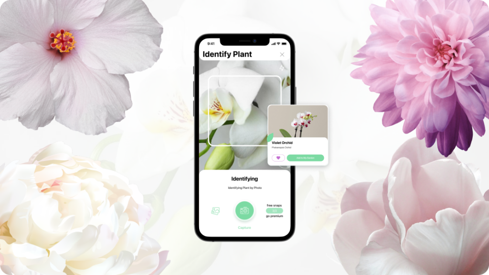

[← All Projects](../README.md)

# Lill — Intelligent Plant Care Assistant

*July 2021 – October 2021*

**Developed at:** [MOB.325](../../experience/mob325/)

**Project Overview:**
Lill is a mobile application designed to assist plant enthusiasts in identifying, diagnosing, and caring for their plants. The app offers a comprehensive suite of features to ensure optimal plant health and growth.

  
  
  
  

**Key Features:**
- **Plant Identification and Diagnosis** – Instantly identify various plant species and diagnose potential issues, providing users with tailored treatment suggestions
- **Smart Care Reminders** – Set up customizable notifications for essential plant care tasks, including watering, fertilizing, spraying, cleaning, and repotting, ensuring timely maintenance
- **Personalized Garden Management** – Create and manage personal plant collections within the app. Track growth, monitor health, and organize plants by different locations or categories using the "My Garden" and "My Places" features

**My Role and Contributions:**
As a developer for Lill, my responsibilities included:
- **Mobile Application Development** – Led the development of the iOS and Android applications, ensuring a seamless and intuitive user experience across platforms
- **Plant Identification Integration** – Implemented advanced algorithms and machine learning models to accurately identify plant species and diagnose potential issues
- **Notification System** – Developed a robust notification system to provide users with timely reminders for various plant care activities
- **User Interface Design** – Collaborated with designers to create an intuitive and visually appealing interface, enhancing user engagement and satisfaction
- **Data Management** – Ensured secure and efficient handling of user data, including personal plant collections and care schedules

**Technologies Used:**
- Node.js
- PostgreSQL
- GraphQL
- Docker
- Nginx

---

[← All Projects](../README.md)

Meta: [meta.yaml](meta.yaml)
