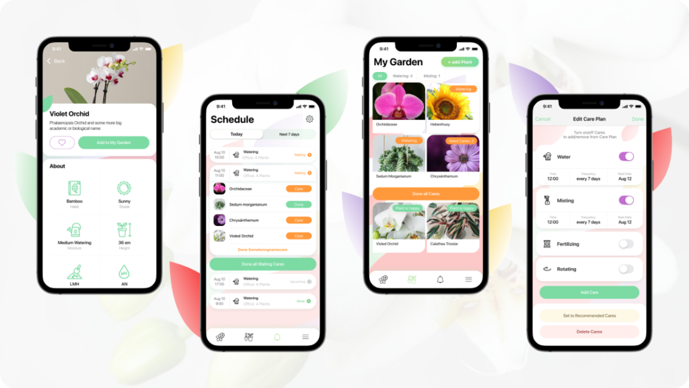
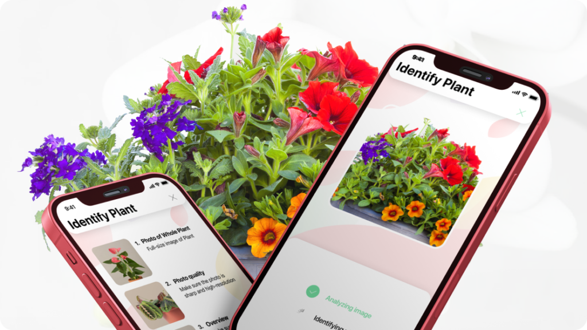

[← All Projects](../README.md)

# 🌱 Lill – Intelligent Plant Care Assistant
*(July 2021 – October 2021)*

**Project Overview:**
Lill is a mobile application designed to assist plant enthusiasts in identifying, diagnosing, and caring for their plants.

  
  
  
  

**Key Features:**
- **Plant Identification and Diagnosis** – AI-powered species identification and issue diagnosis
- **Smart Care Reminders** – Customizable notifications for watering, fertilizing, and repotting
- **Personalized Garden Management** – Track growth and monitor health of your plant collection

**Technologies Used:**
- Node.js
- PostgreSQL
- GraphQL
- Docker
- Nginx

---

[← All Projects](../README.md)
