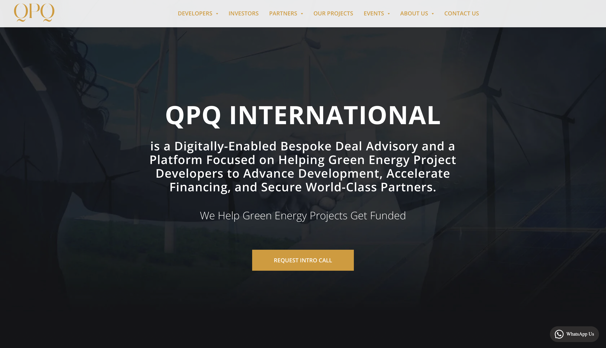

[← All Projects](../README.md)

# QPQ International — Green Energy Project Funding & Advisory Platform

*February 2020 – July 2020*

**Developed at:** [Ephyros](../../experience/ephyros/)

**Project Overview:**
QPQ International is a digitally-enabled bespoke deal advisory platform dedicated to advancing green energy projects globally. The company focuses on assisting project developers in accelerating development, securing financing, and establishing partnerships to promote sustainable initiatives.

**Live Website:** [https://qpq.international](https://qpq.international)

  

**Key Services:**
- **Project Development Support** – QPQ International collaborates with developers to enhance project readiness, ensuring all necessary components are in place to attract investors
- **Investor Matching** – Leveraging a vast network of over 600 professional investors, including private equity funds, institutional investors, and independent power producers (IPPs), QPQ connects suitable investors with vetted projects
- **Funding Accelerator Program** – The Green Energy Project Funding Accelerator is an initiative designed to bridge the gap between green energy projects and investors. It offers coaching and training to project sponsors, culminating in events that showcase vetted projects to potential investors

**Mission:**
QPQ International is committed to making the planet greener by supporting project developers and business owners in the sustainability and renewable energy sectors. The company aims to accelerate the achievement of the United Nations' Sustainable Development Goals (SDGs) through its initiatives.

**Global Reach:**
Based in Dubai, QPQ International operates worldwide, focusing on markets including the US, Canada, Europe, the Balkans, the Baltics, select South American countries, Southeast Asia, Australia, and New Zealand.

**Technologies Used:**
- Laravel
- Vue.js
- PostgreSQL
- Nginx

---

[← All Projects](../README.md)
