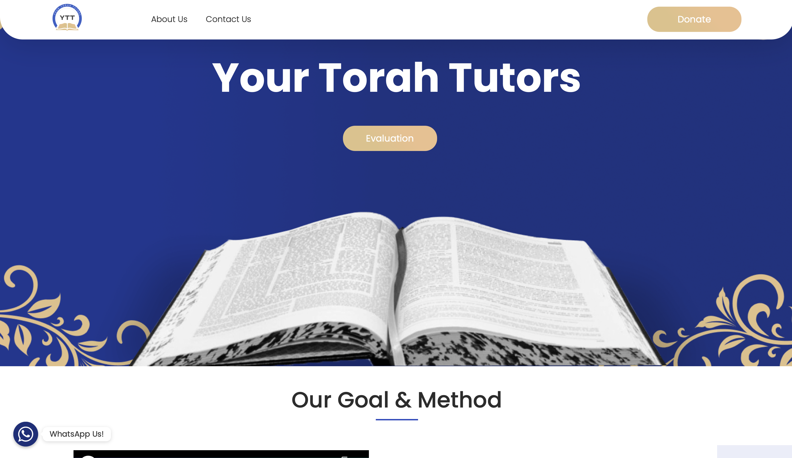

[← All Projects](../README.md)

# Your Torah Tutors — Online Torah Learning Platform

*August 2020 – April 2021*

**Developed at:** [Coelix](../../experience/coelix/)

**Project Overview:**
Your Torah Tutors is an online educational platform dedicated to empowering students to become independent and confident learners in Torah study. The platform offers personalized tutoring sessions focusing on enhancing vocabulary, grammar, and comprehension skills in both Chumash and Gemara. Utilizing unique flashcards and engaging teaching methods, the program makes learning enjoyable and effective. Lessons are conducted via Zoom, making them accessible to students aged 8 and up, regardless of their location.

**Live Website:** [https://yourtorahtutors.org](https://yourtorahtutors.org)

  

**Key Features:**
- **Personalized Learning** – Tailored sessions that cater to the individual needs of each student, ensuring effective learning outcomes
- **Innovative Teaching Tools** – Use of unique flashcards and interactive methods to expand vocabulary and enhance understanding
- **Qualified Tutors** – A team of carefully selected tutors who excel in teaching techniques and are sensitive to each child's needs
- **Flexible Access** – Online lessons via Zoom, allowing students from various locations to participate

**My Role and Contributions:**
As a developer for Your Torah Tutors, my responsibilities included:
- **Website Development** – Designed and developed the official website, ensuring a user-friendly interface and seamless navigation
- **Platform Integration** – Implemented Zoom integration for online lessons, providing a stable and accessible virtual learning environment
- **Flashcard System** – Developed the unique flashcard feature to aid in vocabulary expansion and retention
- **User Accounts** – Created secure login portals for teachers and students, facilitating personalized learning experiences
- **Feedback Mechanism** – Integrated a system for collecting and displaying testimonials to showcase the program's effectiveness

**Technologies Used:**
- Laravel
- Vue.js
- PostgreSQL
- Docker
- PHP
- Nginx

---

Meta: [meta.yaml](meta.yaml)

[← All Projects](../README.md)
