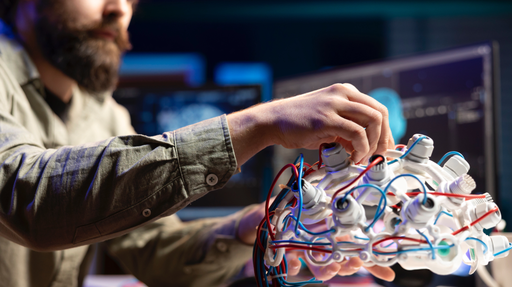

# Brain-Computer Interface (BCI) im HR: Wie Technologie das Recruiting veraendert

Sie haben eine neue Mitarbeiterin oder einen neuen Mitarbeiter eingestellt. Der Lebenslauf ist beeindruckend, die fachlichen Faehigkeiten passen perfekt. Doch einige Monate spaeter merken Sie, dass die Person nicht ins Team passt. Konflikte, Missverstaendnisse, Anpassungsstress — all das fuehrt zu zusaetzlichen Kosten. Recruiting ist immer ein Risiko, besonders wenn es darauf ankommt, wie Mitarbeitende in Arbeitssituationen denken und reagieren.

Heute veraendern innovative Technologien den Ansatz bei der Einstellung — es werden neuronale Netze und Brain-Computer Interfaces entwickelt, die die Kompatibilitaet von Kandidatinnen und Kandidaten mit dem Team analysieren. Ein solches Werkzeug wird von der internationalen Forschungsgruppe "Advanced Scientific Research Projects" (ASRP) entwickelt.

## Das Problem traditioneller Recruiting-Methoden

Traditionelle Ansaetze — Lebenslaufanalyse, Vorstellungsgespraeche und Referenzen — zeigen oft den wichtigsten Faktor nicht: wie gut eine Person in das Team passen wird. Diese Methoden sind anfaellig fuer Verzerrungen und koennen Teamdynamiken nicht im Voraus vorhersagen.

> "Imagine you spend 3 hours interviewing someone, then they join the team and try to adapt. The first meeting went well — everyone smiled, talked about neutral topics. So you hire them, and then everything goes wrong."
>
> — *Alexandra Karl Bernadotte, CEO*

Onboarding-Kosten koennen bis zu 2 Millionen Rubel pro Mitarbeiter erreichen, gefolgt von Schwierigkeiten bei der Integration ins Team. Innovative Ansaetze gehen tiefer und analysieren, wie sich eine Person auf der Ebene des Bewusstseins mit dem Team synchronisiert.

## Innovative Ansaetze im Recruiting

Anstelle subjektiver Bewertungen und langer Vorstellungsgespraeche beginnen Unternehmen, neuronale Netze, Datenanalyse und Brain-Computer Interfaces einzusetzen, um die Kompatibilitaet zwischen Kandidat und Team objektiv zu bewerten. Diese Ansaetze minimieren Fehler, sparen Zeit und schaffen harmonischere Teams.

Das Projekt "bIIryozka" (von REBIS LLC) nutzt Brain-Computer Interfaces, um neuronale Signale von Kandidatinnen und Kandidaten zu analysieren und ihre kognitive Kompatibilitaet mit dem Team zu bewerten. Statt klassischer Vorstellungsgespraeche absolvieren die Teilnehmenden spielbasierte Tests, waehrend ihre Reaktionen auf Aufgaben, Witze und Stresssituationen aufgezeichnet werden.

> "Imagine this: a candidate comes for basic testing to confirm their professional skills. But being an excellent specialist doesn't guarantee they will integrate into the team. After checking hard skills, the candidate plays bIIryozka. We see how well they fit the team and whether they synchronize with it."
>
> — *Denis Banchenko, CEO*

Einfach gesagt findet das Vorstellungsgespraech in einem Spielraum statt. Der Kandidat und die Teammitglieder tragen Brain-Computer Interfaces und nehmen an einem gemeinsamen Spiel teil.

## Aufbau einer Datenbank kognitiver Muster

Der Einsatz von Brain-Computer Interfaces im Recruiting erzeugt grosse Datenmengen ueber kognitive Aktivitaet und Reaktionen von Kandidatinnen und Kandidaten. Diese Daten helfen nicht nur bei unmittelbaren Entscheidungen, sondern ermoeglichen auch langfristige Analyse und Verhaltensprognosen.

Eine Datenbank, die Kandidatenprofile und kognitive Muster von Teams speichert, erlaubt Unternehmen, die Auswahl zu automatisieren: Einmal erhobene Daten koennen genutzt werden, um die Kompatibilitaet mit anderen Teams zu analysieren, ohne Tests zu wiederholen.

> "In the future, with a large database, when a company like Google has several teams and many candidates, we can automatically match rhythms with the database using AI — without inviting the candidate to play again. We could determine that while this candidate wasn't right for Google, they would be a perfect fit for Apple or Starlink."
>
> — *Denis Banchenko, CEO*

Das Konzept des Global Mental System (GMS), beschrieben in einem ResearchGate-Paper mit dem Titel "Technological transformations, formation of GMS (Global Mental System) and GFS (Global Forecasting System)," ermoeglicht die Speicherung von Kandidatenprofilen und ihre Integration in groessere Analyse- und Recruiting-Prozesse.

## Fazit

Die Integration neuronaler Netze und Brain-Computer Interfaces in Recruiting-Prozesse ist mehr als nur eine technologische Neuheit. Sie ist ein Schritt hin zur Bildung harmonischer und produktiver Teams, in denen jede Mitarbeiterin und jeder Mitarbeiter den richtigen Platz findet und Arbeit synchron und effizient wird.

Innovative Technologien veraendern bereits das HR-Verstaendnis, minimieren Subjektivitaet, senken Kosten und beseitigen Anpassungsprobleme. Die Erstellung von Datenbanken kognitiver Muster wie dem Global Mental System oeffnet die Tuer zu automatisierter Einstellung und zur Vorhersage von Teamerfolg.

Die Zukunft des HR liegt in der Verbindung von Bewusstseinswissenschaft und fortschrittlicher Technologie. Unternehmen, die diese Ansaetze als Erste integrieren, werden nicht nur einen Wettbewerbsvorteil gewinnen, sondern auch die Grundlage fuer neue Standards der Teaminteraktion schaffen.

---

*Urspruenglich veroeffentlicht auf [Tproger](https://tproger.ru/articles/nejroseti-v-hr--budushhee-podbora-personala-cherez-sinhronizaciyu-sostoyanij)*
