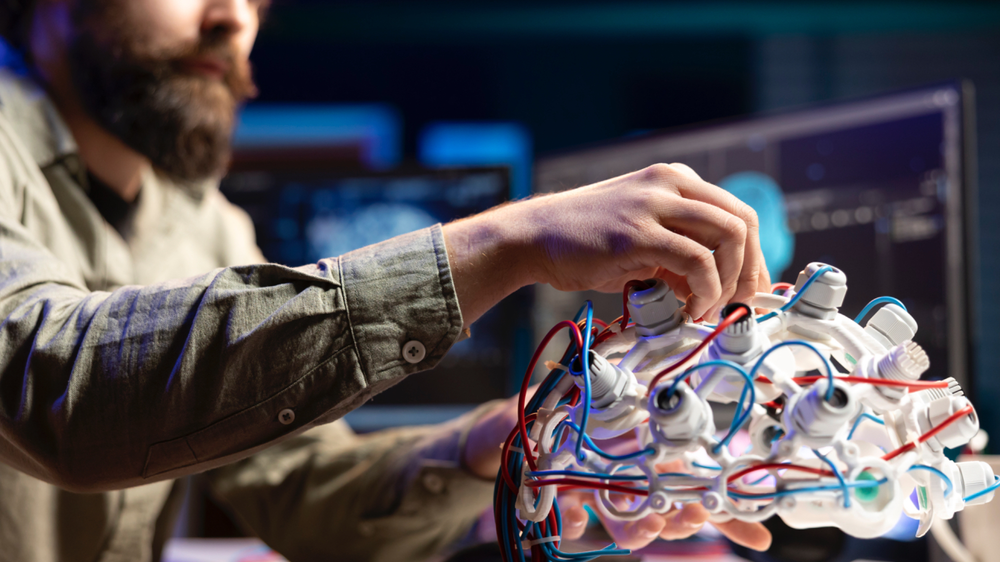

# Brain–Computer Interface (BCI) in HR: How Technology is Changing Recruitment

You hired a new employee. Their resume is impressive, their professional skills are a perfect match. But a few months later, you realize they don't fit in with the team. Conflicts, misunderstandings, adaptation stress — all leading to additional costs. Recruitment is always a risk, especially when it matters how employees think and react in work situations.

Today, innovative technologies are changing the approach to hiring — neural networks and brain-computer interfaces are being developed that analyze candidate compatibility with the team. One such tool is being developed by the International Research Group "Advanced Scientific Research Projects" (ASRP).

## The Problem with Traditional Recruitment Methods

Traditional approaches — resume analysis, interviews, and references — often fail to reveal the most important factor: how a person will fit into the team. These methods are subject to bias and cannot predict team dynamics in advance.

> "Imagine you spend 3 hours interviewing someone, then they join the team and try to adapt. The first meeting went well — everyone smiled, talked about neutral topics. So you hire them, and then everything goes wrong."
>
> — *Alexandra Karl Bernadotte, CEO*

Onboarding costs can reach up to 2 million rubles per employee, followed by difficulties in team integration. Innovative approaches go deeper, analyzing how a person synchronizes with the team at the level of consciousness.

## Innovative Approaches to Recruitment

Instead of subjective assessments and long interviews, companies are beginning to use neural networks, data analysis, and brain-computer interfaces to objectively evaluate candidate-team compatibility. These approaches minimize errors, save time, and create more harmonious teams.

The "bIIryozka" project (by REBIS LLC) uses brain-computer interfaces to analyze candidates' neural signals and assess their cognitive compatibility with the team. Instead of standard interviews, participants complete game tests while their reactions to tasks, jokes, and stressful situations are recorded.

> "Imagine this: a candidate comes for basic testing to confirm their professional skills. But being an excellent specialist doesn't guarantee they will integrate into the team. After checking hard skills, the candidate plays bIIryozka. We see how well they fit the team and whether they synchronize with it."
>
> — *Denis Banchenko, CEO*

Simply put, the interview takes place in a game room. The candidate and team members wear brain-computer interfaces and participate in a collaborative game.

## Building a Cognitive Pattern Database

The use of brain-computer interfaces in hiring generates vast amounts of data about cognitive activity and candidate reactions. This data not only helps make immediate decisions but also enables long-term analysis and behavior prediction.

A database storing candidate profiles and team cognitive patterns allows companies to automate selection: data collected once can be used to analyze compatibility with other teams without repeated testing.

> "In the future, with a large database, when a company like Google has several teams and many candidates, we can automatically match rhythms with the database using AI — without inviting the candidate to play again. We could determine that while this candidate wasn't right for Google, they would be a perfect fit for Apple or Starlink."
>
> — *Denis Banchenko, CEO*

The concept of the Global Mental System (GMS), described in a ResearchGate paper titled "Technological transformations, formation of GMS (Global Mental System) and GFS (Global Forecasting System)," enables storing candidate profiles and integrating them into larger analysis and recruitment processes.

## Conclusion

The integration of neural networks and brain-computer interfaces into recruitment processes is more than just a technological novelty. It is a step toward creating harmonious and productive teams where every employee finds their place, and work becomes synchronous and efficient.

Innovative technologies are already changing the concept of HR, minimizing subjectivity, reducing costs, and eliminating adaptation problems. The creation of cognitive pattern databases like the Global Mental System opens doors to automated hiring and team success prediction.

The future of HR is the combination of consciousness science and advanced technology. Companies that first integrate these approaches will gain not only a competitive advantage but also lay the foundation for new standards of team interaction.

---

*Originally published on [Tproger](https://tproger.ru/articles/nejroseti-v-hr--budushhee-podbora-personala-cherez-sinhronizaciyu-sostoyanij)*
