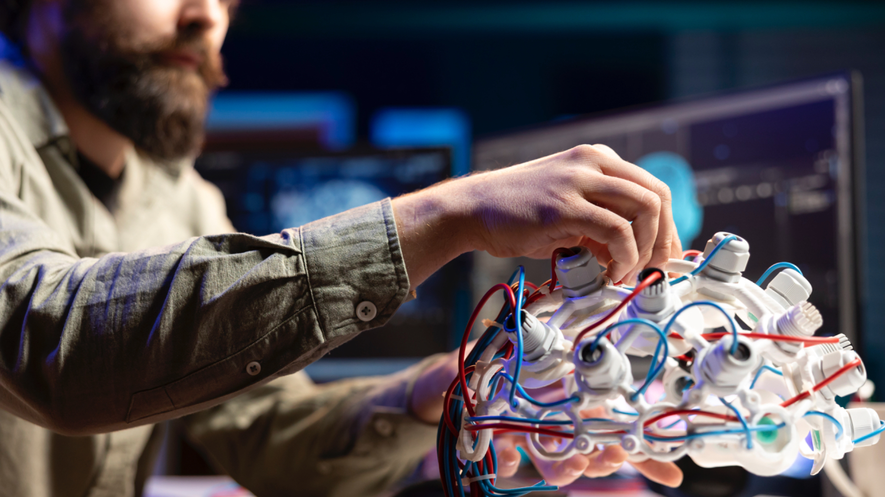

# Interfaz cerebro-computadora (BCI) en RR. HH.: como la tecnologia esta cambiando la seleccion de personal

Contrataste a una nueva persona. Su curriculum es impresionante y sus habilidades profesionales encajan perfectamente. Pero unos meses despues, te das cuenta de que no encaja en el equipo. Conflictos, malentendidos, estres de adaptacion — todo eso genera costes adicionales. La seleccion de personal siempre implica un riesgo, especialmente cuando importa como piensan y reaccionan los empleados en situaciones de trabajo.

Hoy, las tecnologias innovadoras estan cambiando el enfoque de la contratacion: se estan desarrollando redes neuronales e interfaces cerebro-computadora que analizan la compatibilidad de los candidatos con el equipo. Una de estas herramientas esta siendo desarrollada por el grupo internacional de investigacion "Advanced Scientific Research Projects" (ASRP).

## El problema de los metodos tradicionales de seleccion

Los enfoques tradicionales — analisis del curriculum, entrevistas y referencias — a menudo no revelan el factor mas importante: como encajara una persona en el equipo. Estos metodos estan sujetos a sesgos y no pueden predecir de antemano la dinamica del equipo.

> "Imagine you spend 3 hours interviewing someone, then they join the team and try to adapt. The first meeting went well — everyone smiled, talked about neutral topics. So you hire them, and then everything goes wrong."
>
> — *Alexandra Karl Bernadotte, CEO*

Los costes de incorporacion pueden alcanzar hasta 2 millones de rublos por empleado, seguidos de dificultades en la integracion con el equipo. Los enfoques innovadores van mas profundo y analizan como una persona se sincroniza con el equipo a nivel de conciencia.

## Enfoques innovadores para la seleccion

En lugar de evaluaciones subjetivas y entrevistas largas, las empresas empiezan a usar redes neuronales, analisis de datos e interfaces cerebro-computadora para evaluar objetivamente la compatibilidad entre candidato y equipo. Estos enfoques minimizan errores, ahorran tiempo y crean equipos mas armoniosos.

El proyecto "bIIryozka" (de REBIS LLC) usa interfaces cerebro-computadora para analizar las senales neuronales de los candidatos y evaluar su compatibilidad cognitiva con el equipo. En lugar de entrevistas estandar, los participantes realizan pruebas en forma de juego mientras se registran sus reacciones a tareas, bromas y situaciones estresantes.

> "Imagine this: a candidate comes for basic testing to confirm their professional skills. But being an excellent specialist doesn't guarantee they will integrate into the team. After checking hard skills, the candidate plays bIIryozka. We see how well they fit the team and whether they synchronize with it."
>
> — *Denis Banchenko, CEO*

En pocas palabras, la entrevista tiene lugar en una sala de juego. El candidato y los miembros del equipo usan interfaces cerebro-computadora y participan en un juego colaborativo.

## Creacion de una base de datos de patrones cognitivos

El uso de interfaces cerebro-computadora en la contratacion genera enormes cantidades de datos sobre la actividad cognitiva y las reacciones de los candidatos. Estos datos no solo ayudan a tomar decisiones inmediatas, sino que tambien permiten el analisis a largo plazo y la prediccion del comportamiento.

Una base de datos que almacena perfiles de candidatos y patrones cognitivos de equipos permite a las empresas automatizar la seleccion: los datos recogidos una sola vez pueden usarse para analizar la compatibilidad con otros equipos sin repetir las pruebas.

> "In the future, with a large database, when a company like Google has several teams and many candidates, we can automatically match rhythms with the database using AI — without inviting the candidate to play again. We could determine that while this candidate wasn't right for Google, they would be a perfect fit for Apple or Starlink."
>
> — *Denis Banchenko, CEO*

El concepto de Global Mental System (GMS), descrito en un articulo de ResearchGate titulado "Technological transformations, formation of GMS (Global Mental System) and GFS (Global Forecasting System)," permite almacenar perfiles de candidatos e integrarlos en procesos mas amplios de analisis y seleccion.

## Conclusion

La integracion de redes neuronales e interfaces cerebro-computadora en los procesos de seleccion es mas que una novedad tecnologica. Es un paso hacia la creacion de equipos armoniosos y productivos en los que cada empleado encuentra su lugar y el trabajo se vuelve sincronico y eficiente.

Las tecnologias innovadoras ya estan cambiando el concepto de RR. HH., minimizando la subjetividad, reduciendo costes y eliminando problemas de adaptacion. La creacion de bases de datos de patrones cognitivos como el Global Mental System abre la puerta a la contratacion automatizada y a la prediccion del exito de los equipos.

El futuro de RR. HH. es la combinacion de la ciencia de la conciencia y la tecnologia avanzada. Las empresas que primero integren estos enfoques obtendran no solo una ventaja competitiva, sino que tambien sentaran las bases de nuevos estandares de interaccion en equipo.

---

*Publicado originalmente en [Tproger](https://tproger.ru/articles/nejroseti-v-hr--budushhee-podbora-personala-cherez-sinhronizaciyu-sostoyanij)*
