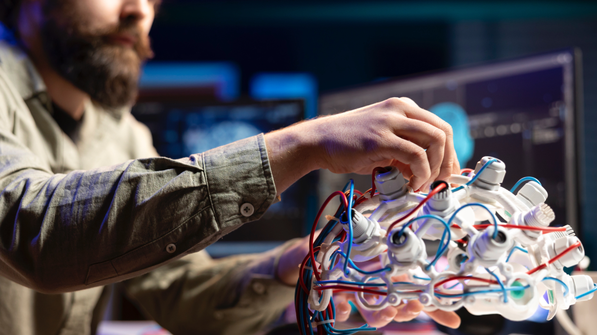

# Brain-Computer Interface (BCI) в HR: как технологии меняют подбор персонала

Вы наняли нового сотрудника. Резюме выглядит впечатляюще, профессиональные навыки полностью подходят. Но через несколько месяцев становится понятно: человек не вписывается в команду. Возникают конфликты, недопонимание, стресс адаптации — и всё это приводит к дополнительным затратам. Подбор персонала всегда остаётся риском, особенно когда важно не только то, что человек умеет, но и то, как он думает и реагирует в рабочих ситуациях.

Сегодня инновационные технологии меняют подход к найму: развиваются нейросети и brain-computer interfaces, которые анализируют совместимость кандидата с командой. Один из таких инструментов разрабатывает международная исследовательская группа "Advanced Scientific Research Projects" (ASRP).

## Проблема традиционных методов найма

Традиционные подходы — анализ резюме, собеседования и рекомендации — часто не показывают самый важный фактор: как человек впишется в команду. Эти методы подвержены субъективности и не позволяют заранее предсказать командную динамику.

> "Представьте, что вы три часа проводите собеседование с человеком, потом он выходит в команду и пытается адаптироваться. Первая встреча прошла хорошо — все улыбались, говорили на нейтральные темы. Вы его нанимаете, а потом всё идёт не так."
>
> — *Alexandra Karl Bernadotte, CEO*

Затраты на онбординг могут доходить до 2 миллионов рублей на одного сотрудника, а затем появляются сложности с интеграцией в команду. Инновационные подходы идут глубже: они анализируют, как человек синхронизируется с командой на уровне сознания.

## Инновационные подходы к рекрутингу

Вместо субъективных оценок и долгих интервью компании начинают использовать нейросети, анализ данных и brain-computer interfaces, чтобы объективно оценивать совместимость кандидата с командой. Такие подходы помогают снизить количество ошибок, сэкономить время и создавать более гармоничные команды.

Проект "bIIryozka" компании REBIS LLC использует brain-computer interfaces для анализа нейросигналов кандидатов и оценки их когнитивной совместимости с командой. Вместо стандартных интервью участники проходят игровые тесты, а система фиксирует их реакции на задачи, шутки и стрессовые ситуации.

> "Представьте: кандидат приходит на базовое тестирование, чтобы подтвердить профессиональные навыки. Но отличный специалист — это ещё не гарантия, что он встроится в команду. После проверки hard skills кандидат играет в bIIryozka. Мы видим, насколько он подходит команде и синхронизируется ли с ней."
>
> — *Denis Banchenko, CEO*

Проще говоря, собеседование проходит в игровой комнате. Кандидат и участники команды надевают brain-computer interfaces и участвуют в совместной игре.

## Создание базы когнитивных паттернов

Использование brain-computer interfaces в найме создаёт большие объёмы данных о когнитивной активности и реакциях кандидатов. Эти данные помогают не только принимать решения здесь и сейчас, но и проводить долгосрочный анализ, а также прогнозировать поведение.

База данных, в которой хранятся профили кандидатов и когнитивные паттерны команд, позволяет компаниям автоматизировать подбор: данные, собранные один раз, можно использовать для анализа совместимости с другими командами без повторного тестирования.

> "В будущем, когда будет большая база, если у компании вроде Google есть несколько команд и много кандидатов, мы сможем автоматически сопоставлять ритмы с базой с помощью ИИ — без повторного приглашения кандидата в игру. Мы сможем определить, что для Google этот кандидат не подошёл, зато идеально подходит для Apple или Starlink."
>
> — *Denis Banchenko, CEO*

Концепция Global Mental System (GMS), описанная в публикации на ResearchGate "Technological transformations, formation of GMS (Global Mental System) and GFS (Global Forecasting System)", позволяет хранить профили кандидатов и интегрировать их в более крупные процессы анализа и рекрутинга.

## Заключение

Интеграция нейросетей и brain-computer interfaces в процессы найма — это не просто технологическая новинка. Это шаг к созданию гармоничных и продуктивных команд, где каждый сотрудник находит своё место, а работа становится синхронной и эффективной.

Инновационные технологии уже меняют представление об HR: они снижают субъективность, уменьшают затраты и помогают избегать проблем адаптации. Создание баз когнитивных паттернов, таких как Global Mental System, открывает путь к автоматизированному найму и прогнозированию успеха команд.

Будущее HR — это соединение науки о сознании и передовых технологий. Компании, которые первыми интегрируют эти подходы, получат не только конкурентное преимущество, но и заложат основу для новых стандартов командного взаимодействия.

---

*Оригинал опубликован на [Tproger](https://tproger.ru/articles/nejroseti-v-hr--budushhee-podbora-personala-cherez-sinhronizaciyu-sostoyanij)*
