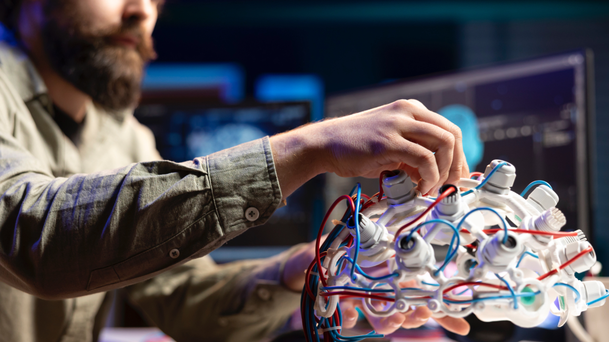

# Brain-Computer Interface (BCI) в HR: як технології змінюють підбір персоналу

Ви найняли нового співробітника. Резюме виглядає вражаюче, професійні навички повністю відповідають вимогам. Але за кілька місяців стає зрозуміло: людина не вписується в команду. Виникають конфлікти, непорозуміння, стрес адаптації — і все це призводить до додаткових витрат. Підбір персоналу завжди залишається ризиком, особливо коли важливо не лише те, що людина вміє, а й те, як вона думає та реагує в робочих ситуаціях.

Сьогодні інноваційні технології змінюють підхід до найму: розвиваються нейромережі та brain-computer interfaces, які аналізують сумісність кандидата з командою. Один із таких інструментів розробляє міжнародна дослідницька група "Advanced Scientific Research Projects" (ASRP).

## Проблема традиційних методів найму

Традиційні підходи — аналіз резюме, співбесіди та рекомендації — часто не показують найважливішого чинника: як людина впишеться в команду. Ці методи залежать від суб'єктивності й не дають змоги заздалегідь передбачити командну динаміку.

> "Уявіть, що ви три години проводите співбесіду з людиною, потім вона виходить у команду й намагається адаптуватися. Перша зустріч пройшла добре — усі усміхалися, говорили на нейтральні теми. Ви її наймаєте, а потім усе йде не так."
>
> — *Alexandra Karl Bernadotte, CEO*

Витрати на онбординг можуть сягати 2 мільйонів рублів на одного співробітника, а після цього з'являються складнощі з інтеграцією в команду. Інноваційні підходи йдуть глибше: вони аналізують, як людина синхронізується з командою на рівні свідомості.

## Інноваційні підходи до рекрутингу

Замість суб'єктивних оцінок і довгих інтерв'ю компанії починають використовувати нейромережі, аналіз даних і brain-computer interfaces, щоб об'єктивно оцінювати сумісність кандидата з командою. Такі підходи допомагають зменшити кількість помилок, заощадити час і створювати більш гармонійні команди.

Проєкт "bIIryozka" компанії REBIS LLC використовує brain-computer interfaces для аналізу нейросигналів кандидатів і оцінки їхньої когнітивної сумісності з командою. Замість стандартних співбесід учасники проходять ігрові тести, а система фіксує їхні реакції на завдання, жарти та стресові ситуації.

> "Уявіть: кандидат приходить на базове тестування, щоб підтвердити професійні навички. Але чудовий спеціаліст — це ще не гарантія, що він вбудується в команду. Після перевірки hard skills кандидат грає в bIIryozka. Ми бачимо, наскільки він підходить команді й чи синхронізується з нею."
>
> — *Denis Banchenko, CEO*

Простіше кажучи, співбесіда проходить в ігровій кімнаті. Кандидат і учасники команди надягають brain-computer interfaces та беруть участь у спільній грі.

## Створення бази когнітивних патернів

Використання brain-computer interfaces у наймі створює великі обсяги даних про когнітивну активність і реакції кандидатів. Ці дані допомагають не лише ухвалювати рішення тут і зараз, а й проводити довгостроковий аналіз та прогнозувати поведінку.

База даних, у якій зберігаються профілі кандидатів і когнітивні патерни команд, дає компаніям змогу автоматизувати підбір: дані, зібрані один раз, можна використовувати для аналізу сумісності з іншими командами без повторного тестування.

> "У майбутньому, коли буде велика база, якщо в компанії на кшталт Google є кілька команд і багато кандидатів, ми зможемо автоматично зіставляти ритми з базою за допомогою ШІ — без повторного запрошення кандидата в гру. Ми зможемо визначити, що для Google цей кандидат не підійшов, зате ідеально підходить для Apple або Starlink."
>
> — *Denis Banchenko, CEO*

Концепція Global Mental System (GMS), описана в публікації на ResearchGate "Technological transformations, formation of GMS (Global Mental System) and GFS (Global Forecasting System)", дає змогу зберігати профілі кандидатів та інтегрувати їх у більші процеси аналізу й рекрутингу.

## Висновок

Інтеграція нейромереж і brain-computer interfaces у процеси найму — це не просто технологічна новинка. Це крок до створення гармонійних і продуктивних команд, де кожен співробітник знаходить своє місце, а робота стає синхронною та ефективною.

Інноваційні технології вже змінюють уявлення про HR: вони зменшують суб'єктивність, скорочують витрати й допомагають уникати проблем адаптації. Створення баз когнітивних патернів, таких як Global Mental System, відкриває шлях до автоматизованого найму та прогнозування успіху команд.

Майбутнє HR — це поєднання науки про свідомість і передових технологій. Компанії, які першими інтегрують ці підходи, отримають не лише конкурентну перевагу, а й закладуть основу для нових стандартів командної взаємодії.

---

*Оригінал опубліковано на [Tproger](https://tproger.ru/articles/nejroseti-v-hr--budushhee-podbora-personala-cherez-sinhronizaciyu-sostoyanij)*
