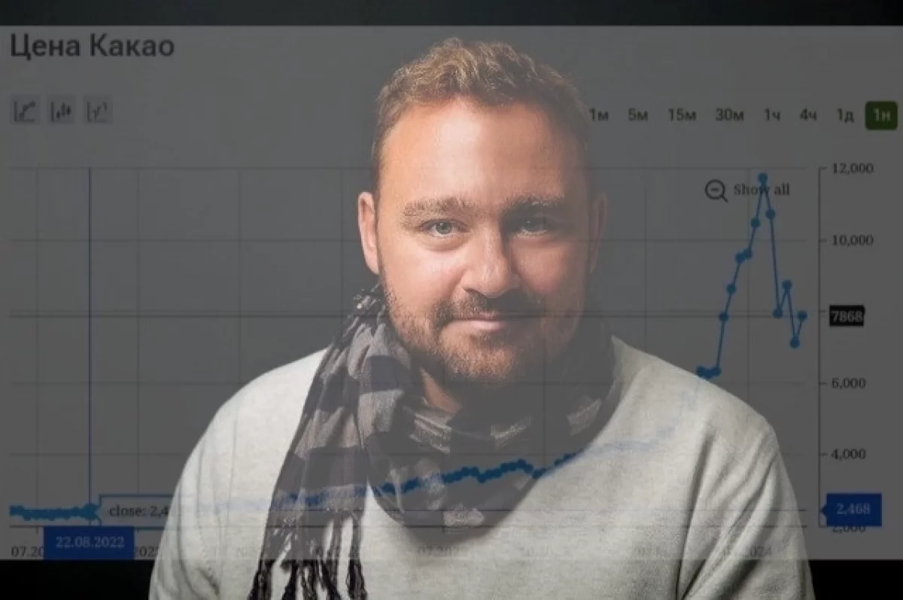
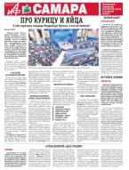

# The Economics of Dreams: How Our Dreams Influence Global Markets

Kazakh-Russian scientist-enthusiast Denis Banchenko has been studying the phenomenon of lucid dreams and dreaming for over 25 years. Through his research together with a team from the international independent research group "Advanced Scientific Research Projects" (ASRP), he and his colleagues discovered and described a new direction in the global economy — the "market of dreams and other transcendental states of consciousness."

## Why Has the Scientific Study of Lucid Dreams Been Under an Unspoken Ban?

The main reason, it seems, is the lack of a clear applied value. Only today has sleep become an integral part of any treatment protocol. For example, leading oncology clinics always include both a dietitian and a somnologist on the patient's care team. It is impossible to effectively treat a person with sleep and nutrition disorders.

As for lucid dreams (LD) — this is a state in which a person realizes they are dreaming and can to some extent control the dream plot and remember who they are while asleep. The unusual nature of LD lies in the fact that the brain during paradoxical sleep works incredibly intensively, which is recorded by EEG devices.

Interestingly, until 1979, research by enthusiast scientists related to LD was ignored by most scientific journals. Today the situation has changed. The number of publications on this topic is growing. French researchers long held leadership in this field, later passed to the USA. Germany, Switzerland, China, Japan, and South Korea are catching up, and Iran has joined the research.

## The Prerequisites for a New Economic Direction

Lucid dreams are gaining popularity — a new LD market has effectively formed. It includes various goods and services for enthusiasts of these practices: sleep products, educational programs, courses, training videos, books, and all related products — pillows, blankets, and more, without which quality LDs are unattainable.

The concept of the "Lucid Dream Market" — also known as the "Banchenko Market" (named after the author of this scientific economic paradigm who first described it) — appeared last year with the publication of a scientific economic article in the Moscow Economic Journal in August 2023.

The discovery happened by chance. Funds were needed for scientific research, and the concept of financing through NFTs was born. Together with the team, a coherent concept was formed, publishing both a model for funding fundamental scientific research by independent private investors and the market for lucid dreams and other transcendental states of consciousness.

## What Industries Does This Market Cover?

First, everything related to comfortable sleep: pillows, blankets, beds, sleep devices, pharmaceuticals, tea, and products affecting sleep quality. The market is growing exponentially, forming a new economic direction that influences global stock markets.

Among those closely following this research are major investors and fund managers. Publications mention the influence of cocoa beans on sleep quality and LD induction. After the economic article was published, shares of one of the largest chocolate producers and cocoa importers in Russia rose almost 90%.

## Diet for Lucid Dreams

What should you eat more often to have lucid dreams? Egg yolks (foods high in choline — the choline diet), bananas, milk, yogurt, oatmeal, walnuts, or almonds. All these products fall within the scope of this market.

The team has also developed a nutrition system based on human genetic code and microbiome genetic code — the so-called Body Food System. The diet is selected individually based on DNA testing of the microbiome and the person for the most effective LD induction and sleep quality.

## Future Professions

The biggest challenge for humanity is the prospect of AI integration. We will literally have to compete with machines, and salvation lies in expanding our intellectual and creative abilities.

Soon we may see specialists in subconscious protection and security, neuroengineers for personality reformatting and expansion of consciousness functions. Dream synchronization has already been partially achieved — a study using the "Banchenko Dream Synchronization Mnemonics Method" successfully united dream elements across a group of seven people using AI.

The dream market will experience an incredible boom. New methods of treating diseases without medication through sleep correction and LD work are emerging. New gadgets that blur the line between consciousness and the materialization of ideas are expected. Devices that can read human speech during sleep already exist — and this is just the beginning!

---

*Originally published on [AiF Samara](https://samara.aif.ru/society/ekonomika-snovideniy-kak-nashi-sny-vliyayut-na-mirovye-rynki)*
