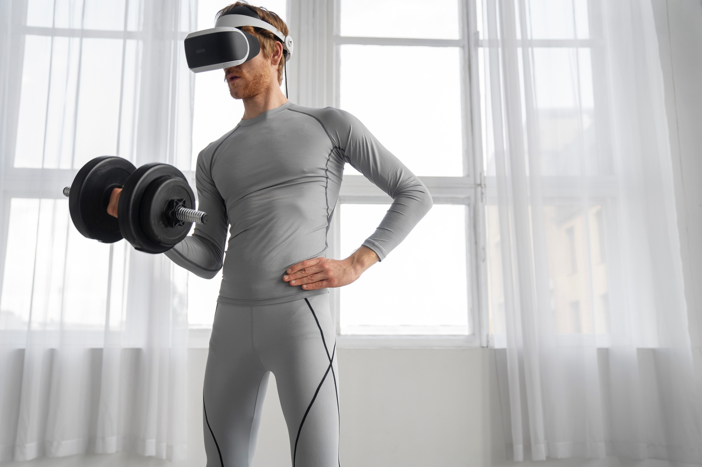

# Luzide Träume und VR: Training des Schweizer Olympiateams in Träumen

Stellen Sie sich vor, Sie könnten trainieren, ohne Ihr Zuhause zu verlassen — ja sogar ohne aufzuwachen. Das klingt nach Science-Fiction, ist für Professor Dr. Daniel Erlacher, der mit dem Schweizer Olympiateam arbeitet, aber bereits Realität. Seine Forschung zeigt, dass luzide Träume einzigartige Trainingsmöglichkeiten eröffnen und es Athleten erlauben, ihre Fähigkeiten im Schlaf zu verbessern. VR wiederum entwickelt sich zu einem leistungsstarken Werkzeug, das die Unberechenbarkeit luzider Träume ausgleichen kann, indem es eine stabile und zugängliche Alternative zur Simulation von Trainingsszenarien bietet. Gemeinsam ebnen diese Ansätze den Weg für eine Revolution im Lernen und im Sport.

## Luzide Träume als Trainingswerkzeug

Luzide Träume (LD) sind ein besonderer Zustand, in dem eine Person erkennt, dass sie träumt, und die Ereignisse des Traums steuern kann. Erlacher begann, dieses Phänomen während seiner Dissertation zu untersuchen und erforschte, wie solche Zustände zu einem Werkzeug der Sportwissenschaft werden könnten. Seine Forschung zeigte, dass LDs neuronale Schaltkreise aktivieren, die jenen ähneln, die beim realen Training beteiligt sind, sodass Fähigkeiten im Schlaf wirksam gefestigt werden können.

> "Diese Forschung begann mit meiner Dissertation. Ich interessierte mich dafür, ob luzides Träumen für motorisches Lernen genutzt werden könnte. Wir führten mehrere Studien durch und konnten zeigen, dass man luzides Träumen bei einfachen Bewegungen — etwa Fingerklopfen — tatsächlich nutzen kann, um die Leistung beim motorischen Lernen zu verbessern. Mindestens 20 % der von uns befragten Bevölkerung erleben häufig luzide Träume, und 20 % davon haben sie für sportliche Leistungen genutzt."
>
> — *Prof. Dr. Daniel Erlacher*

Erlacher weist darauf hin, dass luzide Träume besonders nützlich für Athleten sind, die sich von Verletzungen erholen oder nicht mit traditionellen Methoden trainieren können. Sie wirken wie mentales Probehandeln: Im Schlaf setzen Athleten ihr Training nicht nur fort, sondern verfeinern auch ihre Fähigkeiten, ohne ihren Körper zusätzlich zu belasten.

## Die Herausforderung einer stabilen Induktion luzider Träume

Luzide Träume sind ein bemerkenswertes Trainingswerkzeug, doch diesen Zustand zu erreichen erfordert Mühe und Zeit. Wie Erlacher einräumt, gibt es derzeit keine universelle Methode, die für alle Erfolg garantiert.

> "Das Problem besteht weiterhin darin, luzide Träume zuverlässig zu erreichen. Gleichzeitig ist es viel einfacher, ein VR-System zu kaufen und dasselbe zu tun wie in einem luziden Traum."
>
> — *Prof. Dr. Daniel Erlacher*

Trotz dieser Schwierigkeit hat die Wissenschaft in den letzten Jahren erhebliche Fortschritte gemacht. Zum Beispiel existiert bereits der Banchenko Algorithm — eine stabile Methode zur Induktion luzider Träume. Obwohl er sich noch in der Implementierungsphase befindet, zeigen erste Ergebnisse ein erhebliches Potenzial für eine breite Anwendung und deuten darauf hin, dass das Problem der stabilen Induktion luzider Träume schrittweise gelöst wird.

## VR im Sport: Eine neue Art des Trainings

VR-Technologie ermöglicht es Athleten, realistische Szenarien zu simulieren, die im wirklichen Leben nur schwer oder gar nicht reproduzierbar sind. Sie können unter extremen Bedingungen ohne reales Risiko trainieren oder taktische Manöver mit Teamkollegen üben, die sich überall auf der Welt befinden.

VR ist auch während der Rehabilitation nach Verletzungen nützlich. Die Technologie minimiert körperliche Belastung, während das Gehirn aktiv bleibt und das Muskelgedächtnis erhalten wird. Außerdem wird VR aktiv eingesetzt, um den emotionalen Zustand von Athleten zu steuern und ihnen zu helfen, mit Stress umzugehen oder sich nach schwierigen Wettkämpfen zu erholen.

### Grenzen der VR-Technologie

Allerdings bringt VR auch Herausforderungen mit sich. Hohe Ausrüstungskosten beschränken den Zugang auf Profivereine, während Schwindel und Augenermüdung die Sitzungsdauer begrenzen können. Auch technische Schwierigkeiten wie Reaktionsverzögerungen und der Mangel an realistischen Sportsimulationen müssen gelöst werden. Trotz dieser Hürden entwickelt sich die Technologie schnell weiter. Sinkende Kosten und eine bessere Nutzererfahrung machen VR zu einem immer vielversprechenderen Werkzeug im Sport.

## Luzide Träume und VR: Ein Blick in die Zukunft

Jede Methode — LD und VR — hat ihre Vorteile und Grenzen. Luzide Träume bieten grenzenlose Möglichkeiten: Fähigkeiten können ohne technische Einschränkungen und völlig kostenlos trainiert werden. Sie zu erreichen erfordert jedoch Zeit und Disziplin. VR dagegen bietet schnellen Zugang zu Training mit hohem Realismus, bleibt aber teuer, benötigt physische Ausrüstung und hat Einschränkungen wie Ermüdung und Abhängigkeit von der Qualität der Simulation.

Die Synergie von LD und VR eröffnet völlig neue Horizonte. Stellen Sie sich Athleten vor, die in VR trainieren und ihre Fähigkeiten anschließend in luziden Träumen weiter verfeinern. So entsteht ein doppelter Übungseffekt, bei dem VR eine Grundlage schafft und LDs Verständnis und Speicherung von Fähigkeiten vertiefen.

## Fazit: Die Zukunft beginnt jetzt

Die Integration von luziden Träumen und virtueller Realität verändert bereits das Trainingsverständnis von Olympiateams und Athleten. Diese Technologien zeigen, wie Bewusstseinswissenschaft und modernste IT-Lösungen zusammenwirken können und Türen zu einem neuen Verständnis kognitiver Entwicklung öffnen. Luzide Träume bieten tiefgehende, individualisierte Praxis, während VR ihre Unberechenbarkeit mit zugänglichen und universellen Werkzeugen ausgleicht.

Der spannendste Teil liegt noch vor uns: Die Synergie von VR und LD könnte die Entwicklung von Fähigkeiten revolutionieren und Training in jeder Umgebung und zu jeder Zeit ermöglichen. Athleten, Künstler, Programmierer und sogar Chirurgen werden diese Innovationen optimal nutzen können und wissenschaftliche Experimente in massentaugliche, zugängliche Lösungen verwandeln.

---

*Ursprünglich veröffentlicht auf [Tproger](https://tproger.ru/articles/vr-i-osoznannye-sny--trenirovki-olimpijcev-vo-sne)*
