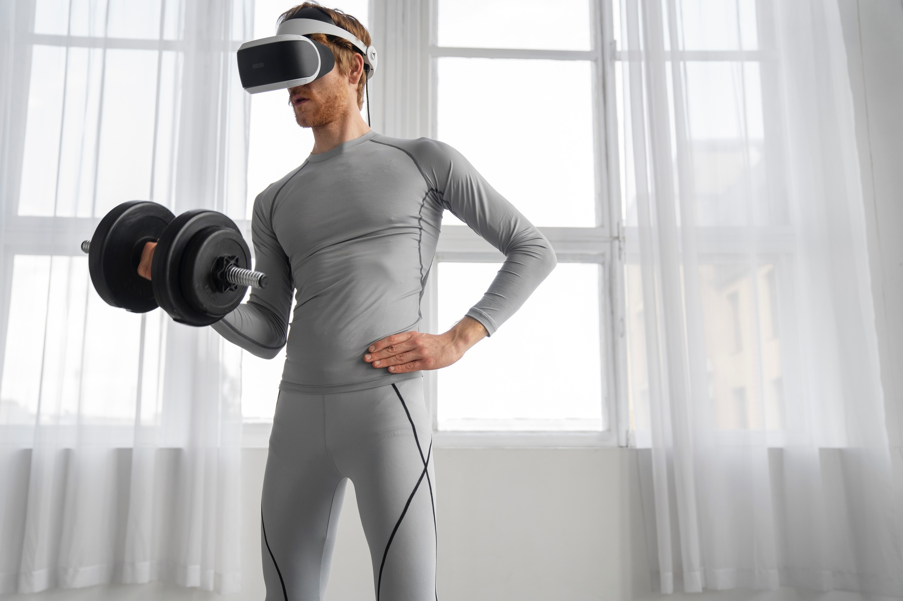

# Lucid Dreams and VR: Swiss Olympic Team Training in Dreams

Imagine being able to train without leaving your home — without even waking up. This sounds like science fiction, but for Professor Dr. Daniel Erlacher, who works with the Swiss Olympic team, it is already a reality. His research shows that lucid dreams open unique training opportunities, allowing athletes to improve their skills while asleep. VR, in turn, is becoming a powerful tool that can compensate for the unpredictability of lucid dreaming, providing a stable and accessible alternative for simulating training scenarios. Together, these approaches are paving the way for a revolution in learning and sports.

## Lucid Dreams as a Training Tool

Lucid dreams (LD) are a unique state in which a person realizes they are dreaming and can control the events of the dream. Erlacher began studying this phenomenon during his doctoral dissertation, exploring how such states could become a tool for sports science. His research proved that LDs activate neural circuits similar to those engaged during real training, allowing skills to be effectively reinforced during sleep.

> "This research began with my doctoral dissertation. I became interested in whether lucid dreaming could be used for motor learning. We conducted several studies and were able to show that for simple movements — such as finger tapping — you can indeed use lucid dreaming to improve motor learning performance. At least 20% of the population we surveyed frequently experience lucid dreams, and 20% of those have used them for athletic performance."
>
> — *Prof. Dr. Daniel Erlacher*

Erlacher notes that lucid dreams are especially useful for athletes recovering from injuries or unable to train through traditional methods. It acts as mental rehearsal: during sleep, athletes not only continue training but also refine their skills without putting extra strain on their bodies.

## The Challenge of Stable Lucid Dream Induction

Lucid dreams are a remarkable training tool, but achieving this state requires effort and time. As Erlacher admits, there is currently no universal method that guarantees success for everyone.

> "The problem is still how to reliably achieve lucid dreams. Meanwhile, it is much easier to buy a VR system and do the same thing as in a lucid dream."
>
> — *Prof. Dr. Daniel Erlacher*

Despite this difficulty, science has made significant progress in recent years. For example, the Banchenko Algorithm — a stable method for inducing lucid dreams — already exists. Although still in the implementation stage, initial results show significant potential for widespread use, suggesting the problem of stable lucid dream induction is gradually being solved.

## VR in Sports: A New Kind of Training

VR technology allows athletes to simulate realistic scenarios that are difficult or impossible to reproduce in real life. They can train in extreme conditions without real risk, or practice tactical maneuvers with teammates located anywhere in the world.

VR is also useful during injury recovery. The technology minimizes physical strain while keeping the brain active and maintaining muscle memory. Moreover, VR is actively used to manage athletes' emotional states, helping them cope with stress or recover after difficult competitions.

### Limitations of VR Technology

However, VR has its challenges. High equipment costs limit accessibility to professional clubs, while dizziness and eye fatigue can restrict session duration. Technical difficulties such as response lag and lack of realistic sports simulations also need resolution. Despite these barriers, technology is developing rapidly. Decreasing costs and improving user experience make VR an increasingly promising tool in sports.

## Lucid Dreams and VR: A View of the Future

Each method — LD and VR — has its advantages and limitations. Lucid dreams offer boundless possibilities: skills can be trained without technical limitations and completely free. However, achieving them requires time and discipline. VR, on the other hand, provides quick access to training with high realism, but remains expensive, requires physical equipment, and has limitations such as fatigue and dependence on simulation quality.

The synergy of LD and VR opens entirely new horizons. Imagine athletes training in VR and then continuing to refine their skills in lucid dreams. This creates a dual-practice effect, where VR helps build a foundation and LDs deepen understanding and skill retention.

## Conclusion: The Future Begins Now

The integration of lucid dreams and virtual reality is already changing the concept of training for Olympic teams and athletes. These technologies demonstrate how the science of consciousness and cutting-edge IT solutions can work in tandem, opening doors to a new understanding of cognitive development. Lucid dreams offer deep, individualized practice, while VR compensates for their unpredictability with accessible and universal tools.

The most exciting part lies ahead: the synergy of VR and LD could revolutionize skill development, allowing training in any environment at any time. Athletes, artists, programmers, and even surgeons will be able to maximize these innovations, turning scientific experiments into mass-market, accessible solutions.

---

*Originally published on [Tproger](https://tproger.ru/articles/vr-i-osoznannye-sny--trenirovki-olimpijcev-vo-sne)*
