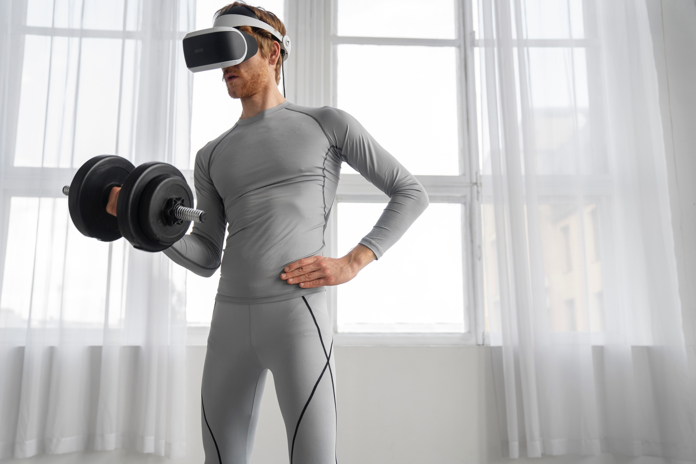

# Sueños lúcidos y VR: entrenamiento del equipo olímpico suizo en sueños

Imagine poder entrenar sin salir de casa — incluso sin despertarse. Suena a ciencia ficción, pero para el profesor Dr. Daniel Erlacher, que trabaja con el equipo olímpico suizo, ya es una realidad. Su investigación muestra que los sueños lúcidos abren oportunidades de entrenamiento únicas, permitiendo que los atletas mejoren sus habilidades mientras duermen. La VR, a su vez, se está convirtiendo en una herramienta poderosa que puede compensar la imprevisibilidad de los sueños lúcidos, ofreciendo una alternativa estable y accesible para simular escenarios de entrenamiento. Juntos, estos enfoques están allanando el camino para una revolución en el aprendizaje y el deporte.

## Los sueños lúcidos como herramienta de entrenamiento

Los sueños lúcidos (LD) son un estado único en el que una persona se da cuenta de que está soñando y puede controlar los acontecimientos del sueño. Erlacher comenzó a estudiar este fenómeno durante su tesis doctoral, explorando cómo esos estados podían convertirse en una herramienta para la ciencia del deporte. Su investigación demostró que los LD activan circuitos neuronales similares a los que intervienen durante el entrenamiento real, lo que permite reforzar habilidades de forma eficaz durante el sueño.

> "Esta investigación comenzó con mi tesis doctoral. Me interesó saber si los sueños lúcidos podían utilizarse para el aprendizaje motor. Realizamos varios estudios y pudimos demostrar que, en movimientos simples — como golpear con los dedos —, sí se puede usar el sueño lúcido para mejorar el rendimiento del aprendizaje motor. Al menos el 20 % de la población que encuestamos experimenta sueños lúcidos con frecuencia, y el 20 % de ellos los ha utilizado para el rendimiento deportivo."
>
> — *Prof. Dr. Daniel Erlacher*

Erlacher señala que los sueños lúcidos son especialmente útiles para atletas que se recuperan de lesiones o que no pueden entrenar mediante métodos tradicionales. Funcionan como un ensayo mental: durante el sueño, los atletas no solo continúan entrenando, sino que también perfeccionan sus habilidades sin someter el cuerpo a una carga adicional.

## El desafío de inducir sueños lúcidos de forma estable

Los sueños lúcidos son una herramienta de entrenamiento notable, pero alcanzar este estado requiere esfuerzo y tiempo. Como admite Erlacher, actualmente no existe un método universal que garantice el éxito para todos.

> "El problema sigue siendo cómo alcanzar sueños lúcidos de manera fiable. Mientras tanto, es mucho más fácil comprar un sistema de VR y hacer lo mismo que en un sueño lúcido."
>
> — *Prof. Dr. Daniel Erlacher*

A pesar de esta dificultad, la ciencia ha logrado avances importantes en los últimos años. Por ejemplo, el Banchenko Algorithm — un método estable para inducir sueños lúcidos — ya existe. Aunque todavía está en fase de implementación, los resultados iniciales muestran un potencial significativo para un uso amplio, lo que sugiere que el problema de la inducción estable de sueños lúcidos se está resolviendo gradualmente.

## VR en el deporte: una nueva forma de entrenamiento

La tecnología VR permite a los atletas simular escenarios realistas que son difíciles o imposibles de reproducir en la vida real. Pueden entrenar en condiciones extremas sin riesgo real, o practicar maniobras tácticas con compañeros de equipo ubicados en cualquier parte del mundo.

La VR también es útil durante la recuperación de lesiones. La tecnología minimiza la carga física mientras mantiene activo el cerebro y conserva la memoria muscular. Además, la VR se usa activamente para gestionar los estados emocionales de los atletas, ayudándoles a afrontar el estrés o a recuperarse después de competiciones difíciles.

### Limitaciones de la tecnología VR

Sin embargo, la VR tiene sus propios desafíos. Los altos costos del equipo limitan el acceso a clubes profesionales, mientras que el mareo y la fatiga ocular pueden restringir la duración de las sesiones. También deben resolverse dificultades técnicas como la latencia de respuesta y la falta de simulaciones deportivas realistas. A pesar de estas barreras, la tecnología se desarrolla rápidamente. La reducción de costos y la mejora de la experiencia de usuario hacen que la VR sea una herramienta cada vez más prometedora en el deporte.

## Sueños lúcidos y VR: una mirada al futuro

Cada método — LD y VR — tiene sus ventajas y limitaciones. Los sueños lúcidos ofrecen posibilidades ilimitadas: las habilidades pueden entrenarse sin limitaciones técnicas y de forma completamente gratuita. Sin embargo, alcanzarlos requiere tiempo y disciplina. La VR, por otro lado, ofrece acceso rápido a entrenamientos con alto realismo, pero sigue siendo costosa, requiere equipo físico y presenta limitaciones como la fatiga y la dependencia de la calidad de la simulación.

La sinergia entre LD y VR abre horizontes completamente nuevos. Imagine a atletas entrenando en VR y luego continuando el perfeccionamiento de sus habilidades en sueños lúcidos. Esto crea un efecto de doble práctica, en el que la VR ayuda a construir una base y los LD profundizan la comprensión y la retención de habilidades.

## Conclusión: el futuro empieza ahora

La integración de los sueños lúcidos y la realidad virtual ya está cambiando el concepto de entrenamiento para equipos olímpicos y atletas. Estas tecnologías demuestran cómo la ciencia de la conciencia y las soluciones de TI de vanguardia pueden trabajar en conjunto, abriendo puertas a una nueva comprensión del desarrollo cognitivo. Los sueños lúcidos ofrecen una práctica profunda e individualizada, mientras que la VR compensa su imprevisibilidad con herramientas accesibles y universales.

Lo más emocionante aún está por venir: la sinergia de VR y LD podría revolucionar el desarrollo de habilidades, permitiendo entrenar en cualquier entorno y en cualquier momento. Atletas, artistas, programadores e incluso cirujanos podrán aprovechar al máximo estas innovaciones, convirtiendo experimentos científicos en soluciones accesibles para el mercado masivo.

---

*Publicado originalmente en [Tproger](https://tproger.ru/articles/vr-i-osoznannye-sny--trenirovki-olimpijcev-vo-sne)*
