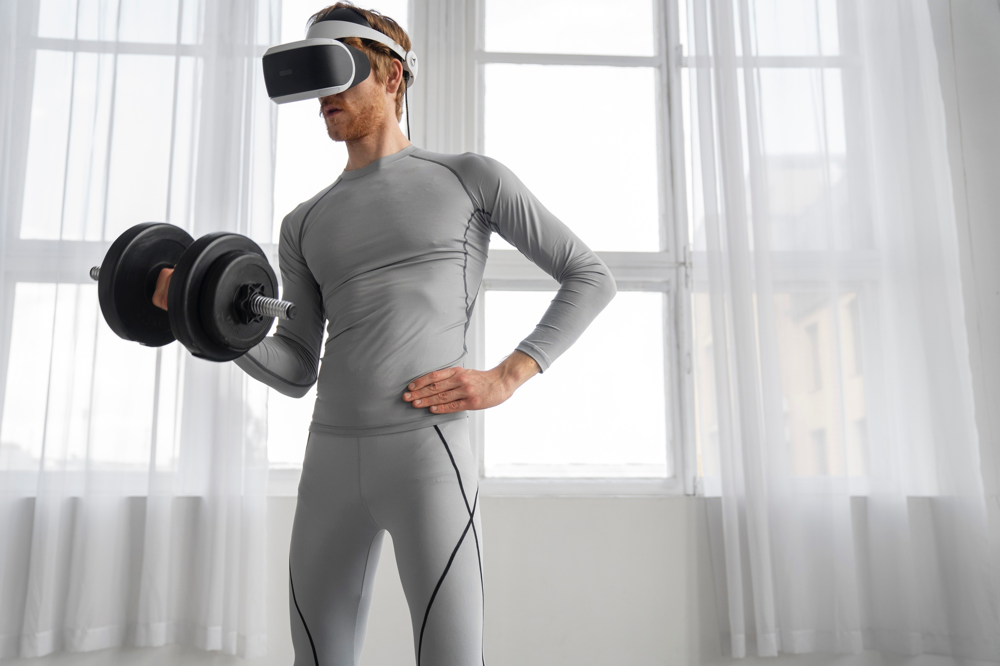

# Осознанные сны и VR: тренировки швейцарской олимпийской команды во сне

Представьте, что можно тренироваться, не выходя из дома — и даже не просыпаясь. Звучит как научная фантастика, но для профессора доктора Даниэля Эрлахера, который работает со швейцарской олимпийской командой, это уже реальность. Его исследования показывают, что осознанные сны открывают уникальные тренировочные возможности и позволяют спортсменам улучшать навыки во время сна. VR, в свою очередь, становится мощным инструментом, который может компенсировать непредсказуемость осознанных сновидений и дать стабильную, доступную альтернативу для симуляции тренировочных сценариев. Вместе эти подходы прокладывают путь к революции в обучении и спорте.

## Осознанные сны как инструмент тренировки

Осознанные сны (LD) — это уникальное состояние, в котором человек понимает, что спит, и может управлять событиями сна. Эрлахер начал изучать этот феномен во время работы над докторской диссертацией, исследуя, могут ли такие состояния стать инструментом спортивной науки. Его исследования показали, что LD активируют нейронные контуры, похожие на те, что задействуются во время реальной тренировки. Это позволяет эффективно закреплять навыки во сне.

> "Это исследование началось с моей докторской диссертации. Мне стало интересно, можно ли использовать осознанные сновидения для моторного обучения. Мы провели несколько исследований и смогли показать, что для простых движений — например, постукивания пальцами — осознанные сновидения действительно можно использовать для улучшения результатов моторного обучения. По крайней мере 20% опрошенных нами людей часто видят осознанные сны, и 20% из них использовали их для спортивных результатов."
>
> — *Prof. Dr. Daniel Erlacher*

Эрлахер отмечает, что осознанные сны особенно полезны для спортсменов, которые восстанавливаются после травм или не могут тренироваться традиционными методами. Это работает как мысленная репетиция: во время сна спортсмены не только продолжают тренировку, но и оттачивают навыки без дополнительной нагрузки на тело.

## Проблема стабильного входа в осознанные сны

Осознанные сны — сильный тренировочный инструмент, но достижение этого состояния требует усилий и времени. Как признаёт Эрлахер, универсального метода, который гарантировал бы успех каждому, пока не существует.

> "Проблема всё ещё в том, как надёжно достигать осознанных сновидений. В то же время гораздо проще купить VR-систему и делать то же самое, что и в осознанном сне."
>
> — *Prof. Dr. Daniel Erlacher*

Несмотря на эту сложность, за последние годы наука значительно продвинулась. Например, уже существует алгоритм Банченко — стабильный метод индукции осознанных сновидений. Хотя он всё ещё находится на стадии внедрения, первые результаты показывают значительный потенциал для широкого применения. Это говорит о том, что проблема стабильного входа в осознанные сны постепенно решается.

## VR в спорте: новый тип тренировок

VR-технологии позволяют спортсменам моделировать реалистичные сценарии, которые сложно или невозможно воспроизвести в реальной жизни. Они могут тренироваться в экстремальных условиях без реального риска или отрабатывать тактические манёвры с партнёрами по команде, которые находятся в любой точке мира.

VR также полезен при восстановлении после травм. Технология снижает физическую нагрузку, но сохраняет активность мозга и поддерживает мышечную память. Кроме того, VR активно используется для управления эмоциональным состоянием спортсменов, помогая справляться со стрессом или восстанавливаться после сложных соревнований.

### Ограничения VR-технологий

Однако у VR есть свои сложности. Высокая стоимость оборудования ограничивает доступность для профессиональных клубов, а головокружение и усталость глаз могут сокращать длительность сессий. Технические проблемы, например задержка отклика и недостаток реалистичных спортивных симуляций, тоже требуют решения. Несмотря на эти барьеры, технология быстро развивается. Снижение стоимости и улучшение пользовательского опыта делают VR всё более перспективным инструментом в спорте.

## Осознанные сны и VR: взгляд в будущее

У каждого метода — LD и VR — есть свои преимущества и ограничения. Осознанные сны дают почти безграничные возможности: навыки можно тренировать без технических ограничений и совершенно бесплатно. Но для их достижения нужны время и дисциплина. VR, наоборот, даёт быстрый доступ к тренировкам с высокой реалистичностью, но остаётся дорогим, требует физического оборудования и имеет ограничения вроде усталости и зависимости от качества симуляции.

Синергия LD и VR открывает совершенно новые горизонты. Представьте спортсменов, которые тренируются в VR, а затем продолжают оттачивать навыки в осознанных снах. Это создаёт эффект двойной практики: VR помогает сформировать основу, а LD углубляют понимание и закрепление навыков.

## Заключение: будущее начинается сейчас

Интеграция осознанных снов и виртуальной реальности уже меняет представление о тренировках олимпийских команд и спортсменов. Эти технологии показывают, как наука о сознании и передовые IT-решения могут работать вместе, открывая путь к новому пониманию когнитивного развития. Осознанные сны дают глубокую индивидуальную практику, а VR компенсирует их непредсказуемость доступными и универсальными инструментами.

Самое интересное ещё впереди: синергия VR и LD может произвести революцию в развитии навыков, позволяя тренироваться в любой среде и в любое время. Спортсмены, художники, программисты и даже хирурги смогут максимально использовать эти инновации, превращая научные эксперименты в массовые и доступные решения.

---

*Оригинал опубликован на [Tproger](https://tproger.ru/articles/vr-i-osoznannye-sny--trenirovki-olimpijcev-vo-sne)*
