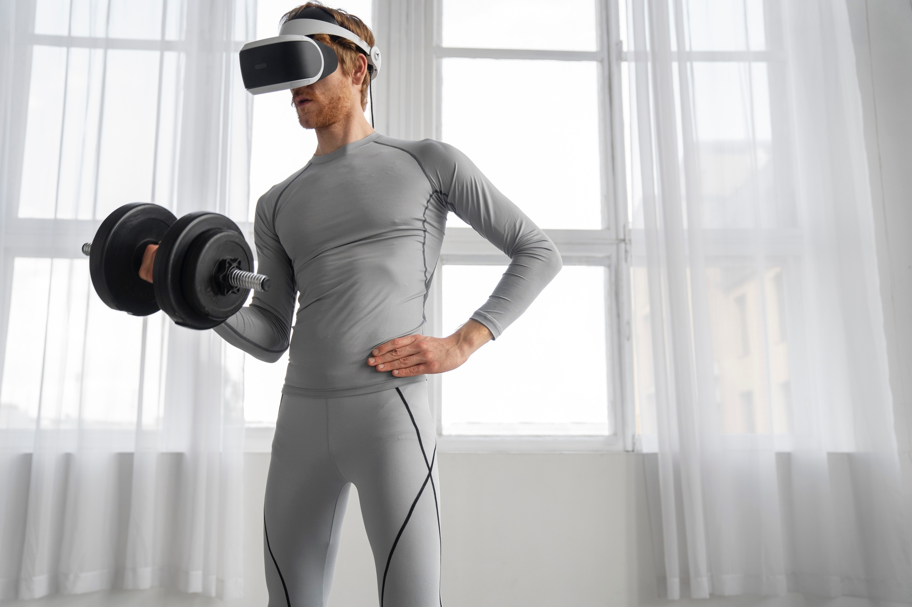

# Усвідомлені сни та VR: тренування швейцарської олімпійської команди уві сні

Уявіть, що можна тренуватися, не виходячи з дому — і навіть не прокидаючись. Звучить як наукова фантастика, але для професора доктора Даніеля Ерлахера, який працює зі швейцарською олімпійською командою, це вже реальність. Його дослідження показують, що усвідомлені сни відкривають унікальні тренувальні можливості й дають спортсменам змогу покращувати навички під час сну. VR, своєю чергою, стає потужним інструментом, який може компенсувати непередбачуваність усвідомлених сновидінь і дати стабільну, доступну альтернативу для симуляції тренувальних сценаріїв. Разом ці підходи прокладають шлях до революції в навчанні та спорті.

## Усвідомлені сни як інструмент тренування

Усвідомлені сни (LD) — це унікальний стан, у якому людина розуміє, що спить, і може керувати подіями сну. Ерлахер почав вивчати цей феномен під час роботи над докторською дисертацією, досліджуючи, чи можуть такі стани стати інструментом спортивної науки. Його дослідження показали, що LD активують нейронні контури, схожі на ті, що задіюються під час реального тренування. Це дає змогу ефективно закріплювати навички уві сні.

> "Це дослідження почалося з моєї докторської дисертації. Мені стало цікаво, чи можна використовувати усвідомлені сновидіння для моторного навчання. Ми провели кілька досліджень і змогли показати, що для простих рухів — наприклад, постукування пальцями — усвідомлені сновидіння справді можна використовувати для покращення результатів моторного навчання. Принаймні 20% опитаних нами людей часто бачать усвідомлені сни, і 20% із них використовували їх для спортивних результатів."
>
> — *Prof. Dr. Daniel Erlacher*

Ерлахер зазначає, що усвідомлені сни особливо корисні для спортсменів, які відновлюються після травм або не можуть тренуватися традиційними методами. Це працює як уявна репетиція: під час сну спортсмени не лише продовжують тренування, а й відточують навички без додаткового навантаження на тіло.

## Проблема стабільного входу в усвідомлені сни

Усвідомлені сни — потужний тренувальний інструмент, але досягнення цього стану потребує зусиль і часу. Як визнає Ерлахер, універсального методу, який гарантував би успіх кожному, поки не існує.

> "Проблема все ще в тому, як надійно досягати усвідомлених сновидінь. Водночас набагато простіше купити VR-систему й робити те саме, що й в усвідомленому сні."
>
> — *Prof. Dr. Daniel Erlacher*

Попри цю складність, за останні роки наука значно просунулася вперед. Наприклад, уже існує алгоритм Банченка — стабільний метод індукції усвідомлених сновидінь. Хоча він усе ще перебуває на стадії впровадження, перші результати показують значний потенціал для широкого застосування. Це свідчить про те, що проблема стабільного входу в усвідомлені сни поступово вирішується.

## VR у спорті: новий тип тренувань

VR-технології дають спортсменам змогу моделювати реалістичні сценарії, які складно або неможливо відтворити в реальному житті. Вони можуть тренуватися в екстремальних умовах без реального ризику або відпрацьовувати тактичні маневри з партнерами по команді, які перебувають у будь-якій точці світу.

VR також корисний під час відновлення після травм. Технологія знижує фізичне навантаження, але зберігає активність мозку й підтримує м'язову пам'ять. Крім того, VR активно використовується для керування емоційним станом спортсменів, допомагаючи справлятися зі стресом або відновлюватися після складних змагань.

### Обмеження VR-технологій

Однак у VR є свої складнощі. Висока вартість обладнання обмежує доступність для професійних клубів, а запаморочення й втома очей можуть скорочувати тривалість сесій. Технічні проблеми, наприклад затримка відгуку та нестача реалістичних спортивних симуляцій, також потребують вирішення. Попри ці бар'єри, технологія швидко розвивається. Зниження вартості й покращення користувацького досвіду роблять VR дедалі перспективнішим інструментом у спорті.

## Усвідомлені сни та VR: погляд у майбутнє

У кожного методу — LD і VR — є свої переваги та обмеження. Усвідомлені сни дають майже безмежні можливості: навички можна тренувати без технічних обмежень і абсолютно безкоштовно. Але для їх досягнення потрібні час і дисципліна. VR, навпаки, дає швидкий доступ до тренувань із високою реалістичністю, але залишається дорогим, потребує фізичного обладнання й має обмеження на кшталт втоми та залежності від якості симуляції.

Синергія LD і VR відкриває цілком нові горизонти. Уявіть спортсменів, які тренуються у VR, а потім продовжують відточувати навички в усвідомлених снах. Це створює ефект подвійної практики: VR допомагає сформувати основу, а LD поглиблюють розуміння й закріплення навичок.

## Висновок: майбутнє починається зараз

Інтеграція усвідомлених снів і віртуальної реальності вже змінює уявлення про тренування олімпійських команд і спортсменів. Ці технології показують, як наука про свідомість і передові IT-рішення можуть працювати разом, відкриваючи шлях до нового розуміння когнітивного розвитку. Усвідомлені сни дають глибоку індивідуальну практику, а VR компенсує їхню непередбачуваність доступними й універсальними інструментами.

Найцікавіше ще попереду: синергія VR і LD може здійснити революцію в розвитку навичок, дозволяючи тренуватися в будь-якому середовищі й у будь-який час. Спортсмени, художники, програмісти й навіть хірурги зможуть максимально використовувати ці інновації, перетворюючи наукові експерименти на масові та доступні рішення.

---

*Оригінал опубліковано на [Tproger](https://tproger.ru/articles/vr-i-osoznannye-sny--trenirovki-olimpijcev-vo-sne)*
