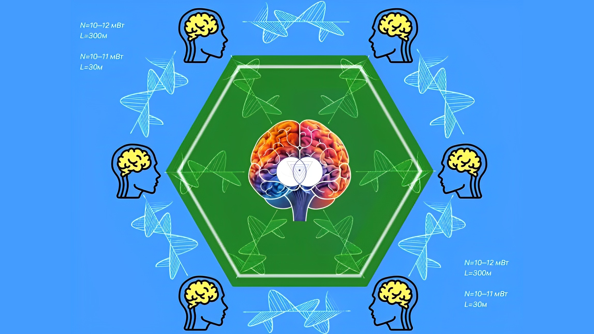

# Vom Pet Project zur wissenschaftlichen Forschung: Der Weg zu echter Innovation (2023)

Innovation beginnt immer mit kleinen Schritten. Selbst die bescheidensten Ideen können zu erstaunlichen Entdeckungen und wissenschaftlicher Forschung führen, die unser Verständnis der Welt verändert.

Eine solche Geschichte handelt von einer Idee, die als Pet Project begann, aber schließlich zu einer wissenschaftlichen Studie mit bemerkenswerten Ergebnissen heranwuchs. Der Titel dieser Forschung lautet: *"Application of the 'Banchenko Dream Synchronization Mnemonics Method' for Joint Synchronization of Dream Elements (including Lucid Dreams) within the 'Blokhin Dream Network Concept' and Analysis of Results based on the 'Kapustin Dream Match Search AI Model'"*.

Diese unglaubliche Geschichte zeigt, wie Leidenschaft für Programmierung, Forschung und wissenschaftliche Neugier zu Innovation führen kann.

## Eine Idee, geboren aus Leidenschaft für Forschung

Die Geschichte begann mit einem Pet Project, dessen Idee kühn und etwas ungewöhnlich wirkte. Die Gründer beschlossen, Schlaf und die Möglichkeit zu erforschen, Träume zwischen verschiedenen Menschen zu synchronisieren.

Ihre Hypothese war unkonventionell und sogar exzentrisch. Sie vermuteten, dass der Einsatz von Meme-Theorie und Tag-Memen in Kombination mit Mechanismen zur Synchronisierung von Gehirnrhythmen zu einer Traumsynchronisierung unter den Teilnehmenden führen könnte, einschließlich Fällen luzider Träume.

## Vom Pet Project zur wissenschaftlichen Modellierung

Zunächst schien dies eine Idee zu sein, die im Bereich des Amateurinteresses bleiben würde. Doch die Kühnheit und wissenschaftliche Neugier der Forschenden kannten keine Grenzen.

Sie entwickelten ein neues Computermodell — das "Kapustin Dream Match Search AI Model" — zur Erkennung von Übereinstimmungen zwischen Träumen auf Basis künstlicher Intelligenz. Dieses Modell wurde zum Schlüsselelement ihrer Forschung.

Für einen genaueren Blick auf die Prinzipien des Modells siehe den früheren Artikel [AI and Lucid Dreaming: Exploring New Opportunities](../ai-lucid-dreaming/).

## Hypothesen und Ergebnisse

Die Forschenden formulierten mehrere Hypothesen. Die erste, ungerichtete Hypothese besagte, dass Traumsynchronisierung durch gemeinsame synchrone Handlungen und Neuroprozesse zu einem höheren Grad an Ähnlichkeit individueller Trauminhalte im Vergleich zu zufälliger Übereinstimmung führen würde.

Die zweite Hypothese besagte, dass synchronisierte Träume eine größere Anzahl miteinander verbundener Themen, Symbole und Erfahrungen zwischen den Teilnehmenden aufweisen würden, was auf eine Ebene der Verbindung jenseits zufälliger Muster hindeutet.

## KI und Traumanalyse

Die Studie begann. Die Teilnehmenden wurden synchronen Handlungen unterzogen, und ihre Träume wurden täglich analysiert. Die Ergebnisse waren fesselnd. Die erste ungerichtete Hypothese wurde bestätigt — Träume wurden tatsächlich zwischen den Teilnehmenden synchronisiert, einschließlich Fällen luzider Träume.

Der eigentliche Durchbruch kam jedoch mit der zweiten Hypothese. Als das Computermodell zur Analyse synchronisierter Träume eingesetzt wurde, zeigte es eine statistisch signifikante Steigerung der Genauigkeit. Das bedeutete, dass künstliche Intelligenz Übereinstimmungen zwischen Träumen mit hoher Präzision erkennen konnte und neue Möglichkeiten zur Erforschung der Welt der Träume eröffnete.

Diese Forschung hebt auch die Bedeutung von Pet Projects und Startups für Programmierer hervor. Man kann mit kleinen Ideen beginnen, doch wie diese Geschichte zeigt, können sie zu wissenschaftlicher Forschung heranwachsen und zu Innovationen führen, die unser Verständnis der Welt verändern. Programmierer, die von wissenschaftlicher Neugier und Leidenschaft für Forschung angetrieben werden, können revolutionäre Entdeckungen machen, selbst wenn sie mit den bescheidensten Ideen beginnen.

## Schlussfolgerungen

Die Studie entwickelte sich von einem ungewöhnlichen Pet Project zu einer wissenschaftlichen Entdeckung mit Potenzial für weitere Forschung in den Bereichen Träume und künstliche Intelligenz. Diese Geschichte ist ein Beispiel dafür, wie Leidenschaft für Programmierung, Wissenschaft und wissenschaftliche Neugier zu echter Innovation führen kann, selbst wenn man mit den bescheidensten Ideen beginnt. Dem, was erreicht werden kann, wenn man leidenschaftlich und interessiert ist, sind keine Grenzen gesetzt.

---

*Ursprünglich veröffentlicht auf [Tproger](https://tproger.ru/articles/ot-pet-proekta-do-nauchnogo-issledovaniya-put-k-nastoyashhej-innovacii)*
