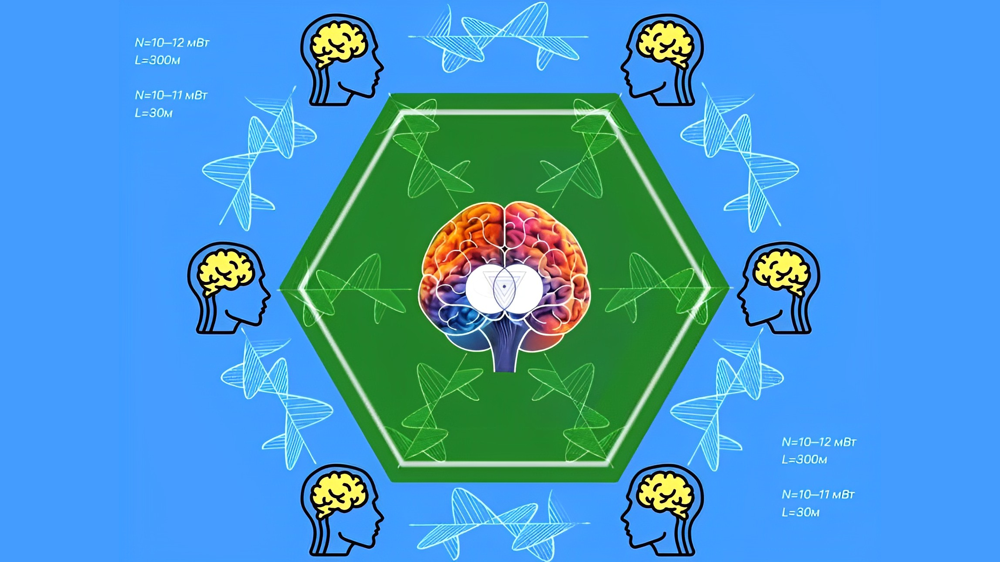

# From Pet Project to Scientific Research: Path to True Innovation (2023)

Innovation always begins with small steps. Even the most modest ideas can lead to astonishing discoveries and scientific research that changes our understanding of the world.

One such story is of an idea that started as a pet project but eventually grew into a scientific study with remarkable results. The title of this research is: *"Application of the 'Banchenko Dream Synchronization Mnemonics Method' for Joint Synchronization of Dream Elements (including Lucid Dreams) within the 'Blokhin Dream Network Concept' and Analysis of Results based on the 'Kapustin Dream Match Search AI Model'"*.

This incredible story demonstrates how a passion for programming, research, and scientific curiosity can lead to innovation.

## An Idea Born from a Passion for Research

The story began with a pet project whose idea seemed bold and somewhat unusual. The founders decided to explore sleep and the possibility of synchronizing dreams between different people.

Their hypothesis was unconventional and even eccentric. They suggested that using meme theory and tag-memes in combination with brain rhythm synchronization mechanisms could lead to dream synchronization among participants, including cases of lucid dreams.

## From Pet Project to Scientific Modeling

At first, this seemed like an idea that would remain within the realm of amateur interest. But the researchers' boldness and scientific curiosity knew no bounds.

They developed a new computer model — the "Kapustin Dream Match Search AI Model" — for identifying correspondences between dreams based on artificial intelligence. This model became the key element of their research.

For a closer look at the model's principles, see the earlier article [AI and Lucid Dreaming: Exploring New Opportunities](../ai-lucid-dreaming/).

## Hypotheses and Results

The researchers formulated several hypotheses. The first, non-directional hypothesis proposed that dream synchronization through shared synchronous actions and neuroprocesses would lead to a higher degree of similarity in individual dream content compared to random coincidence.

The second hypothesis proposed that synchronized dreams would exhibit a higher number of interconnected themes, symbols, and experiences between participants, indicating a level of interconnection beyond random patterns.

## AI and Dream Analysis

The study began. Participants were subjected to synchronous actions, and their dreams were analyzed daily. The results were captivating. The first non-directional hypothesis was confirmed — dreams were indeed synchronized between participants, including cases of lucid dreams.

But the real breakthrough came with the second hypothesis. When the computer model was applied to analyze synchronized dreams, it demonstrated a statistically significant increase in accuracy. This meant that artificial intelligence could recognize matches between dreams with high precision, opening new possibilities for exploring the world of dreams.

This research also highlights the importance of pet projects and startups for programmers. You can start with small ideas, but as this story shows, they can grow into scientific research and lead to innovations that change our understanding of the world. Programmers driven by scientific curiosity and a passion for research can make revolutionary discoveries, even starting from the most modest ideas.

## Conclusions

The study evolved from an unusual pet project into a scientific discovery with potential for further research in the fields of dreams and artificial intelligence. This story is an example of how passion for programming, science, and scientific curiosity can lead to true innovation, even when starting with the most modest ideas. There is no limit to what can be achieved when you are passionate and interested.

---

*Originally published on [Tproger](https://tproger.ru/articles/ot-pet-proekta-do-nauchnogo-issledovaniya-put-k-nastoyashhej-innovacii)*
