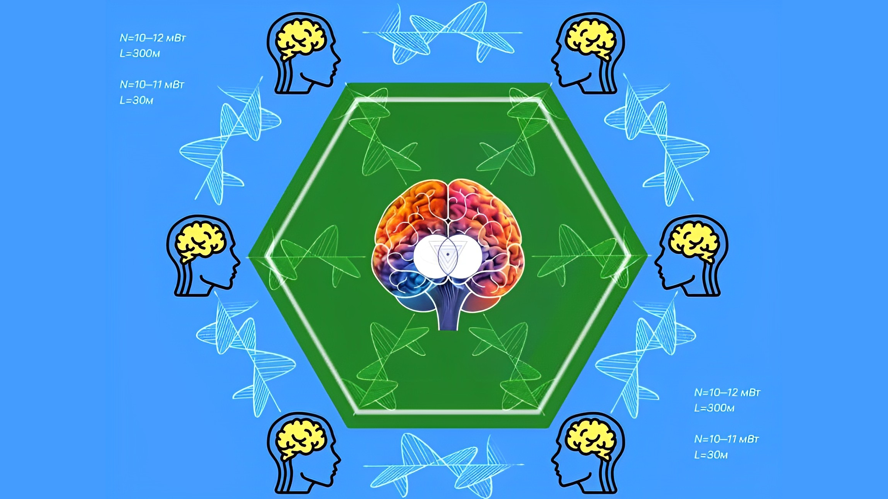

# От pet project к научному исследованию: путь к настоящей инновации (2023)

Инновации всегда начинаются с маленьких шагов. Даже самые скромные идеи могут привести к удивительным открытиям и научным исследованиям, которые меняют наше понимание мира.

Одна из таких историй началась с идеи для pet project, а затем выросла в научное исследование с заметными результатами. Название этого исследования: *"Application of the 'Banchenko Dream Synchronization Mnemonics Method' for Joint Synchronization of Dream Elements (including Lucid Dreams) within the 'Blokhin Dream Network Concept' and Analysis of Results based on the 'Kapustin Dream Match Search AI Model'"*.

Эта история показывает, как увлечение программированием, исследованиями и научным поиском может привести к инновации.

## Идея, рождённая из интереса к исследованиям

История началась с pet project, идея которого казалась смелой и немного необычной. Основатели решили исследовать сон и возможность синхронизации сновидений между разными людьми.

Их гипотеза была нестандартной и даже эксцентричной. Они предположили, что использование теории мемов и tag-memes в сочетании с механизмами синхронизации ритмов мозга может привести к синхронизации сновидений участников, включая случаи осознанных снов.

## От pet project к научному моделированию

Сначала казалось, что эта идея так и останется в области любительского интереса. Но смелость исследователей и их научное любопытство не имели границ.

Они разработали новую компьютерную модель — "Kapustin Dream Match Search AI Model" — для поиска соответствий между снами с помощью искусственного интеллекта. Эта модель стала ключевым элементом исследования.

Подробнее о принципах работы модели можно прочитать в предыдущей статье [ИИ и осознанные сновидения: новые возможности](../ai-lucid-dreaming/).

## Гипотезы и результаты

Исследователи сформулировали несколько гипотез. Первая, ненаправленная гипотеза предполагала, что синхронизация сновидений через совместные синхронные действия и нейропроцессы приведёт к более высокой степени сходства индивидуального содержания снов по сравнению со случайным совпадением.

Вторая гипотеза предполагала, что синхронизированные сны будут содержать больше взаимосвязанных тем, символов и переживаний между участниками, что укажет на уровень взаимосвязанности выше случайных паттернов.

## ИИ и анализ сновидений

Исследование началось. Участники выполняли синхронные действия, а их сны анализировались ежедневно. Результаты оказались захватывающими. Первая ненаправленная гипотеза подтвердилась: сны действительно синхронизировались между участниками, включая случаи осознанных сновидений.

Но настоящий прорыв произошёл при проверке второй гипотезы. Когда компьютерную модель применили для анализа синхронизированных снов, она показала статистически значимое повышение точности. Это означало, что искусственный интеллект способен с высокой точностью распознавать совпадения между снами, открывая новые возможности для исследования мира сновидений.

Это исследование также подчёркивает важность pet projects и стартапов для программистов. Можно начинать с маленьких идей, но, как показывает эта история, они способны вырасти в научные исследования и привести к инновациям, которые меняют наше понимание мира. Программисты, движимые научным любопытством и интересом к исследованиям, могут делать революционные открытия, даже начав с самых скромных идей.

## Выводы

Исследование выросло из необычного pet project в научное открытие с потенциалом для дальнейшей работы в области сновидений и искусственного интеллекта. Эта история показывает, как интерес к программированию, науке и исследовательскому поиску может привести к настоящей инновации, даже если всё начинается с самой скромной идеи. Когда есть увлечённость и интерес, границы возможного становятся шире.

---

*Оригинал опубликован на [Tproger](https://tproger.ru/articles/ot-pet-proekta-do-nauchnogo-issledovaniya-put-k-nastoyashhej-innovacii)*
