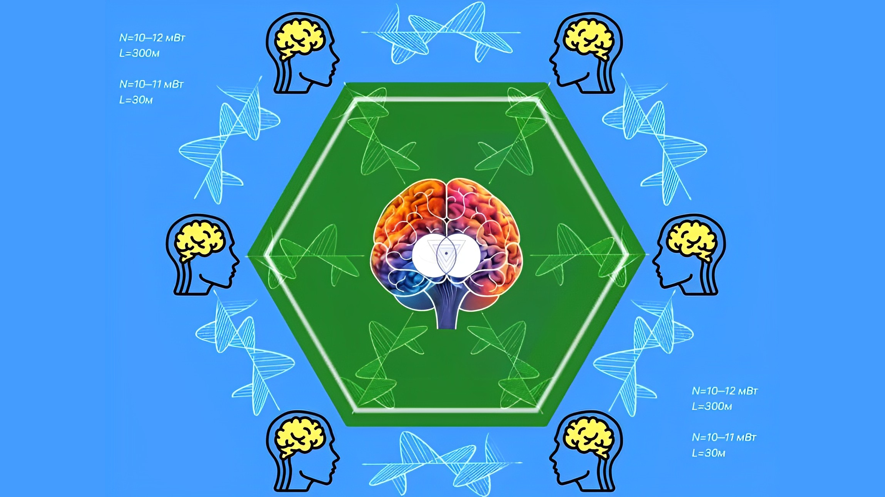

# Від pet project до наукового дослідження: шлях до справжньої інновації (2023)

Інновації завжди починаються з маленьких кроків. Навіть найскромніші ідеї можуть привести до дивовижних відкриттів і наукових досліджень, які змінюють наше розуміння світу.

Одна з таких історій почалася з ідеї для pet project, а потім виросла в наукове дослідження з помітними результатами. Назва цього дослідження: *"Application of the 'Banchenko Dream Synchronization Mnemonics Method' for Joint Synchronization of Dream Elements (including Lucid Dreams) within the 'Blokhin Dream Network Concept' and Analysis of Results based on the 'Kapustin Dream Match Search AI Model'"*.

Ця історія показує, як захоплення програмуванням, дослідженнями та науковим пошуком може привести до інновації.

## Ідея, народжена з інтересу до досліджень

Історія почалася з pet project, ідея якого здавалася сміливою і трохи незвичною. Засновники вирішили дослідити сон і можливість синхронізації сновидінь між різними людьми.

Їхня гіпотеза була нестандартною і навіть ексцентричною. Вони припустили, що використання теорії мемів і tag-memes у поєднанні з механізмами синхронізації ритмів мозку може привести до синхронізації сновидінь учасників, включно з випадками усвідомлених снів.

## Від pet project до наукового моделювання

Спочатку здавалося, що ця ідея так і залишиться в межах аматорського інтересу. Але сміливість дослідників і їхня наукова цікавість не мали меж.

Вони розробили нову комп'ютерну модель — "Kapustin Dream Match Search AI Model" — для пошуку відповідностей між снами за допомогою штучного інтелекту. Ця модель стала ключовим елементом дослідження.

Докладніше про принципи роботи моделі можна прочитати в попередній статті [ШІ та усвідомлені сновидіння: нові можливості](../ai-lucid-dreaming/).

## Гіпотези та результати

Дослідники сформулювали кілька гіпотез. Перша, ненапрямлена гіпотеза припускала, що синхронізація сновидінь через спільні синхронні дії та нейропроцеси приведе до вищого ступеня схожості індивідуального змісту снів порівняно з випадковим збігом.

Друга гіпотеза припускала, що синхронізовані сни міститимуть більше взаємопов'язаних тем, символів і переживань між учасниками, що вкаже на рівень взаємозв'язку вищий за випадкові патерни.

## ШІ та аналіз сновидінь

Дослідження почалося. Учасники виконували синхронні дії, а їхні сни аналізувалися щодня. Результати виявилися захопливими. Перша ненапрямлена гіпотеза підтвердилася: сни справді синхронізувалися між учасниками, включно з випадками усвідомлених сновидінь.

Але справжній прорив стався під час перевірки другої гіпотези. Коли комп'ютерну модель застосували для аналізу синхронізованих снів, вона показала статистично значуще підвищення точності. Це означало, що штучний інтелект здатний із високою точністю розпізнавати збіги між снами, відкриваючи нові можливості для дослідження світу сновидінь.

Це дослідження також підкреслює важливість pet projects і стартапів для програмістів. Можна починати з маленьких ідей, але, як показує ця історія, вони здатні вирости в наукові дослідження й привести до інновацій, які змінюють наше розуміння світу. Програмісти, якими рухає наукова цікавість та інтерес до досліджень, можуть робити революційні відкриття, навіть почавши з найскромніших ідей.

## Висновки

Дослідження виросло з незвичного pet project у наукове відкриття з потенціалом для подальшої роботи в галузі сновидінь і штучного інтелекту. Ця історія показує, як інтерес до програмування, науки й дослідницького пошуку може привести до справжньої інновації, навіть якщо все починається з найскромнішої ідеї. Коли є захоплення та інтерес, межі можливого стають ширшими.

---

*Оригінал опубліковано на [Tproger](https://tproger.ru/articles/ot-pet-proekta-do-nauchnogo-issledovaniya-put-k-nastoyashhej-innovacii)*
