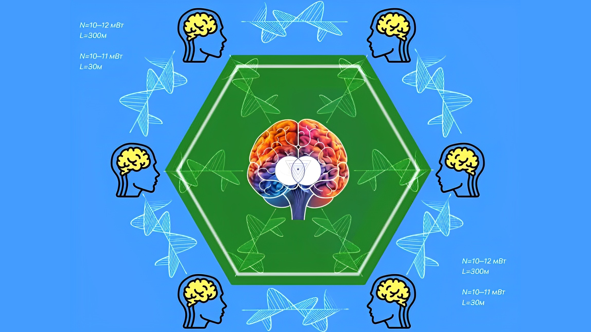

# De pet project a investigación científica: camino hacia la verdadera innovación (2024)

La innovación siempre comienza con pequeños pasos. Incluso las ideas más modestas pueden conducir a descubrimientos asombrosos y a investigaciones científicas que cambian nuestra comprensión del mundo.

Una historia así es la de una idea que comenzó como un pet project, pero que finalmente creció hasta convertirse en un estudio científico con resultados notables. El título de esta investigación es: *"Application of the 'Banchenko Dream Synchronization Mnemonics Method' for Joint Synchronization of Dream Elements (including Lucid Dreams) within the 'Blokhin Dream Network Concept' and Analysis of Results based on the 'Kapustin Dream Match Search AI Model'"*.

Esta increíble historia demuestra cómo la pasión por la programación, la investigación y la curiosidad científica puede conducir a la innovación.

## Una idea nacida de la pasión por la investigación

La historia comenzó con un pet project cuya idea parecía audaz y algo inusual. Los fundadores decidieron explorar el sueño y la posibilidad de sincronizar sueños entre distintas personas.

Su hipótesis era poco convencional e incluso excéntrica. Sugirieron que el uso de la teoría de los memes y los tag-memes en combinación con mecanismos de sincronización de ritmos cerebrales podría conducir a la sincronización de sueños entre los participantes, incluidos casos de sueños lúcidos.

## Del pet project al modelado científico

Al principio, esto parecía una idea que permanecería dentro del ámbito del interés amateur. Pero la audacia y la curiosidad científica de los investigadores no tenían límites.

Desarrollaron un nuevo modelo informático — el "Kapustin Dream Match Search AI Model" — para identificar correspondencias entre sueños basándose en inteligencia artificial. Este modelo se convirtió en el elemento clave de su investigación.

Para ver más de cerca los principios del modelo, consulte el artículo anterior [AI and Lucid Dreaming: Exploring New Opportunities](../ai-lucid-dreaming/).

## Hipótesis y resultados

Los investigadores formularon varias hipótesis. La primera hipótesis, no direccional, propuso que la sincronización de sueños mediante acciones sincrónicas compartidas y neuroprocesos conduciría a un mayor grado de similitud en el contenido individual de los sueños en comparación con una coincidencia aleatoria.

La segunda hipótesis propuso que los sueños sincronizados presentarían un mayor número de temas, símbolos y experiencias interconectados entre los participantes, lo que indicaría un nivel de interconexión más allá de los patrones aleatorios.

## IA y análisis de sueños

El estudio comenzó. Los participantes fueron sometidos a acciones sincrónicas, y sus sueños se analizaron diariamente. Los resultados fueron fascinantes. La primera hipótesis no direccional fue confirmada: los sueños se sincronizaron efectivamente entre los participantes, incluidos casos de sueños lúcidos.

Pero el verdadero avance llegó con la segunda hipótesis. Cuando se aplicó el modelo informático para analizar los sueños sincronizados, demostró un aumento estadísticamente significativo de la precisión. Esto significaba que la inteligencia artificial podía reconocer coincidencias entre sueños con alta precisión, abriendo nuevas posibilidades para explorar el mundo de los sueños.

Esta investigación también destaca la importancia de los pet projects y las startups para los programadores. Se puede empezar con ideas pequeñas, pero, como muestra esta historia, pueden crecer hasta convertirse en investigación científica y conducir a innovaciones que cambian nuestra comprensión del mundo. Los programadores impulsados por la curiosidad científica y la pasión por la investigación pueden hacer descubrimientos revolucionarios, incluso partiendo de las ideas más modestas.

## Conclusiones

El estudio evolucionó desde un pet project inusual hasta convertirse en un descubrimiento científico con potencial para futuras investigaciones en los campos de los sueños y la inteligencia artificial. Esta historia es un ejemplo de cómo la pasión por la programación, la ciencia y la curiosidad científica puede conducir a una verdadera innovación, incluso cuando se parte de las ideas más modestas. No hay límite para lo que puede lograrse cuando se tiene pasión e interés.

---

*Publicado originalmente en [Tproger](https://tproger.ru/articles/ot-pet-proekta-do-nauchnogo-issledovaniya-put-k-nastoyashhej-innovacii)*
