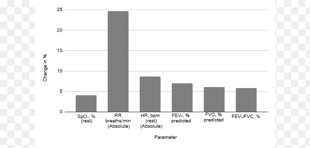
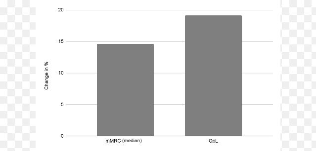
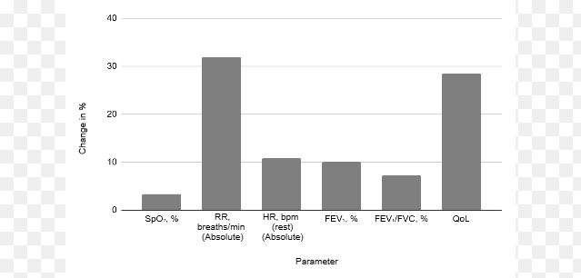
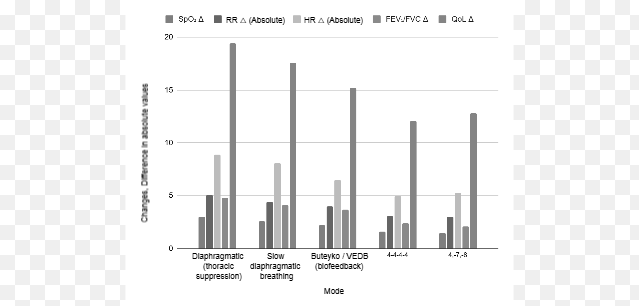

[← Research Publications](../README.md)

# Clinical Validation of the Inspira-X System
*September 2025 — ASRP.Science, Clinical Study No. 1*

**Developed at:** [ASRP](../../../experience/asrp/)

**Authors:** Valeria Ovseannicova, Alexandr Ovseannicov, Galina Ovseannicova, Denis Banchenko, Ivan Savelev, Mykhailo Kapustin

**Links:** [DOI: 10.66082/asrp-2026-001](https://doi.org/10.66082/asrp-2026-001) | [PDF](ClinicalValidationoftheInspira-XSystem.pdf)

A pilot observational clinical study (N=77) validating the Inspira-X dual-channel biofeedback pneumograph, which corrects dysfunctional breathing patterns by giving participants real-time visualization of thoracic vs. diaphragmatic breathing. Over a 4-week training protocol (6–7 sessions/week), participants showed statistically significant improvements across SpO2 (+4.0%), respiratory rate (-24.7%), heart rate (-8.7%), and spirometric indicators (FEV1 +7.0%, FVC +6.1%, FEV1/FVC +5.8%).

Clinically significant reductions in dyspnea (mMRC) were recorded in 71% of symptomatic patients, and quality-of-life scores rose by ~19%.

Effects were strongest in the elderly cohort (65–82 y/o), where QoL improved by 28.5% and respiratory rate dropped by 32% — a result the authors note is largely unattainable with non-biofeedback correction methods.

A comparative analysis against Buteyko breathing, VEDB, and structured patterns (4-4-4-4, 4-7-8) found Inspira-X's active biofeedback approach outperformed all of them, supporting the hypothesis that conscious engagement with objective biosignal feedback accelerates respiratory retraining.

Meta: [meta.yaml](meta.yaml)

[← Research Publications](../README.md)
