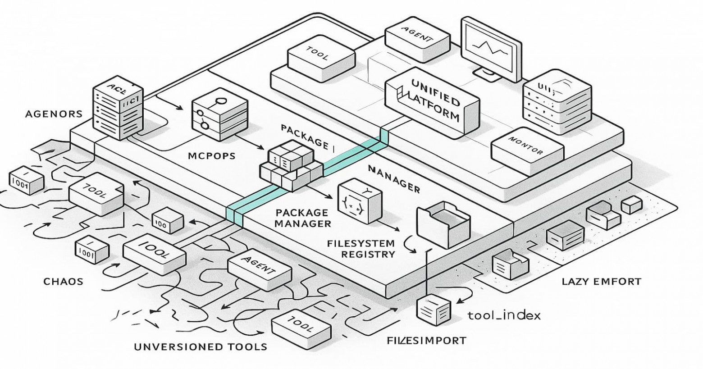

# Building AI Agent Infrastructure: Three Paths from Chaos to Scalable Systems

**Stats:** 10,327 views — Medium: 149, Habr: 10.2K, Hashnode: 11

How to move from a messy AI monorepo to a scalable agent ecosystem — with real examples, three architectural paths (Filesystem Registry, Package Manager, AgentOps), and lessons from building multi-agent infrastructures.

**Links:** [Medium](https://medium.com/@kapustinomm/building-ai-agent-infrastructure-three-paths-from-chaos-to-scalable-systems-35c81a96a41a) | [Habr](https://habr.com/en/articles/960154/)

**Translations:** [English](article.en.md) | [Deutsch](article.de.md) | [Español](article.es.md) | [Русский](article.ru.md) | [Українська](article.uk.md)

