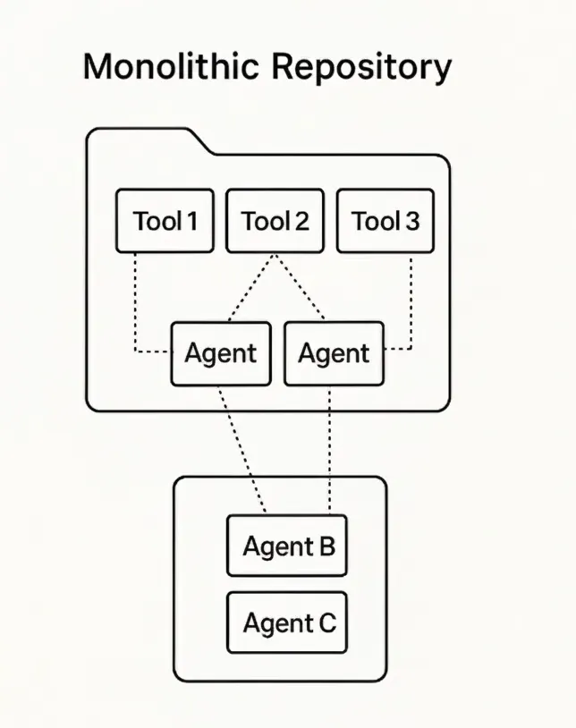
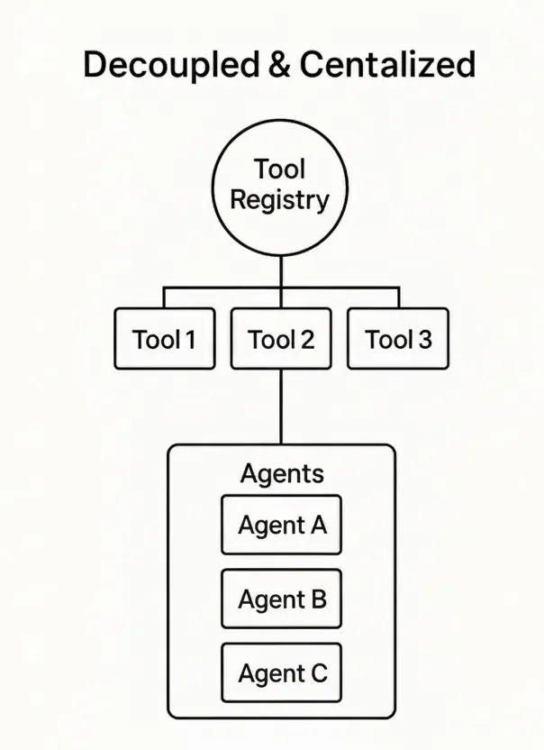
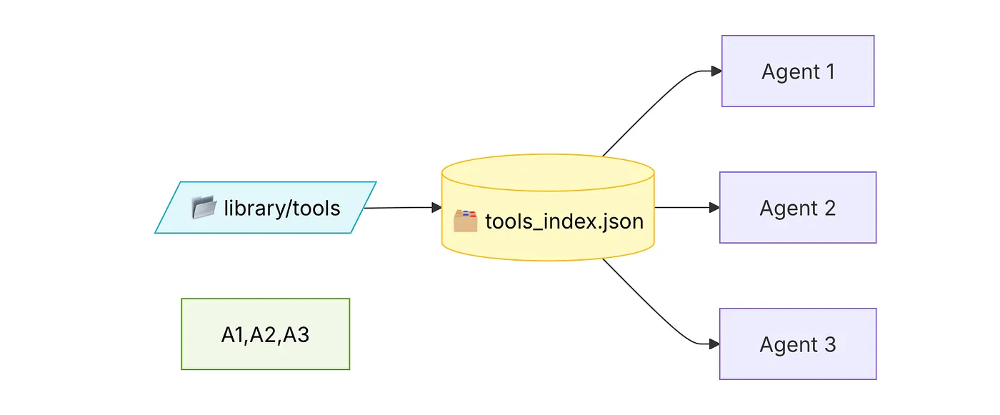
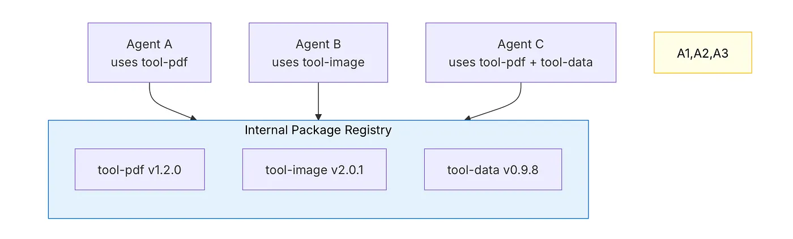
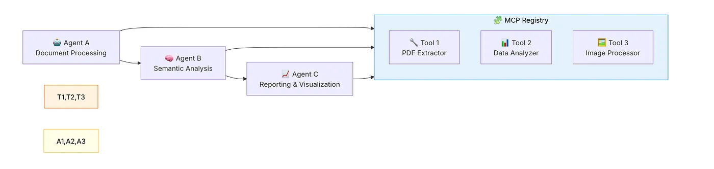

# Aufbau von AI-Agent-Infrastruktur: Drei Wege vom Chaos zu skalierbaren Systemen

Wie man von einem unübersichtlichen KI-Monorepo zu einem skalierbaren Agenten-Ökosystem gelangt — mit realen Beispielen, drei Architekturpfaden und Erfahrungen aus dem Aufbau von Multi-Agent-Infrastrukturen.

*25. Oktober 2025*

---

Mein Name ist **Mykhailo Kapustin**, Co-Founder & CTO bei ASRP (Advanced Scientific Research Projects). Dieser Artikel entstand gemeinsam mit **Kyryl Zmiienko, Senior Artificial Intelligence Engineer (AI/ML) bei ASRP**, dessen Rat und technische Vision eine zentrale Rolle bei der Ausarbeitung der vorgeschlagenen Lösungen spielten.

## Das Problem

Vor Kurzem wandte sich ein Kunde mit einer vertrauten Herausforderung an ASRP. Über Jahre der Arbeit im deutschen Markt hatte das Unternehmen eine umfangreiche Sammlung interner Werkzeuge entwickelt — von Bibliotheken für PDF-Verarbeitung, Bild- und Datenverarbeitung bis hin zu Automatisierungs- und Analysesystemen. Das Team setzte zunehmend Agententechnologien ein und wollte diese Werkzeuge KI-Agenten als kombinierbare Module zur Verfügung stellen.

Für einen schnellen Start erstellte der Kunde ein einziges großes **Monorepo**, das sowohl Agenten als auch Tools enthielt. Agenten konnten lokal kommunizieren und Tools aus benachbarten Verzeichnissen verwenden. Beim Erstellen eines neuen Agenten wurden die benötigten Tools einfach in dessen Verzeichnis kopiert.


*Abb. 1. Ausgangsarchitektur des Systems: Agenten und Tools in einem einzigen Monorepository*

Dieser Ansatz skaliert nicht:

1. Kein **einheitliches Tool-Registry** — keine Möglichkeit zu sehen, welche Tools existieren
2. Kein **Agentenverzeichnis** — jeder Agent lebte isoliert
3. Neue Agenten erforderten **ständiges Kopieren von Code**, wodurch das Repo aufblähte
4. Keine **Versionskontrolle** für Tools — Wartung und Weiterentwicklung wurden schwierig

## Drei Architekturpfade

Nach einer detaillierten Analyse der Daten und Projektstruktur des Kunden entwickelte ich drei strategische Entwicklungslinien:


*Abb. 2. Zielarchitektur: zentrale Verwaltung von Agenten und Tools*

### Pfad 1: Filesystem Registry mit Lazy Loading

Ein leichter, schneller Weg, um das bestehende Monorepo zu stabilisieren. Automatische Tool-Indizierung mit einem manuellen Manifest ermöglicht schnelle Updates und bereitet das System auf künftiges Wachstum vor.

```
project_root/
├── agents/
│   ├── researcher/
│   │   ├── main.py
│   │   └── config.yaml
│   └── summarizer/
│       └── main.py
├── tools/
│   ├── extract_pdf.py
│   ├── search_web.py
│   └── system_file.py
└── registries/
    ├── tool_registry.py
    └── agent_registry.py
```

**Einfaches Beispiel für eine Tool Registry:**

```python
from pathlib import Path
import importlib.util, json

class ToolRegistry:
    def __init__(self, path="tools", cache=".cache/tools_index.json"):
        self.path = Path(path)
        self.cache = Path(cache)
        self.index = {}

    def scan(self):
        tools = {}
        for file in self.path.glob("*.py"):
            name = file.stem
            tools[name] = {"file_path": str(file), "mtime": file.stat().st_mtime}
        self.index = tools
        self.cache.parent.mkdir(parents=True, exist_ok=True)
        json.dump({"tools": tools}, open(self.cache, "w"), indent=2)
        return tools

    def load(self, tool_name):
        entry = self.index.get(tool_name)
        if not entry:
            raise KeyError(f"Tool {tool_name} not found")
        spec = importlib.util.spec_from_file_location(tool_name, entry["file_path"])
        module = importlib.util.module_from_spec(spec)
        spec.loader.exec_module(module)
        return module
```

Agenten können nun nur das laden, was sie benötigen:

```python
from registries.tool_registry import ToolRegistry

registry = ToolRegistry()
registry.scan()
pdf_tool = registry.load("extract_pdf")
pdf_tool.run("document.pdf")
```


*Abb. 5. Die Filesystem Registry ist eine schnelle, temporäre Lösung, die Tools lokal zentralisiert — ihr fehlen jedoch echte Versionskontrolle und langfristige Skalierbarkeit.*

**Vorteile:** Kein CI/CD nötig, funktioniert sofort für lokale Setups und Piloten.  
**Nachteile:** Minimale Versionskontrolle — ein Tool-Update betrifft sofort alle Agenten; Rollback ist manuell.

### Pfad 2: Package Manager & modulares Tool-Ökosystem

Tools werden zu **Paketen** — unabhängigen Modulen mit eigener Version, Dokumentation und eigenem Lebenszyklus. Statt endlosem Kopieren werden Tools in domänenspezifische Pakete (`pdf-toolset`, `image-processing`, `data-analysis`) ausgelagert und über einen internen Package Manager angebunden.

Jeder Agent erhält eine Konfigurationsdatei (`package.json` oder `requirements.txt`), die seine Abhängigkeiten deklariert. Bei der Initialisierung zieht der Agent die exakten Versionen aus der internen Package Registry.


*Abb. 4. Das modulare Tool-Ökosystem gibt jedem Agenten eine eigene Abhängigkeitsliste und Versionskontrolle über einen internen Package Manager.*

**Vorteile:**
- Ende von Codeduplizierung und manuellen Updates
- Transparente Abhängigkeiten und Versionskontrolle
- Geringeres Risiko unvorhersehbarer Brüche
- Architektonische Flexibilität für schrittweise Weiterentwicklung

**Nachteile:** Erfordert echte Engineering-Arbeit — Tools extrahieren, interne Registry einrichten, CI/CD aktualisieren, Agenten anpassen.

### Pfad 3: AgentOps-Infrastruktur (MCP & A2A)

Die höchste Reifestufe — Agenten arbeiten nicht als Module innerhalb eines Monolithen, sondern als **autonome Services**, die über offene Standards kommunizieren.

**MCP (Model Context Protocol):** Offener Standard, der LLMs und Agenten erlaubt, sich mit externen Datenquellen, Tools und APIs zu verbinden. Ein einheitliches Format für die Kommunikation zwischen Agenten und Tools.

**A2A (Agent-to-Agent):** Ermöglicht Agenten, zu interagieren und zusammenzuarbeiten — Aufgaben zu delegieren, gemeinsame Handlungsketten aufzubauen und sogar mit Agenten zu arbeiten, die auf anderen Frameworks basieren.


*Abb. 3. Die AgentOps-Infrastruktur vereinheitlicht Agenten und Tools: Agenten verbinden sich mit der MCP Registry, um auf gemeinsame Tools zuzugreifen, und interagieren über A2A-Protokolle miteinander. So entsteht ein dynamisches, vernetztes Ökosystem.*

**Vorteile:**
- Kein Zwang, alles in einem Monolithen zu halten
- Unabhängige Teams pro Agent oder Geschäftsdomäne
- Einfache Modell- und Tool-Versionierung mit Rollbacks
- Echte Skalierbarkeit — eine mikroserviceartige Architektur
- Unternehmensübergreifende Integration möglich

**Nachteile:** Erfordert DevOps-Praktiken, CI/CD, Containerisierung und Orchestrierungssysteme.

## Fazit

Jedes Agenten-Ökosystem durchläuft drei Stufen:

1. **Filesystem Registry** — gut für MVP
2. **Package Manager** — kontrollierte Ordnung mit Modulen, Registries und Versionen (MLP)
3. **AgentOps (MCP & A2A)** — intelligente Infrastruktur, in der Agenten skalierbare, interagierende Services sind (Enterprise)

AgentOps ist kein Schlagwort — es ist der natürliche Endpunkt der Systemreife. Unternehmen, die dieses Niveau erreichen, schaffen nicht nur beherrschbaren Code, sondern ein **KI-Ökosystem**, in dem Agenten mit dem Geschäft wachsen.

---

*Mykhailo Kapustin, Co-Founder & CTO bei ASRP*  
*Kyryl Zmiienko, Senior AI/ML Engineer bei ASRP*

---

### Quellen

- [Original article on Arcanum12th](https://arcanum12th.education/ru/documents/529d51a0-5d82-4b3f-b8ea-7ea06c9955f0)
- [MCP Specification](https://modelcontextprotocol.io/)
- [A2A Protocol](https://github.com/google/A2A)
