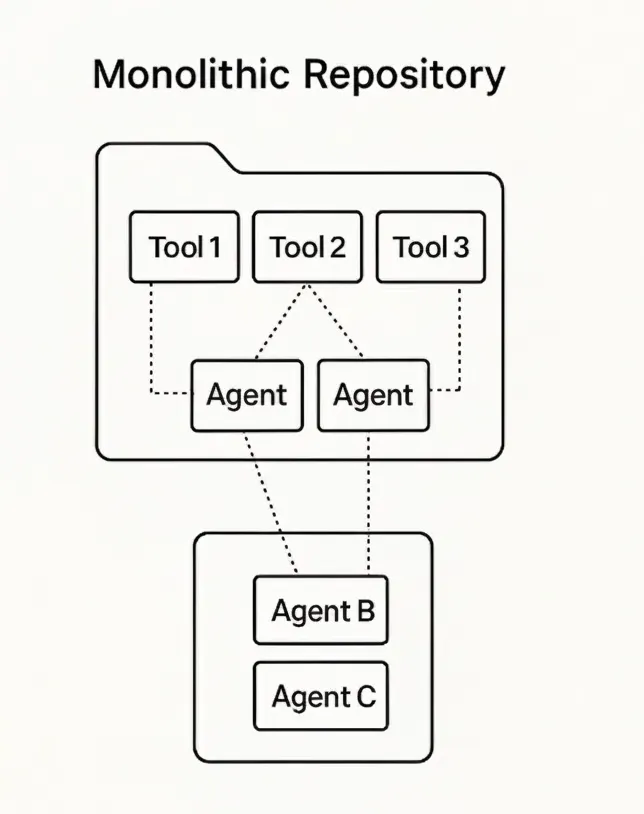
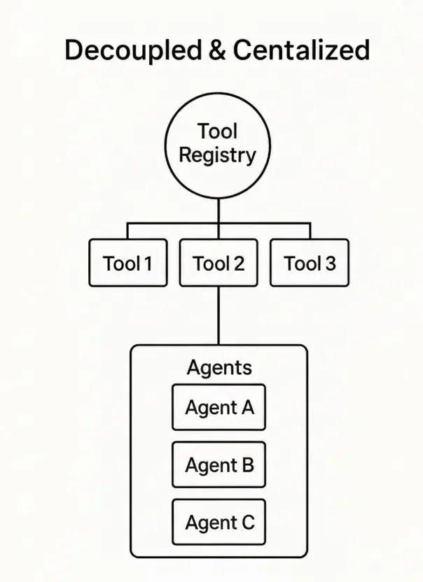
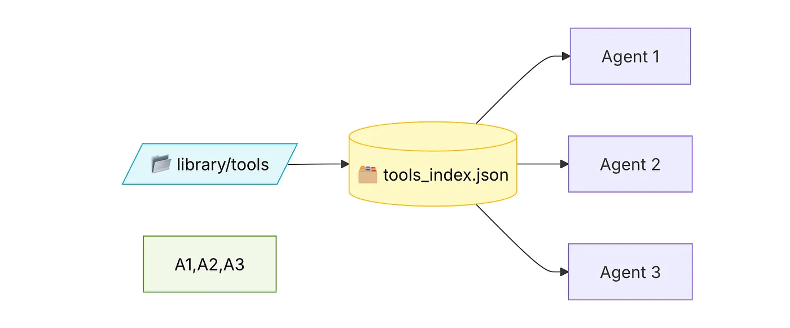
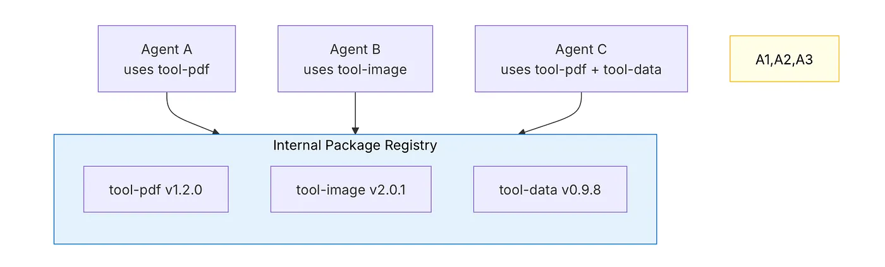
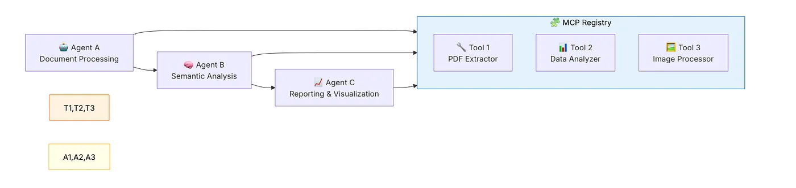

# Construir infraestructura para agentes de IA: tres caminos del caos a sistemas escalables

Cómo pasar de un monorepo de IA desordenado a un ecosistema de agentes escalable, con ejemplos reales, tres caminos arquitectónicos y lecciones aprendidas al construir infraestructuras multiagente.

*25 de octubre de 2025*

---

Mi nombre es **Mykhailo Kapustin**, Co-Founder & CTO en ASRP (Advanced Scientific Research Projects). Este artículo fue coescrito con **Kyryl Zmiienko, Senior Artificial Intelligence Engineer (AI/ML) en ASRP**, cuyo consejo y visión técnica desempeñaron un papel clave en la formación de las soluciones propuestas.

## El problema

Hace poco, un cliente se acercó a ASRP con un desafío familiar. Durante años de trabajo en el mercado alemán, había desarrollado un amplio conjunto de herramientas internas: desde bibliotecas para procesamiento de PDF, manejo de imágenes y datos hasta sistemas de automatización y análisis. Su equipo estaba adoptando activamente tecnologías de agentes y quería poner estas herramientas a disposición de agentes de IA como módulos componibles.

Para empezar rápido, el cliente creó un único **monorepo** grande que contenía tanto agentes como herramientas. Los agentes podían comunicarse localmente y usar herramientas de directorios vecinos. Al crear un nuevo agente, simplemente copiaban las herramientas necesarias en su directorio.


*Fig. 1. Arquitectura inicial del sistema: agentes y herramientas dentro de un único monorepositorio*

Este enfoque no escala:

1. No hay **registro unificado de herramientas**: no existe una forma de ver qué herramientas hay
2. No hay **directorio de agentes**: cada agente vivía aislado
3. Los nuevos agentes requerían **copiado constante de código**, inflando el repositorio
4. No hay **control de versiones** para las herramientas: mantenimiento y evolución difíciles

## Tres caminos arquitectónicos

Después de un análisis detallado de los datos y la estructura del proyecto del cliente, desarrollé tres líneas estratégicas de desarrollo:


*Fig. 2. Arquitectura objetivo: gestión centralizada de agentes y herramientas*

### Camino 1: Filesystem Registry con Lazy Loading

Un camino ligero y rápido para estabilizar el monorepo existente. La indexación automática de herramientas con un manifiesto manual permite actualizaciones rápidas y prepara el sistema para el crecimiento futuro.

```
project_root/
├── agents/
│   ├── researcher/
│   │   ├── main.py
│   │   └── config.yaml
│   └── summarizer/
│       └── main.py
├── tools/
│   ├── extract_pdf.py
│   ├── search_web.py
│   └── system_file.py
└── registries/
    ├── tool_registry.py
    └── agent_registry.py
```

**Ejemplo simple de Tool Registry:**

```python
from pathlib import Path
import importlib.util, json

class ToolRegistry:
    def __init__(self, path="tools", cache=".cache/tools_index.json"):
        self.path = Path(path)
        self.cache = Path(cache)
        self.index = {}

    def scan(self):
        tools = {}
        for file in self.path.glob("*.py"):
            name = file.stem
            tools[name] = {"file_path": str(file), "mtime": file.stat().st_mtime}
        self.index = tools
        self.cache.parent.mkdir(parents=True, exist_ok=True)
        json.dump({"tools": tools}, open(self.cache, "w"), indent=2)
        return tools

    def load(self, tool_name):
        entry = self.index.get(tool_name)
        if not entry:
            raise KeyError(f"Tool {tool_name} not found")
        spec = importlib.util.spec_from_file_location(tool_name, entry["file_path"])
        module = importlib.util.module_from_spec(spec)
        spec.loader.exec_module(module)
        return module
```

Ahora los agentes pueden cargar solo lo que necesitan:

```python
from registries.tool_registry import ToolRegistry

registry = ToolRegistry()
registry.scan()
pdf_tool = registry.load("extract_pdf")
pdf_tool.run("document.pdf")
```


*Fig. 5. El filesystem registry es una solución rápida y temporal que centraliza herramientas localmente, pero carece de control de versiones adecuado y escalabilidad a largo plazo.*

**Ventajas:** No necesita CI/CD, funciona de inmediato para entornos locales y pilotos.  
**Desventajas:** Control de versiones mínimo: actualizar una herramienta afecta instantáneamente a todos los agentes; el rollback es manual.

### Camino 2: Package Manager y ecosistema modular de herramientas

Las herramientas se convierten en **paquetes**: módulos independientes con su propia versión, documentación y ciclo de vida. En lugar de copiar sin fin, las herramientas se extraen a paquetes específicos por dominio (`pdf-toolset`, `image-processing`, `data-analysis`) y se conectan mediante un package manager interno.

Cada agente obtiene un archivo de configuración (`package.json` o `requirements.txt`) que declara sus dependencias. Al inicializarse, el agente toma las versiones exactas desde el registro interno de paquetes.


*Fig. 4. El ecosistema modular de herramientas da a cada agente su propia lista de dependencias y control de versiones mediante un package manager interno.*

**Ventajas:**
- Fin de la duplicación de código y de las actualizaciones manuales
- Dependencias transparentes y control de versiones
- Menor riesgo de roturas impredecibles
- Flexibilidad arquitectónica para una evolución por fases

**Desventajas:** Requiere trabajo real de ingeniería: extraer herramientas, configurar un registro interno, actualizar CI/CD y adaptar agentes.

### Camino 3: Infraestructura AgentOps (MCP & A2A)

El nivel de madurez más alto: los agentes no operan como módulos dentro de un monolito, sino como **servicios autónomos** que se comunican mediante estándares abiertos.

**MCP (Model Context Protocol):** estándar abierto que permite a LLMs y agentes conectarse con fuentes de datos externas, herramientas y APIs. Un formato unificado para la comunicación agente-herramienta.

**A2A (Agent-to-Agent):** permite que los agentes interactúen y colaboren: delegar tareas, construir cadenas de acciones conjuntas e incluso trabajar con agentes creados sobre frameworks distintos.


*Fig. 3. La infraestructura AgentOps unifica agentes y herramientas: los agentes se conectan al MCP Registry para acceder a herramientas compartidas e interactúan entre sí mediante protocolos A2A, formando un ecosistema dinámico e interconectado.*

**Ventajas:**
- No hace falta mantenerlo todo en un solo monolito
- Equipos independientes por agente o dominio de negocio
- Versionado sencillo de modelos y herramientas con rollbacks
- Escalabilidad real: arquitectura similar a microservicios
- Posible integración entre empresas

**Desventajas:** Requiere prácticas DevOps, CI/CD, contenerización y sistemas de orquestación.

## Conclusión

Todo ecosistema de agentes pasa por tres etapas:

1. **Filesystem Registry**: bueno para un MVP
2. **Package Manager**: orden controlado con módulos, registros y versiones (MLP)
3. **AgentOps (MCP & A2A)**: infraestructura inteligente donde los agentes son servicios escalables e interactivos (Enterprise)

AgentOps no es una palabra de moda: es el punto final natural de la madurez del sistema. Las empresas que alcanzan este nivel crean no solo código manejable, sino un **ecosistema de IA** donde los agentes crecen junto con el negocio.

---

*Mykhailo Kapustin, Co-Founder & CTO en ASRP*  
*Kyryl Zmiienko, Senior AI/ML Engineer en ASRP*

---

### Fuentes

- [Original article on Arcanum12th](https://arcanum12th.education/ru/documents/529d51a0-5d82-4b3f-b8ea-7ea06c9955f0)
- [MCP Specification](https://modelcontextprotocol.io/)
- [A2A Protocol](https://github.com/google/A2A)
