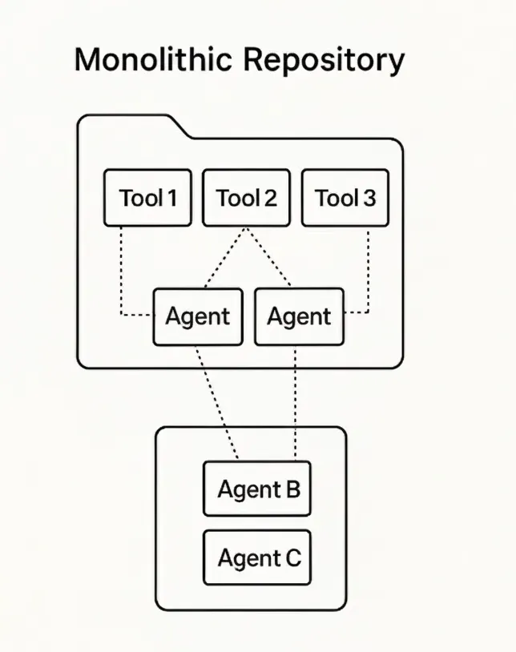
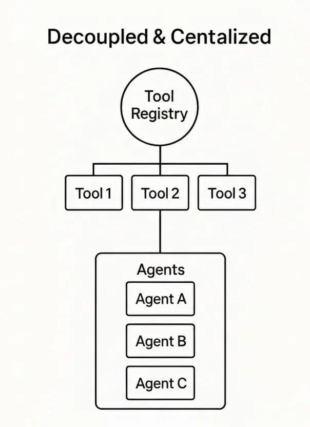
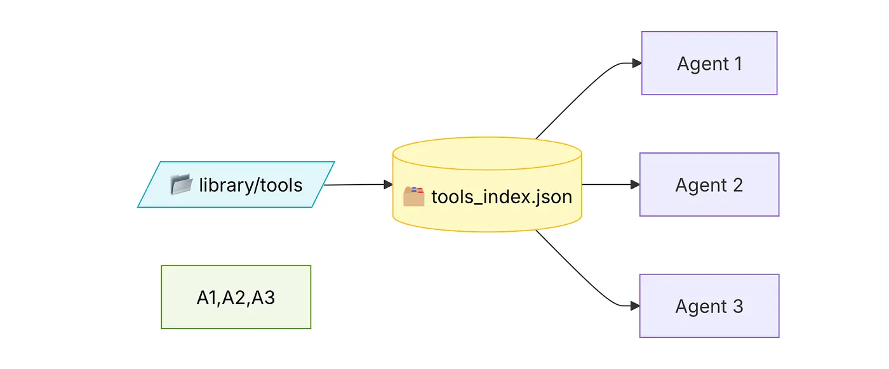
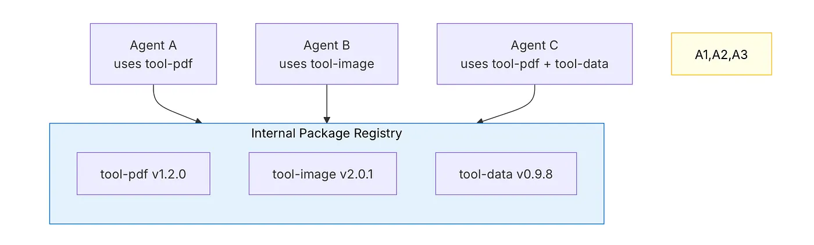
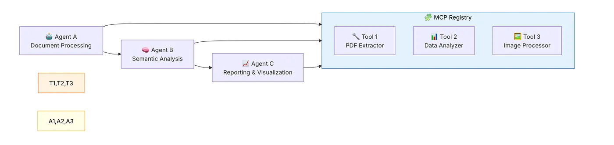

# Построение инфраструктуры AI-агентов: три пути от хаоса к масштабируемым системам

Как перейти от запутанного AI-монорепозитория к масштабируемой экосистеме агентов — с реальными примерами, тремя архитектурными путями и выводами из практики построения многоагентных инфраструктур.

*25 октября 2025*

---

Меня зовут **Mykhailo Kapustin**, я Co-Founder & CTO в ASRP (Advanced Scientific Research Projects). Эта статья написана в соавторстве с **Kyryl Zmiienko, Senior Artificial Intelligence Engineer (AI/ML) в ASRP**, чьи советы и техническое видение сыграли ключевую роль в формировании предложенных решений.

## Проблема

Недавно к ASRP обратился клиент с хорошо знакомой задачей. За годы работы на немецком рынке у него сформировался большой набор внутренних инструментов — от библиотек для обработки PDF, изображений и данных до систем автоматизации и аналитики. Команда активно внедряла агентные технологии и хотела сделать эти инструменты доступными для AI-агентов как переиспользуемые модули.

Для быстрого старта клиент создал один большой **монорепозиторий**, в котором находились и агенты, и инструменты. Агенты могли локально взаимодействовать друг с другом и использовать инструменты из соседних директорий. При создании нового агента нужные инструменты просто копировались в его папку.


*Рис. 1. Начальная архитектура системы: агенты и инструменты внутри одного монорепозитория*

Такой подход не масштабируется:

1. Нет **единого реестра инструментов** — невозможно быстро увидеть, какие инструменты уже существуют.
2. Нет **каталога агентов** — каждый агент живёт изолированно.
3. Новые агенты требуют **постоянного копирования кода**, из-за чего репозиторий раздувается.
4. Нет **контроля версий** для инструментов — их сложно поддерживать и развивать.

## Три архитектурных пути

После подробного анализа данных клиента и структуры проекта я выделил три стратегических направления развития:


*Рис. 2. Целевая архитектура: централизованное управление агентами и инструментами*

### Путь 1: файловый реестр с ленивой загрузкой

Лёгкий и быстрый способ стабилизировать существующий монорепозиторий. Автоматическая индексация инструментов вместе с ручным манифестом позволяет быстро обновлять систему и подготовить её к дальнейшему росту.

```
project_root/
├── agents/
│   ├── researcher/
│   │   ├── main.py
│   │   └── config.yaml
│   └── summarizer/
│       └── main.py
├── tools/
│   ├── extract_pdf.py
│   ├── search_web.py
│   └── system_file.py
└── registries/
    ├── tool_registry.py
    └── agent_registry.py
```

**Пример простого реестра инструментов:**

```python
from pathlib import Path
import importlib.util, json

class ToolRegistry:
    def __init__(self, path="tools", cache=".cache/tools_index.json"):
        self.path = Path(path)
        self.cache = Path(cache)
        self.index = {}

    def scan(self):
        tools = {}
        for file in self.path.glob("*.py"):
            name = file.stem
            tools[name] = {"file_path": str(file), "mtime": file.stat().st_mtime}
        self.index = tools
        self.cache.parent.mkdir(parents=True, exist_ok=True)
        json.dump({"tools": tools}, open(self.cache, "w"), indent=2)
        return tools

    def load(self, tool_name):
        entry = self.index.get(tool_name)
        if not entry:
            raise KeyError(f"Tool {tool_name} not found")
        spec = importlib.util.spec_from_file_location(tool_name, entry["file_path"])
        module = importlib.util.module_from_spec(spec)
        spec.loader.exec_module(module)
        return module
```

Теперь агенты могут загружать только то, что им действительно нужно:

```python
from registries.tool_registry import ToolRegistry

registry = ToolRegistry()
registry.scan()
pdf_tool = registry.load("extract_pdf")
pdf_tool.run("document.pdf")
```


*Рис. 5. Файловый реестр — быстрый временный способ централизовать инструменты локально. Но ему не хватает полноценного контроля версий и долгосрочной масштабируемости.*

**Плюсы:** не нужен CI/CD, работает сразу в локальных окружениях и пилотных проектах.  
**Минусы:** минимальный контроль версий — обновление инструмента сразу влияет на всех агентов; откат выполняется вручную.

### Путь 2: пакетный менеджер и модульная экосистема инструментов

Инструменты становятся **пакетами** — независимыми модулями со своей версией, документацией и жизненным циклом. Вместо бесконечного копирования инструменты выносятся в предметные пакеты (`pdf-toolset`, `image-processing`, `data-analysis`) и подключаются через внутренний пакетный менеджер.

Каждый агент получает конфигурационный файл (`package.json` или `requirements.txt`), где объявлены его зависимости. При инициализации агент забирает точные версии из внутреннего реестра пакетов.


*Рис. 4. Модульная экосистема инструментов даёт каждому агенту собственный список зависимостей и контроль версий через внутренний пакетный менеджер.*

**Плюсы:**
- Конец дублированию кода и ручным обновлениям.
- Прозрачные зависимости и контроль версий.
- Меньше риск непредсказуемых поломок.
- Архитектурная гибкость для поэтапного развития.

**Минусы:** требуется настоящая инженерная работа — выделение инструментов, настройка внутреннего реестра, обновление CI/CD, адаптация агентов.

### Путь 3: AgentOps-инфраструктура (MCP и A2A)

Самый высокий уровень зрелости: агенты работают не как модули внутри монолита, а как **автономные сервисы**, которые взаимодействуют через открытые стандарты.

**MCP (Model Context Protocol):** открытый стандарт, который позволяет LLM и агентам подключаться к внешним источникам данных, инструментам и API. Это единый формат коммуникации между агентами и инструментами.

**A2A (Agent-to-Agent):** позволяет агентам взаимодействовать и сотрудничать — делегировать задачи, строить совместные цепочки действий и даже работать с агентами, созданными на разных фреймворках.


*Рис. 3. AgentOps-инфраструктура объединяет агентов и инструменты: агенты подключаются к MCP Registry для доступа к общим инструментам и взаимодействуют друг с другом через A2A-протоколы, формируя динамичную связанную экосистему.*

**Плюсы:**
- Не нужно держать всё в одном монолите.
- Независимые команды для отдельных агентов или бизнес-доменов.
- Простое версионирование моделей и инструментов с откатами.
- Настоящая масштабируемость — архитектура, похожая на микросервисы.
- Возможна интеграция между компаниями.

**Минусы:** нужны DevOps-практики, CI/CD, контейнеризация и системы оркестрации.

## Заключение

Каждая агентная экосистема проходит через три стадии:

1. **Filesystem Registry** — хороший вариант для MVP.
2. **Package Manager** — управляемый порядок с модулями, реестрами и версиями (MLP).
3. **AgentOps (MCP и A2A)** — интеллектуальная инфраструктура, где агенты являются масштабируемыми взаимодействующими сервисами (Enterprise).

AgentOps — не модное слово, а естественная конечная точка зрелости системы. Компании, которые доходят до этого уровня, создают не просто управляемый код, а **AI-экосистему**, в которой агенты растут вместе с бизнесом.

---

*Mykhailo Kapustin, Co-Founder & CTO в ASRP*  
*Kyryl Zmiienko, Senior AI/ML Engineer в ASRP*

---

### Источники

- [Оригинальная статья на Arcanum12th](https://arcanum12th.education/ru/documents/529d51a0-5d82-4b3f-b8ea-7ea06c9955f0)
- [MCP Specification](https://modelcontextprotocol.io/)
- [A2A Protocol](https://github.com/google/A2A)
