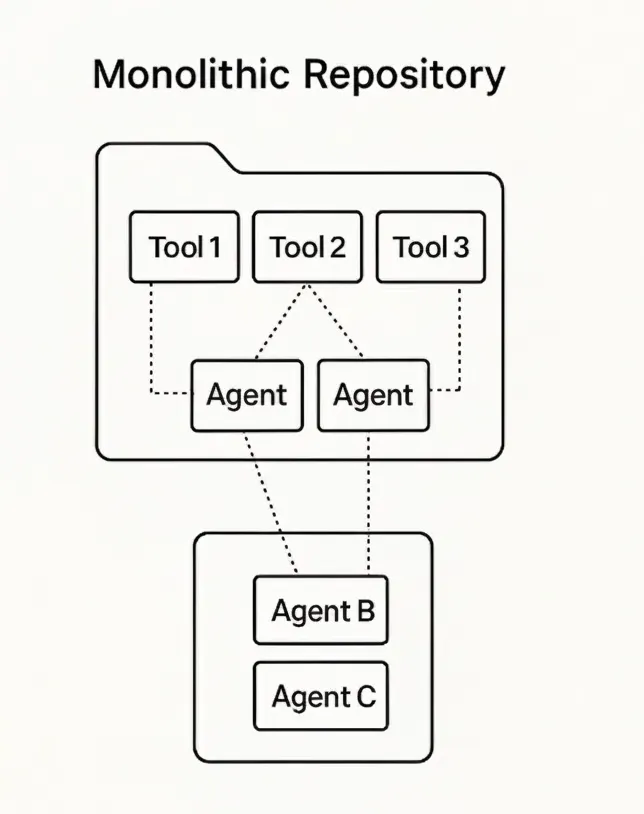
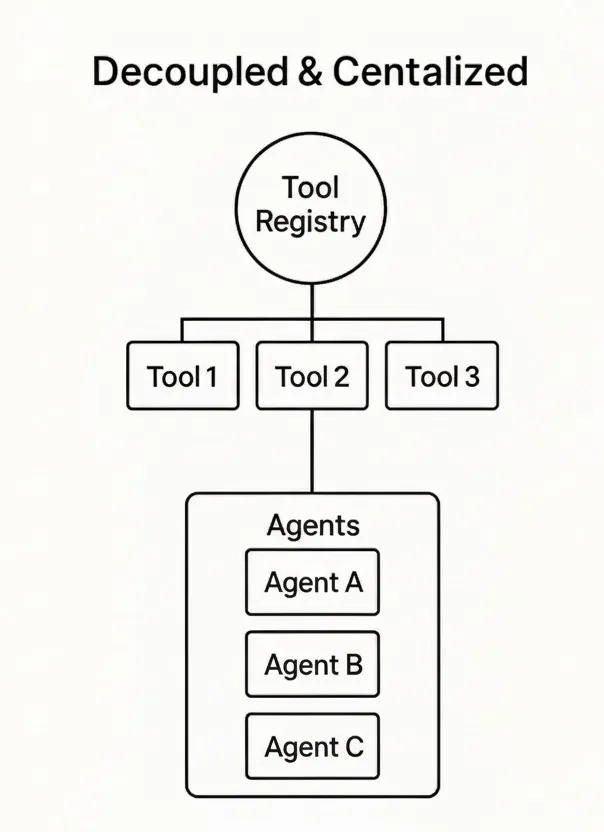
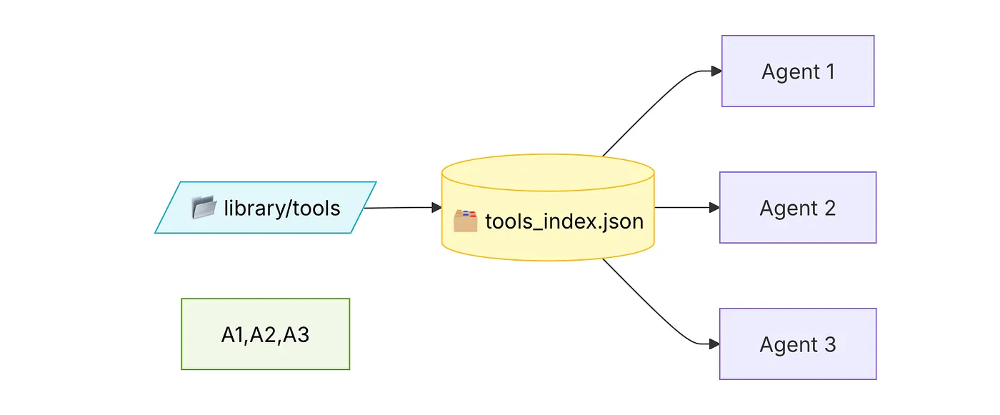
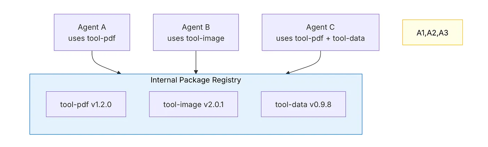
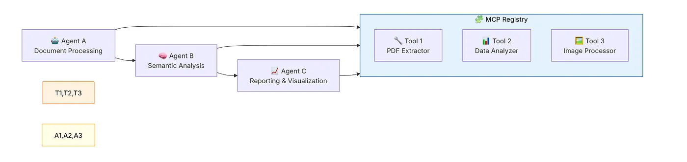

# Побудова інфраструктури AI-агентів: три шляхи від хаосу до масштабованих систем

Як перейти від заплутаного AI-монорепозиторію до масштабованої екосистеми агентів — з реальними прикладами, трьома архітектурними шляхами та висновками з практики побудови багатоагентних інфраструктур.

*25 жовтня 2025*

---

Мене звати **Mykhailo Kapustin**, я Co-Founder & CTO в ASRP (Advanced Scientific Research Projects). Цю статтю написано у співавторстві з **Kyryl Zmiienko, Senior Artificial Intelligence Engineer (AI/ML) в ASRP**, чиї поради й технічне бачення відіграли ключову роль у формуванні запропонованих рішень.

## Проблема

Нещодавно до ASRP звернувся клієнт із добре знайомим завданням. За роки роботи на німецькому ринку в нього сформувався великий набір внутрішніх інструментів — від бібліотек для обробки PDF, зображень і даних до систем автоматизації та аналітики. Команда активно впроваджувала агентні технології й хотіла зробити ці інструменти доступними для AI-агентів як перевикористовувані модулі.

Для швидкого старту клієнт створив один великий **монорепозиторій**, у якому були і агенти, і інструменти. Агенти могли локально взаємодіяти між собою та використовувати інструменти із сусідніх директорій. Під час створення нового агента потрібні інструменти просто копіювалися в його папку.


*Рис. 1. Початкова архітектура системи: агенти та інструменти всередині одного монорепозиторію*

Такий підхід не масштабується:

1. Немає **єдиного реєстру інструментів** — неможливо швидко побачити, які інструменти вже існують.
2. Немає **каталогу агентів** — кожен агент живе ізольовано.
3. Нові агенти потребують **постійного копіювання коду**, через що репозиторій розростається.
4. Немає **контролю версій** для інструментів — їх складно підтримувати й розвивати.

## Три архітектурні шляхи

Після докладного аналізу даних клієнта та структури проєкту я виділив три стратегічні напрями розвитку:


*Рис. 2. Цільова архітектура: централізоване керування агентами та інструментами*

### Шлях 1: файловий реєстр із лінивим завантаженням

Легкий і швидкий спосіб стабілізувати наявний монорепозиторій. Автоматична індексація інструментів разом із ручним маніфестом дає змогу швидко оновлювати систему й підготувати її до подальшого зростання.

```
project_root/
├── agents/
│   ├── researcher/
│   │   ├── main.py
│   │   └── config.yaml
│   └── summarizer/
│       └── main.py
├── tools/
│   ├── extract_pdf.py
│   ├── search_web.py
│   └── system_file.py
└── registries/
    ├── tool_registry.py
    └── agent_registry.py
```

**Приклад простого реєстру інструментів:**

```python
from pathlib import Path
import importlib.util, json

class ToolRegistry:
    def __init__(self, path="tools", cache=".cache/tools_index.json"):
        self.path = Path(path)
        self.cache = Path(cache)
        self.index = {}

    def scan(self):
        tools = {}
        for file in self.path.glob("*.py"):
            name = file.stem
            tools[name] = {"file_path": str(file), "mtime": file.stat().st_mtime}
        self.index = tools
        self.cache.parent.mkdir(parents=True, exist_ok=True)
        json.dump({"tools": tools}, open(self.cache, "w"), indent=2)
        return tools

    def load(self, tool_name):
        entry = self.index.get(tool_name)
        if not entry:
            raise KeyError(f"Tool {tool_name} not found")
        spec = importlib.util.spec_from_file_location(tool_name, entry["file_path"])
        module = importlib.util.module_from_spec(spec)
        spec.loader.exec_module(module)
        return module
```

Тепер агенти можуть завантажувати лише те, що їм справді потрібно:

```python
from registries.tool_registry import ToolRegistry

registry = ToolRegistry()
registry.scan()
pdf_tool = registry.load("extract_pdf")
pdf_tool.run("document.pdf")
```


*Рис. 5. Файловий реєстр — швидкий тимчасовий спосіб централізувати інструменти локально. Але йому бракує повноцінного контролю версій і довгострокової масштабованості.*

**Плюси:** не потрібен CI/CD, працює одразу в локальних середовищах і пілотних проєктах.  
**Мінуси:** мінімальний контроль версій — оновлення інструмента одразу впливає на всіх агентів; відкат виконується вручну.

### Шлях 2: пакетний менеджер і модульна екосистема інструментів

Інструменти стають **пакетами** — незалежними модулями зі своєю версією, документацією та життєвим циклом. Замість нескінченного копіювання інструменти виносяться в предметні пакети (`pdf-toolset`, `image-processing`, `data-analysis`) і підключаються через внутрішній пакетний менеджер.

Кожен агент отримує конфігураційний файл (`package.json` або `requirements.txt`), де оголошені його залежності. Під час ініціалізації агент забирає точні версії з внутрішнього реєстру пакетів.


*Рис. 4. Модульна екосистема інструментів дає кожному агенту власний список залежностей і контроль версій через внутрішній пакетний менеджер.*

**Плюси:**
- Кінець дублюванню коду та ручним оновленням.
- Прозорі залежності й контроль версій.
- Менший ризик непередбачуваних поломок.
- Архітектурна гнучкість для поетапного розвитку.

**Мінуси:** потрібна справжня інженерна робота — виділення інструментів, налаштування внутрішнього реєстру, оновлення CI/CD, адаптація агентів.

### Шлях 3: AgentOps-інфраструктура (MCP і A2A)

Найвищий рівень зрілості: агенти працюють не як модулі всередині моноліту, а як **автономні сервіси**, що взаємодіють через відкриті стандарти.

**MCP (Model Context Protocol):** відкритий стандарт, який дає змогу LLM і агентам підключатися до зовнішніх джерел даних, інструментів та API. Це єдиний формат комунікації між агентами й інструментами.

**A2A (Agent-to-Agent):** дає агентам змогу взаємодіяти й співпрацювати — делегувати задачі, будувати спільні ланцюжки дій і навіть працювати з агентами, створеними на різних фреймворках.


*Рис. 3. AgentOps-інфраструктура об'єднує агентів та інструменти: агенти підключаються до MCP Registry для доступу до спільних інструментів і взаємодіють між собою через A2A-протоколи, формуючи динамічну пов'язану екосистему.*

**Плюси:**
- Не потрібно тримати все в одному моноліті.
- Незалежні команди для окремих агентів або бізнес-доменів.
- Просте версіонування моделей та інструментів із відкатами.
- Справжня масштабованість — архітектура, схожа на мікросервіси.
- Можлива інтеграція між компаніями.

**Мінуси:** потрібні DevOps-практики, CI/CD, контейнеризація та системи оркестрації.

## Висновок

Кожна агентна екосистема проходить через три стадії:

1. **Filesystem Registry** — хороший варіант для MVP.
2. **Package Manager** — керований порядок із модулями, реєстрами та версіями (MLP).
3. **AgentOps (MCP і A2A)** — інтелектуальна інфраструктура, де агенти є масштабованими взаємодіючими сервісами (Enterprise).

AgentOps — не модне слово, а природна кінцева точка зрілості системи. Компанії, які доходять до цього рівня, створюють не просто керований код, а **AI-екосистему**, у якій агенти ростуть разом із бізнесом.

---

*Mykhailo Kapustin, Co-Founder & CTO в ASRP*  
*Kyryl Zmiienko, Senior AI/ML Engineer в ASRP*

---

### Джерела

- [Оригінальна стаття на Arcanum12th](https://arcanum12th.education/ru/documents/529d51a0-5d82-4b3f-b8ea-7ea06c9955f0)
- [MCP Specification](https://modelcontextprotocol.io/)
- [A2A Protocol](https://github.com/google/A2A)
