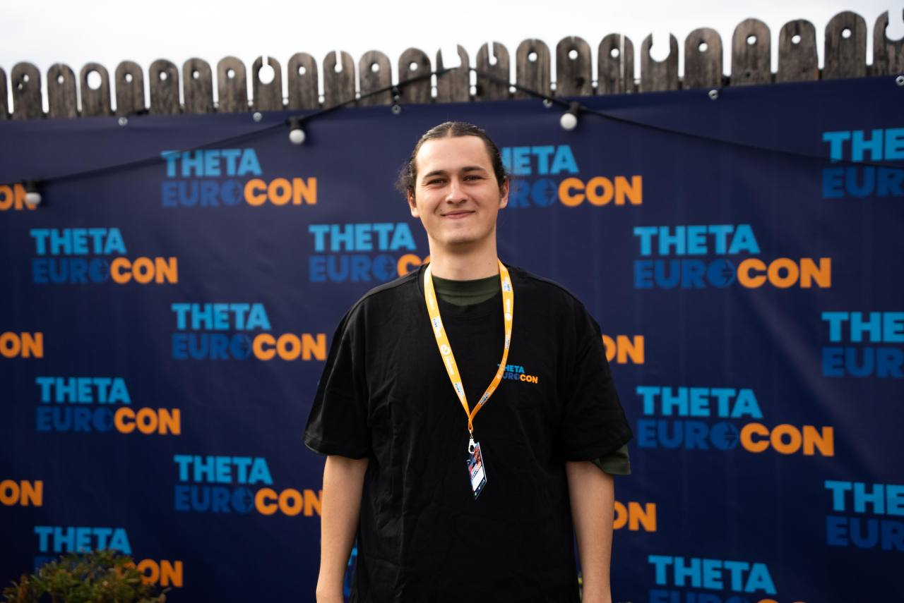
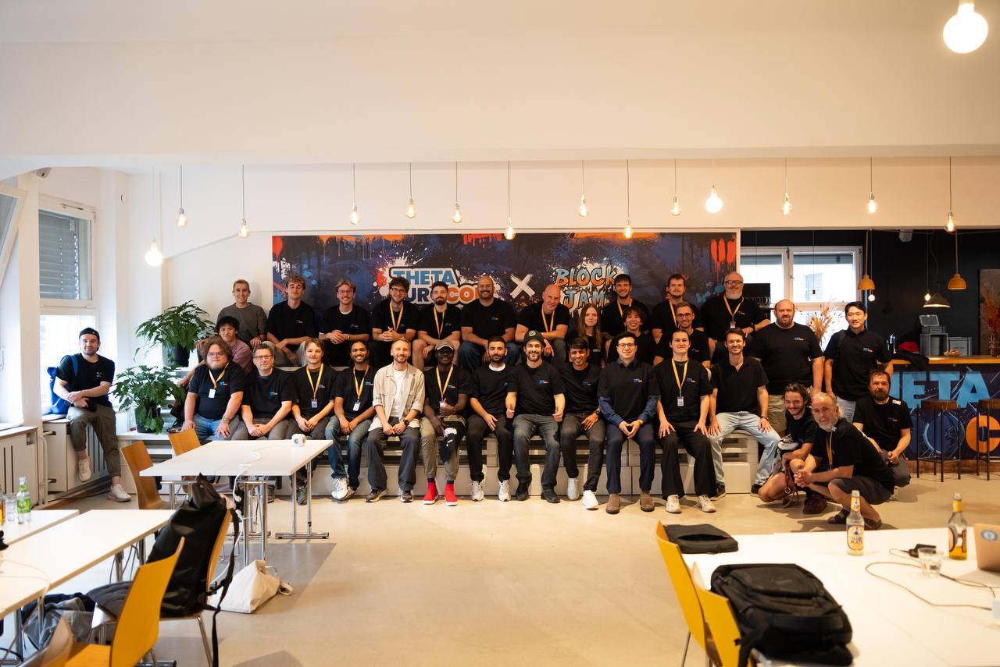
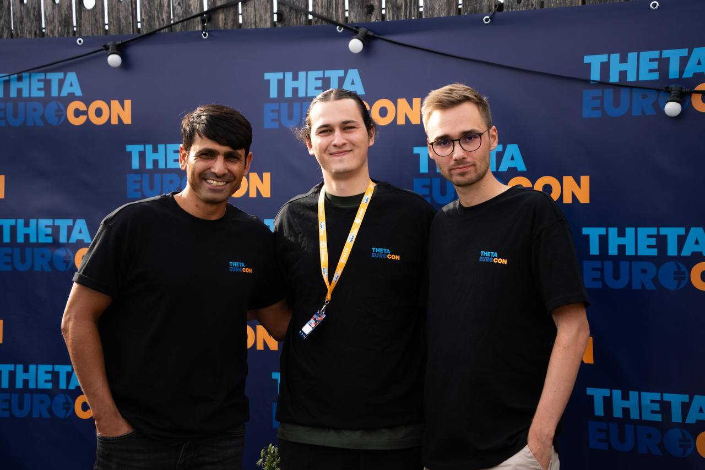
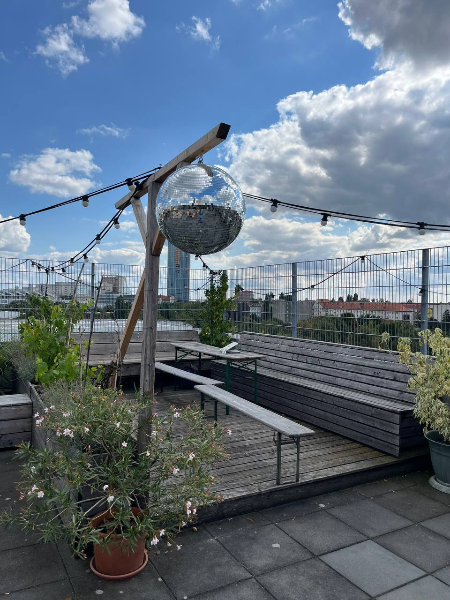

# Mein erster AI- & Blockchain-Hackathon: Aufbau des Global Forecasting System auf der Theta EuroCon in Berlin

*September 2025*

> Ein Blick hinter die Kulissen des Hackathons: Wir bauen GFS — den ersten Konkurrenten zu BlackRocks Aladdin.

Im September 2025 nahm ich an meinem ersten Hackathon teil — dem **Theta EuroCon Hackathon in Berlin** (7.–11. September 2025). Für mich und mein Team bei **Advanced Scientific Research Projects (ASRP)** war es mehr als nur ein Wettbewerb. Es war eine Gelegenheit, unsere Forschung zu präsentieren, unsere Ideen in einem dynamischen Umfeld zu validieren und mit Innovatoren in Kontakt zu treten, die an der Schnittstelle von KI und Blockchain arbeiten.

---

## Über das Team und das Projekt

ASRP ist eine Unternehmensgruppe, die vom legendären Kosmodrom Baikonur in Kasachstan bis zum Kennedy Space Center in Florida reicht. Wir bringen Spezialisten aus KI, Biomedizin, Luft- und Raumfahrttechnik, Journalismus und Wissenschaft zusammen — vereint durch eine Mission: **die Erforschung des Bewusstseins**.

Beim Hackathon stellten wir unser Produkt vor — das **Global Forecasting System (GFS)**. Dieses System analysiert Träume und Daten des kollektiven Unbewussten, gleicht sie mit Nachrichtenfeeds, Aktienkursen, anomalem Tierverhalten und sogar DEFCON-Stufen ab und erzeugt daraus Prognosen nicht nur für Finanzen, sondern auch für Geopolitik und gesellschaftliche Prozesse.

Diese Idee wurde erstmals in unserer Publikation von 2024 *"Forecasting Social, Geopolitical, and Economic Events Using the Banchenko-Technology"* beschrieben. Wir zeigten, dass ein System wie GFS zu einem ernsthaften Konkurrenten der bekannten **Aladdin**-Plattform von BlackRock werden könnte. Während Aladdin KI nutzt, um Märkte und globale Trends zu analysieren, geht GFS weiter — es bezieht Daten aus Trauminhalten, meditativen Zuständen und EEG-Biofeedback ein. Unser Ziel ist es, **kollektives Bewusstsein** nutzbar zu machen, indem Daten vieler Menschen aggregiert werden, um Signale zu extrahieren und Marktbewegungen, politische Ereignisse und gesellschaftliche Veränderungen vorherzusagen.

---

## Die Hackathon-Erfahrung

Mehrere Tage lang lebten wir in einer Atmosphäre ständiger Energie, Ideen und Experimente. Über zwanzig Teams aus aller Welt konkurrierten um die Chance, ihre Projekte zu präsentieren. Es war ein einzigartiger Raum, in dem Blockchain und KI auf Kreativität und mutige Konzepte trafen. Wir schrieben nicht nur Code — wir lernten, Aufgaben zu verteilen, einander zu vertrauen und einzelne Bausteine zu einem einheitlichen System zusammenzufügen, das die Jury beeindrucken konnte.

Besonders einzigartig wurde diese Erfahrung durch die Doppelrolle: Entwickler und Mediengesicht des Projekts. Unser Team war das einzige, das täglich TikTok-Updates, Tagesrückblicke, Interviews mit Co-Foundern und Pläne für den nächsten Tag aufnahm. Dadurch konnten wir unsere Arbeit in Echtzeit zeigen und eine Atmosphäre der Offenheit rund um das Projekt schaffen.

> Interview mit den Co-Foundern der Theta EuroCon während einer kurzen Pause. Ihre Einblicke gaben meinen täglichen Updates zusätzliche Tiefe.

Auch die kleinen Dinge hinterließen Eindruck: Wir wurden dreimal am Tag gut versorgt, und ich verbrachte einen Teil meiner Arbeit auf dem Dach neben einer Discokugel — eine Atmosphäre, die Fokus und Inspiration perfekt verband.

---

## Was wir in fünf Tagen gebaut haben

Während des Hackathons verwandelte unser Team eine Idee in einen funktionierenden Prototyp mit zwei zentralen Versionen:

- **Web Interface** (Andrii Kryliuk) — Visualisierung von Prognosen, Tickern und Ereignissen für die interaktive Datenexploration
- **Telegram Bot** (Oleksandr Hromyko) — ein bequemes Werkzeug zum Einreichen von Träumen sowie zum direkten Empfangen von Interpretationen und Prognosen im Messenger

Parallel dazu bauten wir den Kern des Systems: ein **KI-Modell, das Träume analysiert**, nach ähnlichen Narrativen bei verschiedenen Nutzern sucht und Schlüsselereignisse extrahiert. Anschließend ordnet das System diese Ereignisse potenziellen Wirkungsbereichen zu — Wirtschaft, Geopolitik oder gesellschaftlichen Sphären. Es identifiziert, welche Branchen betroffen sein könnten, und sucht innerhalb dieser Branchen nach konkreten Aktientickern und Unternehmen.

Danach ergänzten wir eine **Mediensuche**: Das Modell prüft, ob Nachrichtenmedien über Ereignisse berichten, die darauf hindeuten, dass Trauminhalte in der Realität manifest werden. Diese mehrschichtige Analyse verbindet subjektive Daten mit objektiven Informationsströmen, um frühe Prognosen zu erstellen.

Besonderer Dank gilt **Kyryl Zmiienko**, der die Logik für die Zuordnung von Branchen zu Märkten stärkte. Gemeinsam mit **Denis Banchenko** und **Valeri Ovseannicova** integrierte ich Forschungsergebnisse und den **Kapustin Markers Algorithm**, der Übereinstimmungen in Traummustern erkennt und verborgene Korrelationen sichtbar macht.

---

## Präsentation und Reaktion

Am 11. September zeigten wir auf der Bühne das erste Demovideo des Systems. Unsere Idee stieß auf echtes Interesse — das Publikum hörte aufmerksam zu, und viele kamen danach mit Fragen und dem Wunsch, mehr zu erfahren, auf uns zu.

> Das Team präsentiert den GFS-Prototyp auf der Bühne der Theta EuroCon.

**Oleksandr Hromyko** sagte:

> Am meisten mochte ich die Hackathon-Atmosphäre — das Gefühl, dass so viele Menschen um uns herum eigene Projekte hatten und wir um das beste Ergebnis konkurrierten. Das Format mit engen Fristen und Wettbewerb war anspruchsvoll, aber unglaublich spannend. Dank dieses Events sahen wir uns selbst aus verschiedenen Perspektiven und wurden als Team noch stärker.

**Kyryl Zmiienko** ergänzte:

> Die Atmosphäre des Hackathons hat mich unglaublich inspiriert. Zusammenhalt, ein ständiger Strom von Ideen — das gab mir immer wieder Energie und machte Lust, etwas wirklich Großes zu bauen!

**Andrii Kryliuk** reflektierte:

> Die Teilnahme am Hackathon war eine wertvolle Erfahrung und eine echte Herausforderung. Unter Zeitdruck musste ich schnell denken, Entscheidungen treffen und verschiedene Ansätze ausprobieren. Teamarbeit, gegenseitige Unterstützung und gemeinsames Entwickeln von Ideen waren besonders wichtig. Diese Erfahrung brachte mich über meine gewohnten Grenzen hinaus und ließ mich wirklich inspiriert zurück.

---

## Fazit

Für mich verkörperte dieser Hackathon Entschlossenheit, Widerstandskraft, inneres Feuer und eine gewisse Kühnheit, uns zu beweisen. Es gab viele Hindernisse, aber wir bündelten die kollektive Energie und Unterstützung, um auf die Bühne zu gehen und anzutreten.

In fünf Tagen bauten wir nicht nur die ersten funktionierenden Versionen des **Global Forecasting System (GFS)**, sondern bestätigten auch, dass unsere Idee Menschen erreichen, echtes Interesse auslösen und Dynamik erzeugen kann.

Wir bewiesen, dass ein Team selbst über Distanzen hinweg als Einheit funktionieren kann, unzählige Hindernisse überwindet und dabei Entschlossenheit und inneres Feuer bewahrt. Für einen ersten Hackathon war das eine enorme Erfahrung — eine Kombination aus technischen Herausforderungen, wissenschaftlichen Ideen und Medienarbeit, die uns auf ein neues Niveau hob.

---

[← Back to articles](../README.md)
