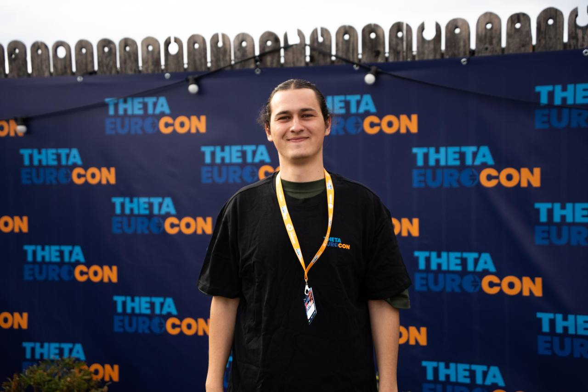
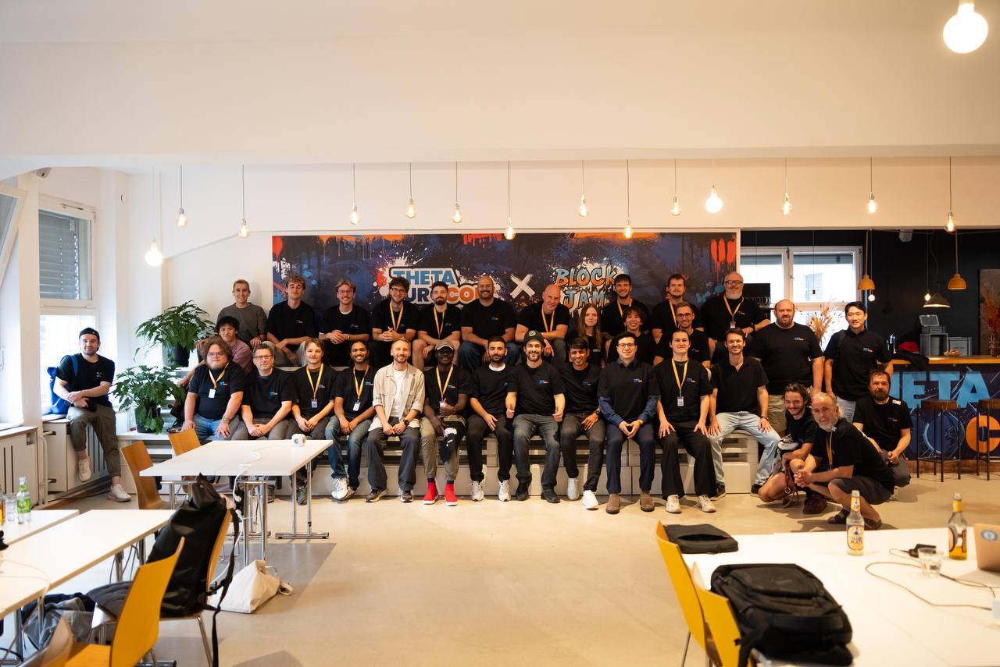
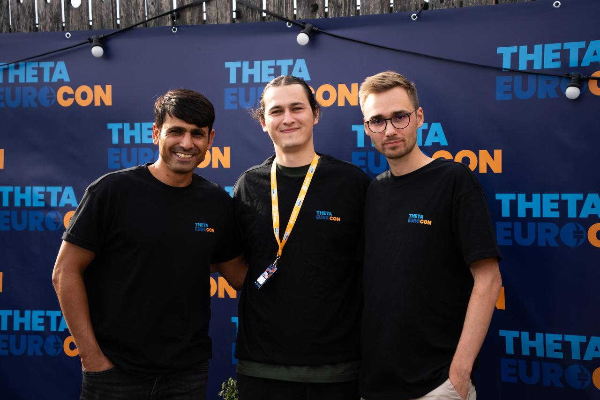
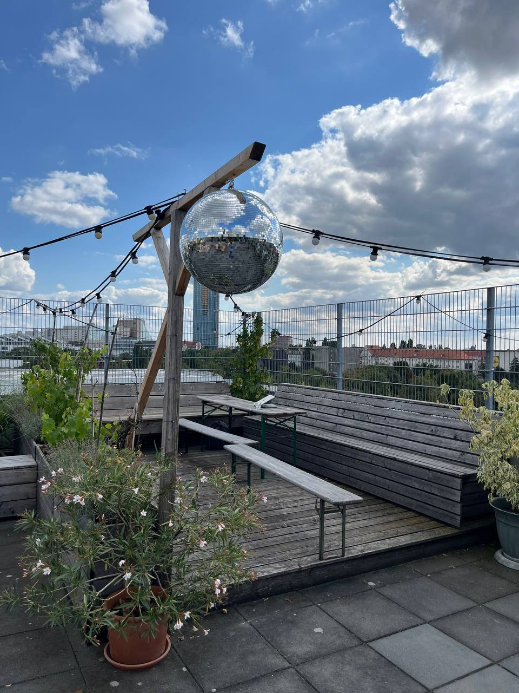

# Mi primer hackathon de IA y blockchain: construyendo el Global Forecasting System en Theta EuroCon en Berlín

*Septiembre de 2025*

> Dentro del hackathon: construyendo GFS, el primer competidor de Aladdin de BlackRock.

En septiembre de 2025 participé en mi primer hackathon: el **Theta EuroCon Hackathon en Berlín** (7-11 de septiembre de 2025). Para mí y para mi equipo en **Advanced Scientific Research Projects (ASRP)**, fue mucho más que una competencia. Fue una oportunidad para presentar nuestra investigación, validar nuestras ideas en un entorno dinámico y conectar con innovadores que trabajan en la intersección de la IA y blockchain.

---

## Sobre el equipo y el proyecto

ASRP es un grupo de empresas que se extiende desde el legendario Cosmódromo de Baikonur en Kazajistán hasta el Kennedy Space Center en Florida. Reunimos especialistas en IA, biomedicina, tecnología aeroespacial, periodismo y ciencia, unidos por una misión: **el estudio de la conciencia**.

En el hackathon presentamos nuestro producto: el **Global Forecasting System (GFS)**. Este sistema analiza sueños y datos del inconsciente colectivo, los cruza con feeds de noticias, cotizaciones bursátiles, comportamiento animal anómalo e incluso niveles DEFCON para generar pronósticos no solo en finanzas, sino también en geopolítica y procesos sociales.

La idea se describió por primera vez en nuestra publicación de 2024 *"Forecasting Social, Geopolitical, and Economic Events Using the Banchenko-Technology"*. Demostramos que un sistema como GFS podría convertirse en un competidor serio de la famosa plataforma **Aladdin** de BlackRock. Mientras Aladdin usa IA para analizar mercados y tendencias globales, GFS va más allá: incorpora datos de contenido onírico, estados meditativos y biofeedback EEG. Nuestro objetivo es aprovechar la **conciencia colectiva** agregando datos de múltiples personas para extraer señales y predecir movimientos de mercado, eventos políticos y cambios sociales.

---

## La experiencia del hackathon

Durante varios días vivimos en una atmósfera de energía constante, ideas y experimentación. Más de veinte equipos de todo el mundo compitieron por la oportunidad de presentar sus proyectos. Fue un espacio único donde blockchain e IA se encontraron con creatividad y conceptos audaces. No solo escribíamos código: aprendimos a distribuir tareas, confiar unos en otros y ensamblar piezas individuales en un sistema unificado capaz de impresionar al jurado.

Lo que hizo que esta experiencia fuera especialmente única fue combinar dos roles: desarrollador y rostro mediático del proyecto. Nuestro equipo fue el único que grabó actualizaciones diarias para TikTok, resúmenes del día, entrevistas con cofundadores y planes para el día siguiente. Esto nos permitió mostrar nuestro trabajo en tiempo real y crear una atmósfera de apertura alrededor del proyecto.

> Entrevista con los cofundadores de Theta EuroCon durante una breve pausa. Sus ideas añadieron profundidad a mis actualizaciones diarias.

Los pequeños detalles también dejaron huella: nos alimentaban bien tres veces al día, y pasé parte de mi trabajo en la azotea junto a una bola de discoteca, una atmósfera que combinaba perfectamente concentración e inspiración.

---

## Lo que construimos en cinco días

Durante el hackathon, nuestro equipo convirtió una idea en un prototipo funcional con dos versiones clave:

- **Web Interface** (Andrii Kryliuk): visualización de pronósticos, tickers y eventos para la exploración interactiva de datos
- **Telegram Bot** (Oleksandr Hromyko): una herramienta cómoda para enviar sueños y recibir interpretaciones y pronósticos directamente en el mensajero

En paralelo, construimos el núcleo del sistema: un **modelo de IA que analiza sueños**, busca narrativas similares entre distintos usuarios y extrae eventos clave. Luego el sistema asigna esos eventos a posibles áreas de impacto: economía, geopolítica o esferas sociales. Identifica qué industrias podrían verse afectadas y busca tickers bursátiles y empresas específicas dentro de esas industrias.

Después añadimos **búsqueda en medios**: el modelo comprueba si los medios informativos están reportando eventos que sugieran que el contenido de los sueños se está manifestando en la realidad. Este análisis multicapa combina datos subjetivos con flujos de información objetiva para construir pronósticos tempranos.

Agradecimiento especial a **Kyryl Zmiienko**, quien reforzó la lógica de mapeo de industrias a mercados. Junto con **Denis Banchenko** y **Valeri Ovseannicova**, integré resultados de investigación y el **Kapustin Markers Algorithm**, que identifica coincidencias en patrones de sueños y revela correlaciones ocultas.

---

## Presentación y reacción

El 11 de septiembre mostramos en el escenario el primer video demo del sistema. Nuestra idea generó interés genuino: el público escuchó con atención, y muchos se acercaron después con preguntas y ganas de saber más.

> El equipo presenta el prototipo de GFS en el escenario de Theta EuroCon.

**Oleksandr Hromyko** compartió:

> Lo que más me gustó fue la atmósfera del hackathon: la sensación de que tantas personas alrededor tenían sus propios proyectos y que competíamos por el mejor resultado. El formato con plazos ajustados y competencia fue desafiante, pero increíblemente emocionante. Gracias a este evento, nos vimos desde distintos ángulos y crecimos aún más como equipo.

**Kyryl Zmiienko** añadió:

> Me inspiró muchísimo la atmósfera del hackathon. Cohesión, un flujo constante de ideas: eso me cargaba de energía y me hacía querer construir algo verdaderamente grande.

**Andrii Kryliuk** reflexionó:

> Participar en el hackathon fue una experiencia valiosa y un verdadero desafío. Bajo presión de tiempo, tuve que pensar rápido, tomar decisiones y probar distintos enfoques. El trabajo en equipo, el apoyo mutuo y la generación colaborativa de ideas fueron especialmente importantes. Esta experiencia me llevó más allá de mis límites habituales y me dejó realmente inspirado.

---

## Conclusión

Para mí, este hackathon encarnó determinación, resiliencia, fuego interior y cierta audacia para demostrarnos a nosotros mismos. Hubo muchos obstáculos, pero canalizamos la energía colectiva y el apoyo para subir al escenario y competir.

En cinco días no solo construimos las primeras versiones funcionales del **Global Forecasting System (GFS)**, sino que también validamos que nuestra idea puede involucrar a la gente, despertar interés genuino y generar impulso.

Demostramos que un equipo puede funcionar como un todo unificado incluso a distancia, superando innumerables obstáculos y preservando la determinación y el fuego interior. Para un primer hackathon, fue una experiencia inmensa: una combinación de retos de ingeniería, ideas científicas y trabajo mediático que nos elevó a un nuevo nivel.

---

[← Back to articles](../README.md)
