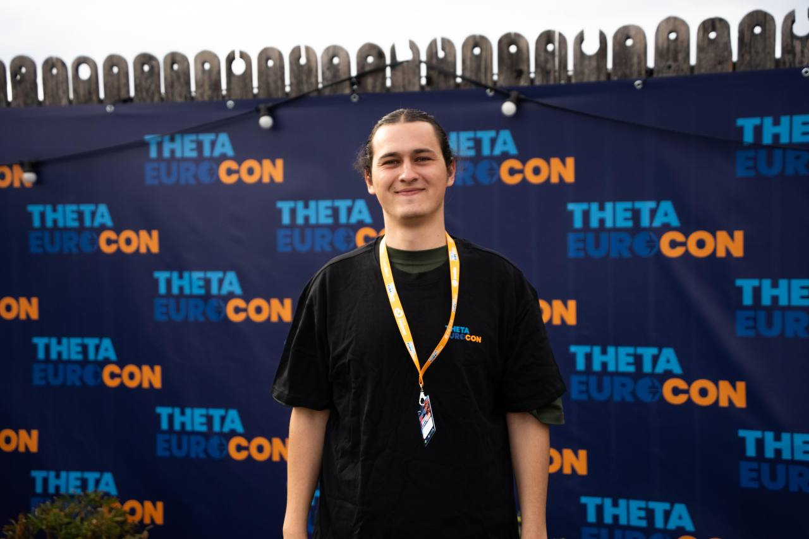
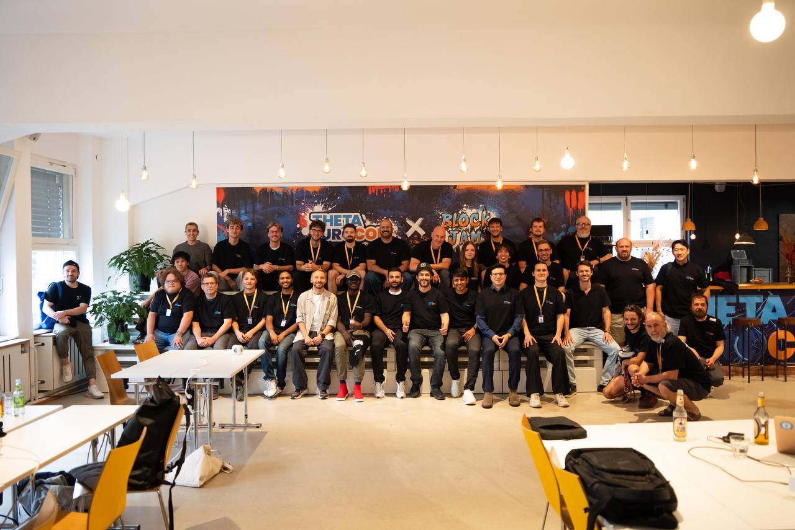
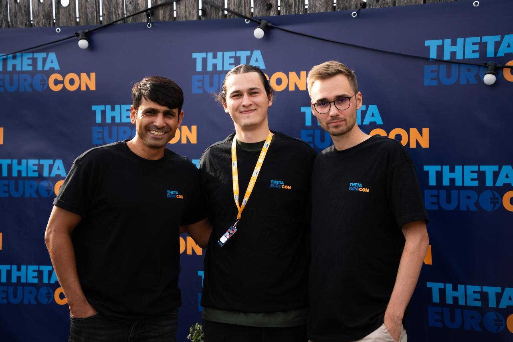
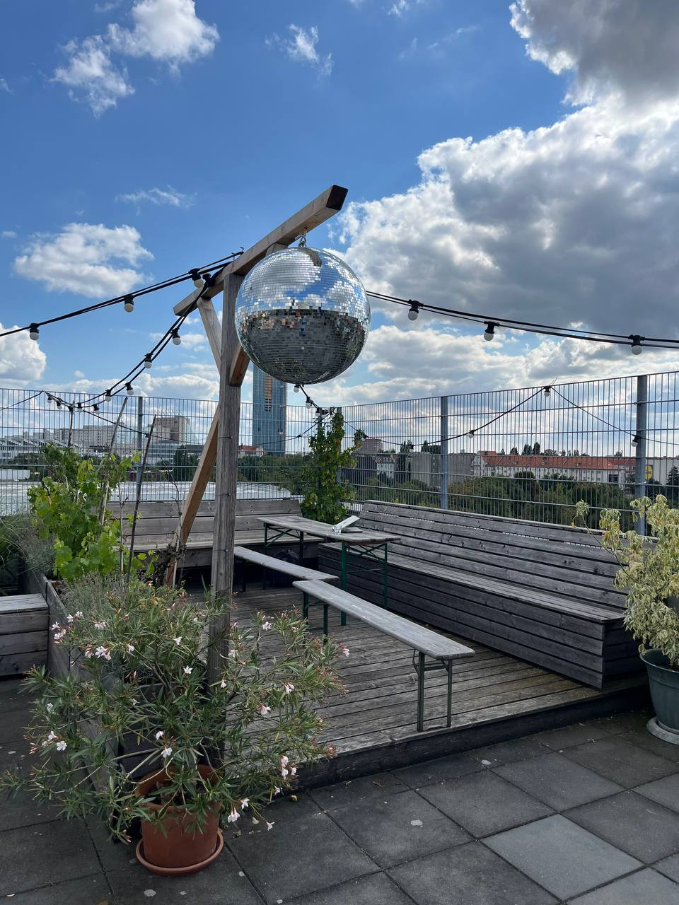

# My First AI & Blockchain Hackathon: Building the Global Forecasting System at Theta EuroCon in Berlin

*September 2025*

> Inside the hackathon: building GFS — the first competitor to BlackRock's Aladdin.

In September 2025, I participated in my first hackathon — the **Theta EuroCon Hackathon in Berlin** (September 7–11, 2025). For me and my team at **Advanced Scientific Research Projects (ASRP)**, it was more than just a competition. It was an opportunity to showcase our research, validate our ideas in a dynamic environment, and connect with innovators working at the intersection of AI and blockchain.

---

## About the Team and Project

ASRP is a group of companies spanning from the legendary Baikonur Cosmodrome in Kazakhstan to the Kennedy Space Center in Florida. We bring together specialists in AI, biomedicine, aerospace technology, journalism, and science — united by one mission: **the study of consciousness**.

At the hackathon, we presented our product — the **Global Forecasting System (GFS)**. This system analyzes dreams and collective unconscious data, cross-referencing them with news feeds, stock quotes, anomalous animal behavior, and even DEFCON levels to generate forecasts not only in finance but also in geopolitics and social processes.

This idea was first outlined in our 2024 publication *"Forecasting Social, Geopolitical, and Economic Events Using the Banchenko-Technology"*. We demonstrated that a system like GFS could become a serious competitor to BlackRock's famous **Aladdin** platform. While Aladdin uses AI to analyze markets and global trends, GFS goes further — incorporating data from dream content, meditative states, and EEG biofeedback. Our goal is to leverage **collective consciousness** by aggregating data from multiple people to extract signals and predict market movements, political events, and social changes.

---

## The Hackathon Experience

For several days, we lived in an atmosphere of constant energy, ideas, and experimentation. Over twenty teams from around the world competed for the chance to present their projects. It was a unique space where blockchain and AI met creativity and bold concepts. We weren't just writing code — we learned to distribute tasks, trust each other, and assemble individual pieces into a unified system that could impress the jury.

What made this experience especially unique was juggling two roles: developer and media face of the project. Our team was the only one recording daily TikTok updates, day reviews, interviews with co-founders, and plans for the next day. This allowed us to showcase our work in real-time and create an atmosphere of openness around the project.

> Interview with Theta EuroCon co-founders during a short break. Their insights added depth to my daily updates.

The little things also made an impression: we were well-fed three times a day, and I spent part of my work on the rooftop next to a disco ball — an atmosphere that perfectly combined focus and inspiration.

---

## What We Built in Five Days

During the hackathon, our team turned an idea into a working prototype with two key versions:

- **Web Interface** (Andrii Kryliuk) — visualization of forecasts, tickers, and events for interactive data exploration
- **Telegram Bot** (Oleksandr Hromyko) — a convenient tool for submitting dreams, receiving interpretations and forecasts directly in the messenger

In parallel, we built the system's core: an **AI model that analyzes dreams**, searches for similar narratives across different users, and extracts key events. The system then maps these events to potential areas of impact — economics, geopolitics, or social spheres. It identifies which industries might be affected and searches for specific stock tickers and companies within those industries.

Next, we added **media search**: the model checks whether news outlets are reporting events that suggest dream content is manifesting in reality. This multi-layered analysis combines subjective data with objective information streams to build early forecasts.

Special thanks to **Kyryl Zmiienko**, who strengthened the industry-to-market mapping logic. Together with **Denis Banchenko** and **Valeri Ovseannicova**, I integrated research成果 and the **Kapustin Markers Algorithm**, which identifies dream pattern matches and reveals hidden correlations.

---

## Presentation and Reaction

On September 11, we showed the first demo video of the system on stage. Our idea generated genuine interest — the audience listened attentively, and many approached afterward with questions and a desire to learn more.

> The team presenting the GFS prototype on stage at Theta EuroCon.

**Oleksandr Hromyko** shared:

> What I loved most was the hackathon atmosphere — the feeling that so many people around had their own projects, and we were competing for the best result. The format with tight deadlines and competition was challenging but incredibly exciting. Thanks to this event, we saw ourselves from different angles and grew even stronger as a team.

**Kyryl Zmiienko** added:

> I was incredibly inspired by the hackathon's atmosphere. Cohesion, a constant flow of ideas — it kept charging me up and made me want to build something truly great!

**Andrii Kryliuk** reflected:

> Participating in the hackathon was a valuable experience and a real challenge. Under time pressure, I had to think fast, make decisions, and try different approaches. The teamwork, mutual support, and collaborative ideation were especially important. This experience pushed me beyond my usual limits and left me truly inspired.

---

## Conclusion

For me, this hackathon embodied determination, resilience, inner fire, and a certain audacity to prove ourselves. There were many obstacles, but we channeled the collective energy and support to take the stage and compete.

In five days, we not only built the first working versions of the **Global Forecasting System (GFS)** but also validated that our idea can engage people, spark genuine interest, and build momentum.

We proved that a team can function as a unified whole even across distances, overcoming countless obstacles while preserving determination and inner fire. For a first hackathon, this was an immense experience — a combination of engineering challenges, scientific ideas, and media work that elevated us to a new level.

---

[← Back to articles](../README.md)
