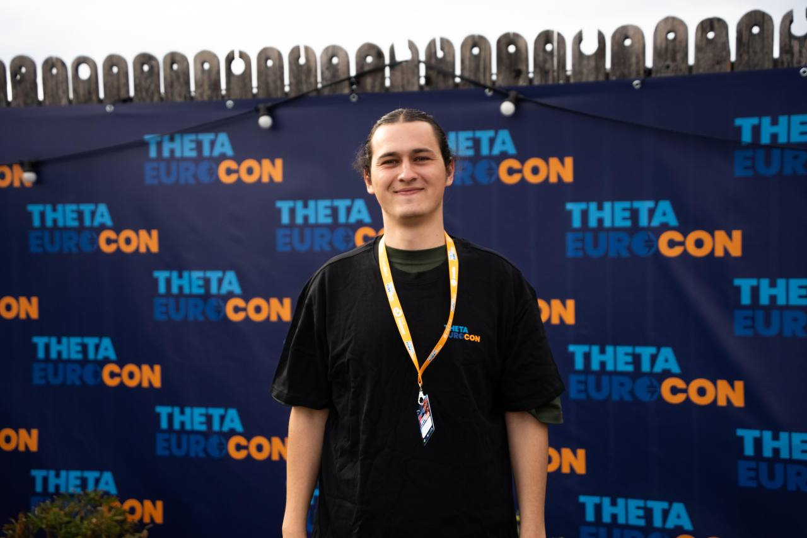
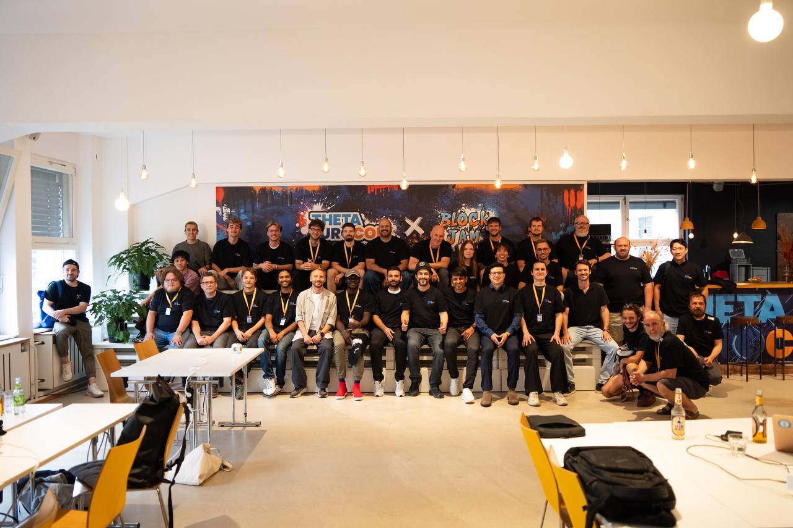
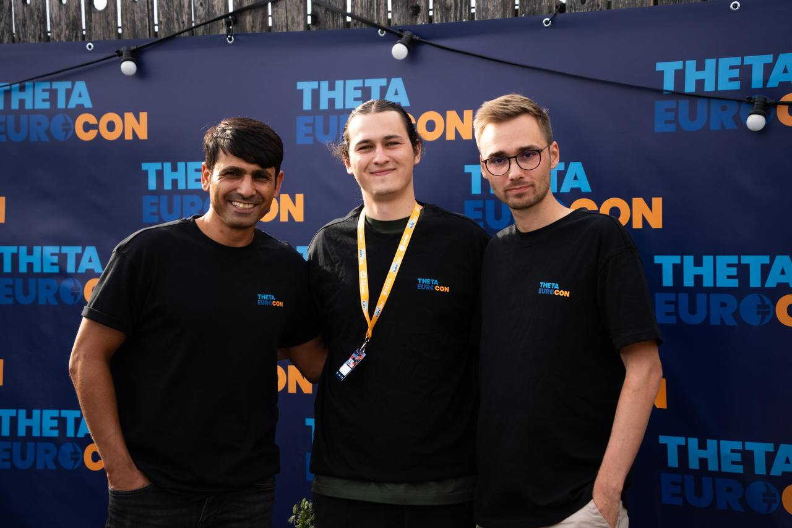
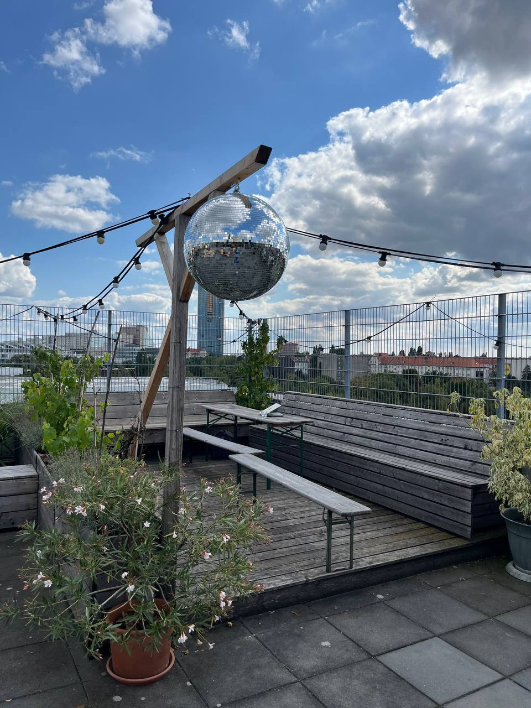

# Мой первый AI & Blockchain hackathon: создание Global Forecasting System на Theta EuroCon в Берлине

*Сентябрь 2025*

> Внутри хакатона: создание GFS — первого конкурента BlackRock Aladdin.

В сентябре 2025 года я участвовал в своём первом хакатоне — **Theta EuroCon Hackathon в Берлине** (7-11 сентября 2025 года). Для меня и моей команды из **Advanced Scientific Research Projects (ASRP)** это было больше, чем соревнование. Это была возможность показать наши исследования, проверить идеи в динамичной среде и познакомиться с инноваторами, работающими на пересечении AI и blockchain.

---

## О команде и проекте

ASRP — это группа компаний, география которой простирается от легендарного космодрома Байконур в Казахстане до Kennedy Space Center во Флориде. Мы объединяем специалистов в области AI, биомедицины, аэрокосмических технологий, журналистики и науки вокруг одной миссии: **изучения сознания**.

На хакатоне мы представили наш продукт — **Global Forecasting System (GFS)**. Эта система анализирует сны и данные коллективного бессознательного, сопоставляя их с новостными лентами, биржевыми котировками, аномальным поведением животных и даже уровнями DEFCON, чтобы генерировать прогнозы не только в финансах, но и в геополитике и социальных процессах.

Впервые эта идея была описана в нашей публикации 2024 года *"Forecasting Social, Geopolitical, and Economic Events Using the Banchenko-Technology"*. Мы показали, что система вроде GFS может стать серьёзным конкурентом знаменитой платформы **Aladdin** от BlackRock. Если Aladdin использует AI для анализа рынков и глобальных трендов, то GFS идёт дальше — включая данные из содержания сновидений, медитативных состояний и EEG biofeedback. Наша цель — использовать **коллективное сознание**, агрегируя данные от множества людей, чтобы извлекать сигналы и прогнозировать движения рынков, политические события и социальные изменения.

---

## Опыт хакатона

Несколько дней мы жили в атмосфере постоянной энергии, идей и экспериментов. Более двадцати команд со всего мира соревновались за возможность представить свои проекты. Это было уникальное пространство, где blockchain и AI встретились с креативностью и смелыми концепциями. Мы не просто писали код — мы учились распределять задачи, доверять друг другу и собирать отдельные части в единую систему, способную впечатлить жюри.

Особенность этого опыта была ещё и в том, что мне приходилось совмещать две роли: разработчика и медийного лица проекта. Наша команда была единственной, кто каждый день записывал TikTok-обновления, обзоры дня, интервью с co-founders и планы на следующий день. Это позволило показывать нашу работу в реальном времени и создавать вокруг проекта атмосферу открытости.

> Интервью с co-founders Theta EuroCon во время короткого перерыва. Их комментарии добавили глубины моим ежедневным обновлениям.

Запомнились и детали: нас хорошо кормили три раза в день, а часть работы я провёл на крыше рядом с disco ball — атмосфера идеально сочетала концентрацию и вдохновение.

---

## Что мы построили за пять дней

Во время хакатона наша команда превратила идею в рабочий прототип с двумя ключевыми версиями:

- **Web Interface** (Andrii Kryliuk) — визуализация прогнозов, тикеров и событий для интерактивного исследования данных.
- **Telegram Bot** (Oleksandr Hromyko) — удобный инструмент для отправки снов, получения интерпретаций и прогнозов прямо в мессенджере.

Параллельно мы строили ядро системы: **AI-модель, которая анализирует сны**, ищет похожие нарративы у разных пользователей и извлекает ключевые события. Затем система сопоставляет эти события с потенциальными зонами влияния — экономикой, геополитикой или социальной сферой. Она определяет, какие индустрии могут быть затронуты, и ищет конкретные биржевые тикеры и компании внутри этих индустрий.

Затем мы добавили **media search**: модель проверяет, сообщают ли новостные источники о событиях, которые могут указывать на проявление содержания снов в реальности. Этот многоуровневый анализ объединяет субъективные данные с объективными информационными потоками, чтобы строить ранние прогнозы.

Отдельная благодарность **Kyryl Zmiienko**, который усилил логику сопоставления индустрий и рынков. Вместе с **Denis Banchenko** и **Valeri Ovseannicova** я интегрировал исследовательские результаты и **Kapustin Markers Algorithm**, который определяет совпадения паттернов сновидений и выявляет скрытые корреляции.

---

## Презентация и реакция

11 сентября мы показали первое демо-видео системы на сцене. Наша идея вызвала живой интерес: аудитория слушала внимательно, а после выступления многие подходили с вопросами и желанием узнать больше.

> Команда представляет прототип GFS на сцене Theta EuroCon.

**Oleksandr Hromyko** поделился:

> Больше всего мне понравилась атмосфера хакатона — ощущение, что вокруг столько людей со своими проектами, и мы соревнуемся за лучший результат. Формат с жёсткими дедлайнами и конкуренцией был сложным, но невероятно захватывающим. Благодаря этому событию мы увидели себя с разных сторон и стали ещё сильнее как команда.

**Kyryl Zmiienko** добавил:

> Меня невероятно вдохновила атмосфера хакатона. Сплочённость, постоянный поток идей — это заряжало меня и заставляло хотеть построить что-то действительно большое!

**Andrii Kryliuk** отметил:

> Участие в хакатоне стало ценным опытом и настоящим вызовом. В условиях нехватки времени нужно было быстро думать, принимать решения и пробовать разные подходы. Особенно важными были командная работа, взаимная поддержка и совместная генерация идей. Этот опыт вывел меня за привычные пределы и по-настоящему вдохновил.

---

## Заключение

Для меня этот хакатон стал воплощением решимости, стойкости, внутреннего огня и определённой дерзости доказать, на что мы способны. Препятствий было много, но мы направили коллективную энергию и поддержку на то, чтобы выйти на сцену и соревноваться.

За пять дней мы не только построили первые рабочие версии **Global Forecasting System (GFS)**, но и подтвердили, что наша идея способна вовлекать людей, вызывать настоящий интерес и набирать momentum.

Мы доказали, что команда может работать как единое целое даже на расстоянии, преодолевая множество препятствий и сохраняя решимость и внутренний огонь. Для первого хакатона это был огромный опыт — сочетание инженерных вызовов, научных идей и медийной работы, которое вывело нас на новый уровень.

---

[← Назад к статьям](../README.md)
