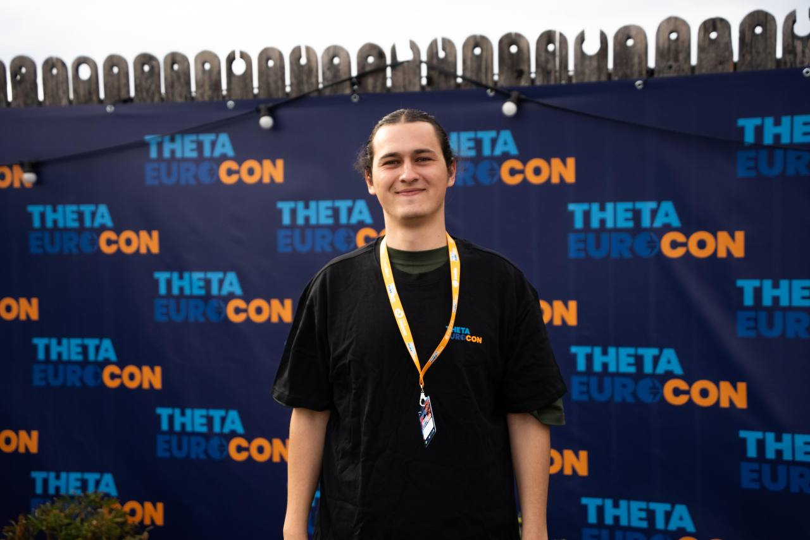
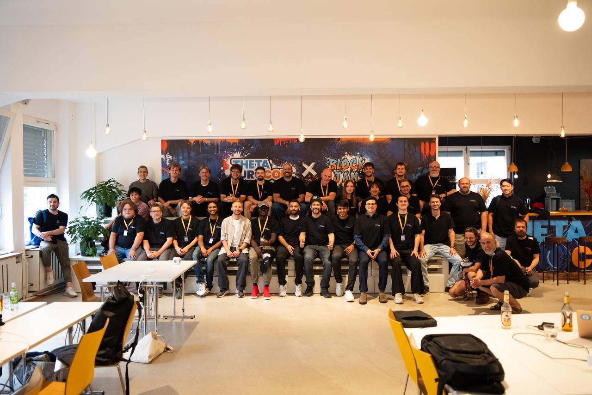
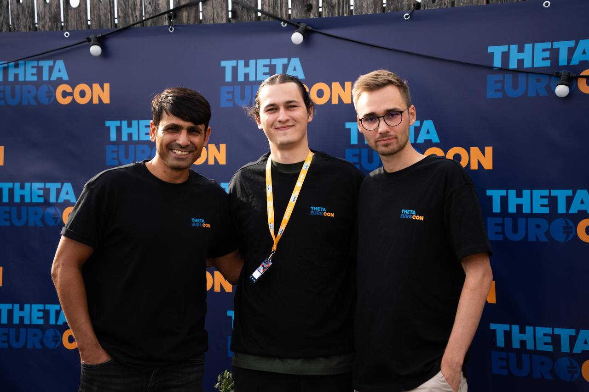
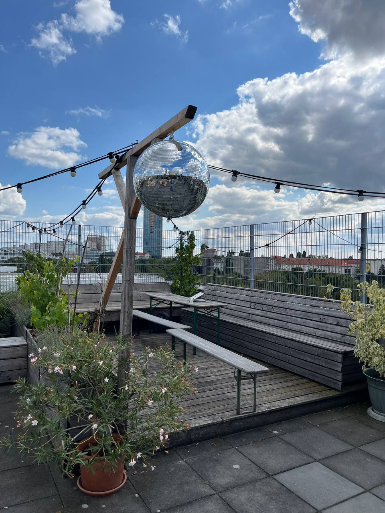

# Мій перший AI & Blockchain hackathon: створення Global Forecasting System на Theta EuroCon у Берліні

*Вересень 2025*

> Усередині хакатону: створення GFS — першого конкурента BlackRock Aladdin.

У вересні 2025 року я взяв участь у своєму першому хакатоні — **Theta EuroCon Hackathon у Берліні** (7-11 вересня 2025 року). Для мене й моєї команди з **Advanced Scientific Research Projects (ASRP)** це було більше, ніж змагання. Це була можливість показати наші дослідження, перевірити ідеї в динамічному середовищі та познайомитися з інноваторами, які працюють на перетині AI і blockchain.

---

## Про команду та проєкт

ASRP — це група компаній, географія якої простягається від легендарного космодрому Байконур у Казахстані до Kennedy Space Center у Флориді. Ми об'єднуємо фахівців у галузі AI, біомедицини, аерокосмічних технологій, журналістики та науки навколо однієї місії: **вивчення свідомості**.

На хакатоні ми представили наш продукт — **Global Forecasting System (GFS)**. Ця система аналізує сни та дані колективного несвідомого, зіставляючи їх із новинними стрічками, біржовими котируваннями, аномальною поведінкою тварин і навіть рівнями DEFCON, щоб генерувати прогнози не лише у фінансах, а й у геополітиці та соціальних процесах.

Уперше цю ідею було описано в нашій публікації 2024 року *"Forecasting Social, Geopolitical, and Economic Events Using the Banchenko-Technology"*. Ми показали, що система на кшталт GFS може стати серйозним конкурентом знаменитої платформи **Aladdin** від BlackRock. Якщо Aladdin використовує AI для аналізу ринків і глобальних трендів, то GFS іде далі — включаючи дані зі змісту сновидінь, медитативних станів і EEG biofeedback. Наша мета — використати **колективну свідомість**, агрегуючи дані від багатьох людей, щоб витягувати сигнали й прогнозувати рухи ринків, політичні події та соціальні зміни.

---

## Досвід хакатону

Кілька днів ми жили в атмосфері постійної енергії, ідей та експериментів. Понад двадцять команд з усього світу змагалися за можливість представити свої проєкти. Це був унікальний простір, де blockchain і AI зустрілися з креативністю та сміливими концепціями. Ми не просто писали код — ми вчилися розподіляти задачі, довіряти одне одному й збирати окремі частини в єдину систему, здатну вразити журі.

Особливість цього досвіду була ще й у тому, що мені доводилося поєднувати дві ролі: розробника і медійного обличчя проєкту. Наша команда була єдиною, хто щодня записував TikTok-оновлення, огляди дня, інтерв'ю з co-founders і плани на наступний день. Це дало змогу показувати нашу роботу в реальному часі й створювати навколо проєкту атмосферу відкритості.

> Інтерв'ю з co-founders Theta EuroCon під час короткої перерви. Їхні коментарі додали глибини моїм щоденним оновленням.

Запам'яталися й деталі: нас добре годували тричі на день, а частину роботи я провів на даху поруч із disco ball — атмосфера ідеально поєднувала концентрацію й натхнення.

---

## Що ми побудували за п'ять днів

Під час хакатону наша команда перетворила ідею на робочий прототип із двома ключовими версіями:

- **Web Interface** (Andrii Kryliuk) — візуалізація прогнозів, тикерів і подій для інтерактивного дослідження даних.
- **Telegram Bot** (Oleksandr Hromyko) — зручний інструмент для надсилання снів, отримання інтерпретацій і прогнозів просто в месенджері.

Паралельно ми будували ядро системи: **AI-модель, яка аналізує сни**, шукає схожі наративи в різних користувачів і витягує ключові події. Потім система зіставляє ці події з потенційними зонами впливу — економікою, геополітикою або соціальною сферою. Вона визначає, які індустрії можуть бути зачеплені, і шукає конкретні біржові тикери та компанії всередині цих індустрій.

Далі ми додали **media search**: модель перевіряє, чи повідомляють новинні джерела про події, які можуть вказувати на прояв змісту снів у реальності. Цей багаторівневий аналіз об'єднує суб'єктивні дані з об'єктивними інформаційними потоками, щоб будувати ранні прогнози.

Окрема подяка **Kyryl Zmiienko**, який посилив логіку зіставлення індустрій і ринків. Разом із **Denis Banchenko** та **Valeri Ovseannicova** я інтегрував дослідницькі результати й **Kapustin Markers Algorithm**, який визначає збіги патернів сновидінь і виявляє приховані кореляції.

---

## Презентація та реакція

11 вересня ми показали перше демо-відео системи на сцені. Наша ідея викликала живий інтерес: аудиторія слухала уважно, а після виступу багато хто підходив із запитаннями та бажанням дізнатися більше.

> Команда представляє прототип GFS на сцені Theta EuroCon.

**Oleksandr Hromyko** поділився:

> Найбільше мені сподобалася атмосфера хакатону — відчуття, що навколо стільки людей зі своїми проєктами, і ми змагаємося за найкращий результат. Формат із жорсткими дедлайнами та конкуренцією був складним, але неймовірно захопливим. Завдяки цій події ми побачили себе з різних боків і стали ще сильнішими як команда.

**Kyryl Zmiienko** додав:

> Мене неймовірно надихнула атмосфера хакатону. Згуртованість, постійний потік ідей — це заряджало мене й змушувало хотіти побудувати щось справді велике!

**Andrii Kryliuk** зазначив:

> Участь у хакатоні стала цінним досвідом і справжнім викликом. В умовах браку часу потрібно було швидко думати, ухвалювати рішення й пробувати різні підходи. Особливо важливими були командна робота, взаємна підтримка та спільна генерація ідей. Цей досвід вивів мене за звичні межі й по-справжньому надихнув.

---

## Висновок

Для мене цей хакатон став втіленням рішучості, стійкості, внутрішнього вогню й певної зухвалості довести, на що ми здатні. Перешкод було багато, але ми спрямували колективну енергію та підтримку на те, щоб вийти на сцену й змагатися.

За п'ять днів ми не лише побудували перші робочі версії **Global Forecasting System (GFS)**, а й підтвердили, що наша ідея здатна залучати людей, викликати справжній інтерес і набирати momentum.

Ми довели, що команда може працювати як єдине ціле навіть на відстані, долаючи безліч перешкод і зберігаючи рішучість та внутрішній вогонь. Для першого хакатону це був величезний досвід — поєднання інженерних викликів, наукових ідей і медійної роботи, яке вивело нас на новий рівень.

---

[← Назад до статей](../README.md)
