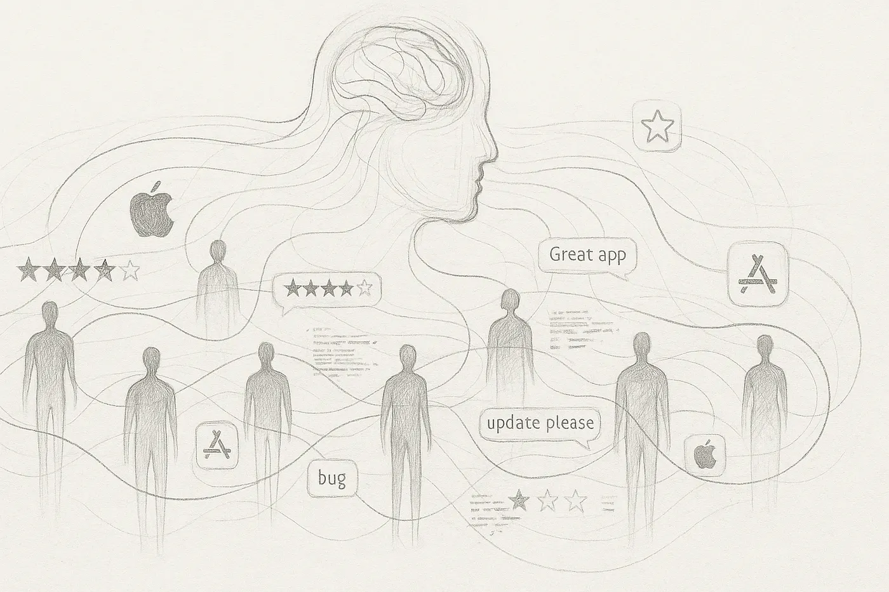
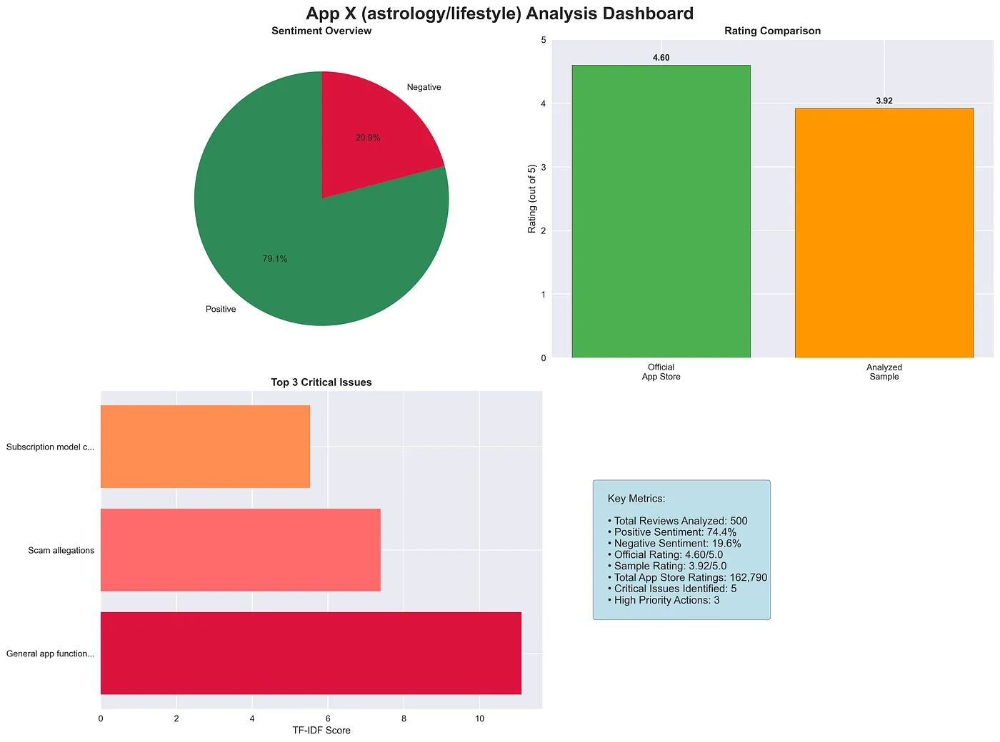
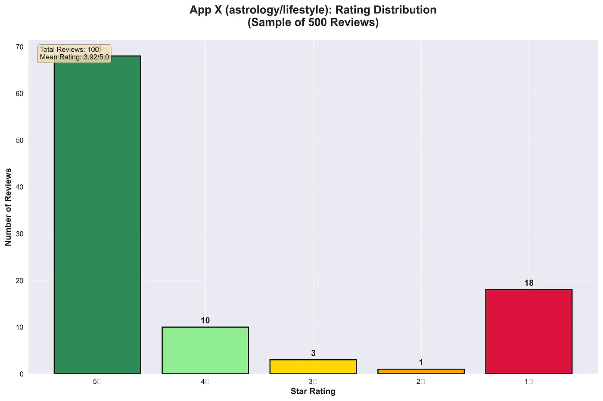
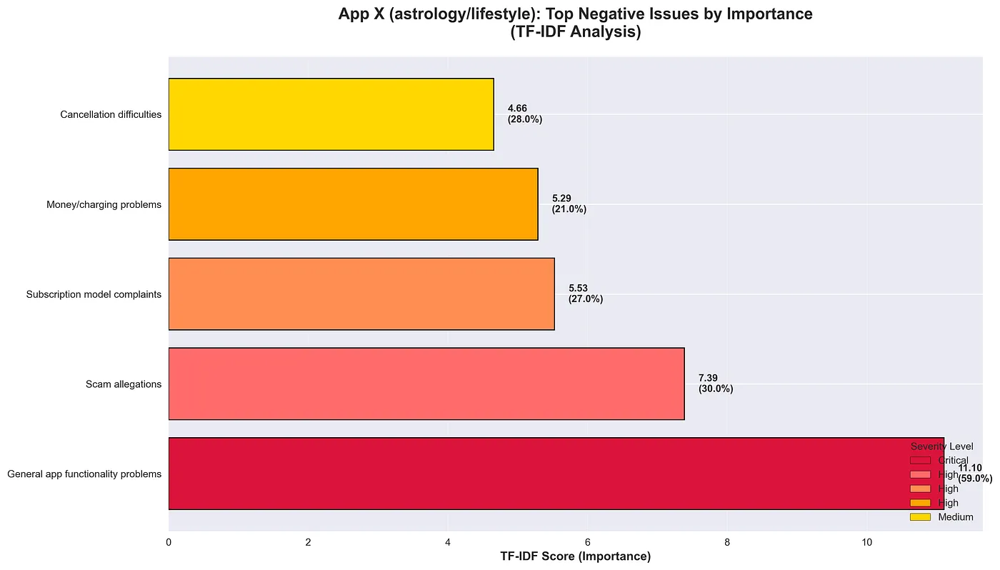
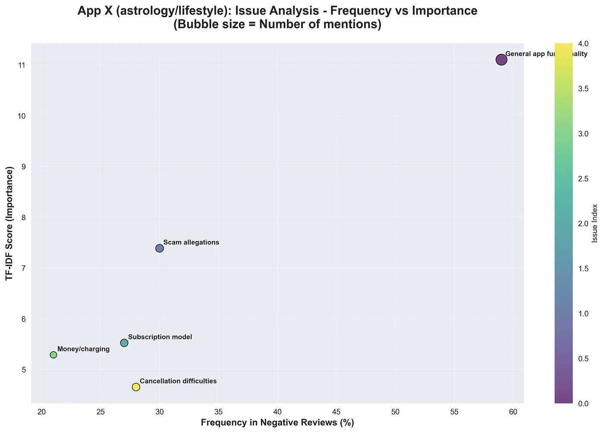
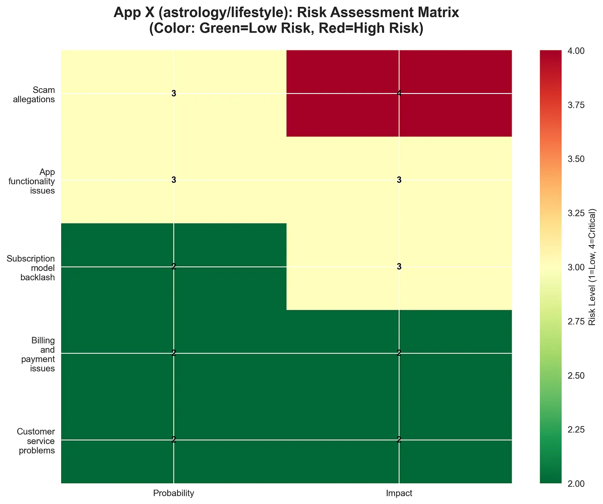
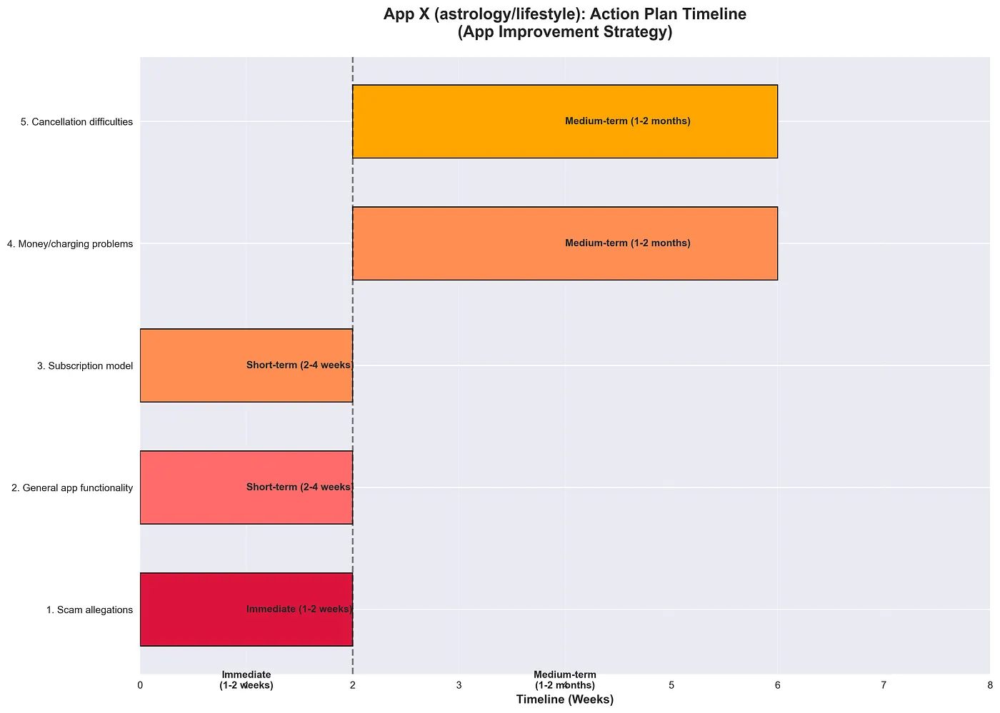

# Aufbau einer App-Store-Review-Analysepipeline mit Python NLP & Datenvisualisierung

App-Store-Bewertungen sind mehr als Sternbewertungen: Sie sind verdichtete menschliche Geschichten von Begeisterung und Frustration. In diesen Kommentaren verbergen sich Signale für entstehende Trends und sich verändernde kollektive Stimmungen. Im Rahmen meiner breiteren Forschung zum Global Forecasting System (GFS) interessierte mich, wie Nutzerfeedback gesellschaftliche Dynamiken widerspiegeln kann, nicht nur Produktleistung.

Ich baute eine Analysepipeline für Apple-App-Store-Bewertungen mit Python, NLP, TF-IDF, VADER und Datenvisualisierung, um Hunderte von Bewertungen schnell in strukturierte Erkenntnisse zu überführen. Dieses Experiment zeigt, wie qualitatives Feedback sowohl Produktschwächen als auch frühe Indikatoren breiterer Verhaltensmuster sichtbar machen kann — genau die Art von Daten, die später in Prognosemodelle einfließen könnte.

Der gesamte Quellcode für diese Analyse ist am Ende des Artikels verfügbar.

## Warum App-Store-Bewertungen als soziale Signale wichtig sind

Nutzerbewertungen im App Store wirken zunächst produktspezifisch, doch ihre Bedeutung reicht tiefer. Sie funktionieren als soziale Signale: Momentaufnahmen von Verbraucherwahrnehmung und Verhalten, die breitere Trends widerspiegeln können.

**Marktverständnis.** Bewertungen zeigen, welche Funktionen Nutzer wünschen oder ablehnen. Sie heben neue Verbraucherpräferenzen hervor, etwa Nachfrage nach Dark Mode oder KI-Funktionen, und zeigen häufige Schmerzpunkte. Das ist kostenlose Marktforschung, die Produktteams strategisch nutzen können.

**Produktstrategie und Verbesserung.** Auf Mikroebene nutzen App-Entwickler Bewertungen, um Bugfixes und Feature-Updates zu priorisieren. Ein plötzlicher Anstieg von Beschwerden über Login-Probleme oder Abopreise ist ein Frühwarnsystem dafür, wo das Produkt seine Nutzer enttäuscht.

**Verhaltensbezogene Erkenntnisse.** Sprachmuster können Hinweise auf Nutzerpsychologie geben. Verwenden Nutzer in Bewertungen von Finanz-Apps während eines wirtschaftlichen Abschwungs mehr ängstliche Sprache? Erwähnen Bewertungen von Gesundheits-Apps pandemiebezogene Begriffe? Über viele Apps aggregiert können Bewertungen sozioökonomische Unterströmungen widerspiegeln.

**Reputation und Vertrauen.** Bewertungen sind ein öffentliches Gespräch über deine Marke. Negative Themen wie Vorwürfe von "scam" oder schlechter Kundenservice können den Ruf einer App über das Produkt selbst hinaus beschädigen. Monitoring hilft Unternehmen, Schaden zu begrenzen und Vertrauen zu erhalten.

Im Kontext von GFS könnten diese App-Review-Signale ein Baustein eines größeren Puzzles sein. Man könnte steigende Negativität in Bewertungen von Gig-Economy-Apps mit breiteren Arbeitsmarkttrends korrelieren oder die Stimmung in Reise-App-Bewertungen als Proxy für Verbrauchervertrauen analysieren. Der App Store ist ein riesiges Echtzeit-Repository menschlicher Stimmung. Unsere Herausforderung besteht darin, diese Signale systematisch zu extrahieren und zu interpretieren.


*Abb. 1. Monochrome konzeptionelle Skizze mit miteinander verbundenen menschlichen Figuren, die durch fließende Datenlinien und Sternsymbole verknüpft sind und kollektive Intelligenz sowie geteiltes Bewusstsein in digitalen Ökosystemen symbolisieren.*

Vielleicht am wichtigsten: Sternbewertungen allein können irreführend sein. Eine App kann insgesamt eine hohe Durchschnittsbewertung von 4,5 Sternen halten und dennoch in aktuellen Bewertungen eine ernsthafte Unzufriedenheit verbergen. Durch die Analyse von Textfeedback entdecken wir Nuancen, die Durchschnittswerte verschleiern. In der folgenden Fallstudie hat App X, eine Astrologie-/Lifestyle-App, eine hohe offizielle Bewertung, doch die Analyse deckte klare Reibungspunkte auf, die Aufmerksamkeit erforderten. Das zeigt, warum ein eigenes Review-Analysesystem für jede datengetriebene Produktstrategie wichtig ist.

## Systemarchitektur: FastAPI, modulare NLP-Pipeline und warum kein "All-in-One"-Google-ADK-Agent

Der Aufbau dieses Analysesystems in Python war eine Übung darin, trotz Zeitdruck modular und skalierbar zu bleiben. Statt eines monolithischen Skripts oder eines einzelnen "Agenten", der alles erledigt, teilte ich die Logik in klare Komponenten auf. Das macht das System leichter wartbar, testbar und erweiterbar. Ich wählte FastAPI, um schnell eine Web-API aufzusetzen, die Analyse über HTTP-Requests auszulösen und anderen ein Interface mit interaktiver Dokumentation bereitzustellen.

Hier ist der Architekturüberblick:

**FastAPI-Anwendung.** Der Einstiegspunkt stellt einen `/analyze`-Endpoint bereit, der die gesamte Pipeline orchestriert. FastAPI liefert Geschwindigkeit und automatisch erzeugte Swagger UI, sodass ich eine App-ID abfragen und innerhalb weniger Minuten JSON-Ergebnisse erhalten kann.

**App-Info- und Review-Fetcher.** Diese Komponente ruft App-Metadaten wie Name, Entwickler und Kategorie über die iTunes Lookup API ab und Nutzerbewertungen über Apples RSS-Feed. Die Entkopplung dieser Logik erlaubt eine einfache Erweiterung auf andere Quellen wie Google Play, ohne die Analyseschicht zu verändern.

**Review-Verarbeitung.** Die Verarbeitungsschicht bereinigt und normalisiert Text: Sie verbindet Titel und Body, entfernt Duplikate, HTML, URLs und Rauschen und tokenisiert per Regex. Der Einfachheit halber übersprang ich schwere Lemmatisierung, obwohl spaCy oder NLTK angeschlossen werden könnten. Das Ergebnis ist ein sauberer Korpus für die Analyse.

**Sentimentanalyse.** Die Pipeline nutzt VADER, einen lexikonbasierten Sentiment-Analyzer, kombiniert mit Sternbewertungen in einem hybriden Score:

```text
sentiment = 0.6 * text_sentiment + 0.4 * star_rating
```

Das balanciert Fälle wie eine 1-Stern-Bewertung mit "good app" oder eine 5-Sterne-Bewertung mit "crashes often". Bewertungen werden mit anpassbaren Schwellenwerten als positiv, neutral oder negativ markiert.

**Keyword- und Issue-Extraktion.** TF-IDF identifiziert Schlüsselphrasen in negativen Bewertungen, etwa "subscription cost" oder "login bug". Keywords werden breiteren Issue-Kategorien wie Payment oder Performance zugeordnet. Jedes Issue wird nach Häufigkeit, Anteil negativer Bewertungen und Durchschnittsbewertung bewertet. Die Schwere kombiniert Regeln, etwa "scam" bedeutet Critical, mit Daten wie Häufigkeit und Wirkung.

**Insights Engine.** Die letzte Schicht gibt einen strukturierten JSON-Report aus: Sentiment-Aufschlüsselung, Top-Issues, entstehende Trends und vorgeschlagene Prioritäten. Eine regelbasierte Schicht weist Zeitpläne wie Immediate, Short-term oder Long-term anhand der Schwere zu und verwandelt Textfeedback in umsetzbare Strategie.

Die modulare Struktur machte Entwicklung und Tests einfach. Jeder Teil — vom Abrufen und Bereinigen bis zu Sentiment und Insights — funktioniert unabhängig. Ich kann Details prüfen, etwa ob der Cleaner URLs korrekt entfernt oder ob die Sentiment-Gewichtung wie erwartet arbeitet. Diese Trennung hält das System außerdem leicht erweiterbar: GPT-basiertes Sentiment oder Google-Play-Fetching hinzuzufügen würde nur ein Modul betreffen.

Ein einzelnes End-to-End-KI-System wäre vielleicht schneller, opfert aber Reproduzierbarkeit und messbare Ausgaben. Das deterministische Design der Pipeline sorgt für konsistente, auditierbare Ergebnisse über Tausende von Reviews hinweg, was für Forschungszuverlässigkeit auf GFS-Niveau entscheidend ist. Die Implementierung nutzt FastAPI, pandas, NLTK VADER, scikit-learn TF-IDF und Matplotlib/Seaborn für Visualisierung. Sie verarbeitet rund 500 Reviews in wenigen Sekunden, und Caching könnte sie noch schneller machen.

## Datenerfassung: Apples RSS-Feeds ohne bezahlte API nutzen

Apple stellt keine offizielle öffentliche Review-API bereit, die einfach alle Bewertungen auf einmal liefert, hat aber einen RSS-Feed, der dafür genutzt werden kann. Eine meiner Designvorgaben war Nullkosten: keine Drittanbieter-Services und keine inoffiziellen Scraper, die brechen könnten. Ich entschied mich für Apples eigene, für iTunes dokumentierte Endpoints.

Für jede App-Store-App kann man Bewertungen im JSON-Format abrufen, indem man eine URL wie diese aufruft:

```text
https://itunes.apple.com/<country_code>/rss/customerreviews/id=<APP_ID>/sortBy=mostRecent/page=<N>/json
```

Mein Fetcher iteriert durch Seiten, bis das gesetzte Limit erreicht ist, standardmäßig 300 und für App X auf 500 erhöht, oder bis keine weiteren Bewertungen mehr vorhanden sind. Er pausiert eine Sekunde zwischen Requests, um Rate Limits zu vermeiden. Jede Bewertung enthält Sterne, Titel, Text, Autor, Version und Datum. Ich speichere Rohdaten als JSONL für Debugging und filtere Duplikate nach Review-ID.

Es sind keine API-Keys oder bezahlter Zugriff nötig: Das ist ein offizieller öffentlicher Endpoint. App-Metadaten wie Rating, Kategorie und Veröffentlichungsdatum kommen aus der iTunes Lookup API. Mit sauberem, strukturiertem JSON und einem einfachen GET-Request ist die Erfassung schnell und zuverlässig. Die einzigen Eigenheiten sind ein User-Agent-Header und die Normalisierung von Apples uneinheitlichen Listen-/Dict-Antworten.

## Datenvorverarbeitung: Text bereinigen und für NLP vorbereiten

Rohbewertungen sind unordentlich. Tippfehler, Emojis, Satzzeichen-Spam und HTML-Artefakte verzerren die Analyse. Das Preprocessing-Modul bereinigt das in mehreren Durchläufen.

Ich verbinde Titel und Body, damit beide zum Sentiment beitragen. Ein Wort wie "Scam!!!" im Titel darf nicht verloren gehen. Mit `ftfy` behebe ich Encoding-Probleme. BeautifulSoup entfernt HTML und spezielle Entities. URLs, E-Mails und Mentions werden entfernt. Emojis werden hier verworfen, obwohl das System sie behalten oder übersetzen könnte. Text wird kleingeschrieben, Whitespace normalisiert, und die Tokenisierung nutzt Regex. Kontraktionen wie "didn't" bleiben erhalten.

TF-IDF filtert Stopwords später automatisch, daher war explizites Entfernen nicht nötig. Lemmatisierung übersprang ich aus Geschwindigkeitsgründen, obwohl spaCy Gruppierungen wie "crash" versus "crashing" verbessern würde. Ein leichter Spracherkenner bestätigte, dass 95 % der Bewertungen Englisch waren. Bewertungen mit weniger als drei Tokens, etwa "ok", werden ausgeschlossen.

Das Ergebnis ist eine saubere Liste normalisierter Reviews mit Tokens, bereit für Sentiment- und Keyword-Analyse. Schon diese grundlegende Pipeline verbessert Textqualität und Interpretierbarkeit deutlich.

## NLP-Analyse: Sentiment-Scoring und Issue-Extraktion

Nach der Bereinigung führte ich zwei Analysen aus: Sentiment-Scoring und Issue-Extraktion. Für Sentiment nutzte ich VADER, das Text von -1, negativ, bis +1, positiv, bewertet. Der Score jeder Bewertung wurde mit ihrer Sternbewertung kombiniert:

```text
sentiment = 0.6 * VADER + 0.4 * normalized_star
```

Die Schwellenwerte waren einfach: über 0,2 positiv, unter -0,2 negativ, alles andere neutral. Dieses hybride Modell balancierte Sarkasmus und widersprüchliche Bewertungen aus, etwa eine 5-Sterne-Bewertung mit "love it but crashes". Korrelationsprüfungen zeigten, dass Ratings und Textsentiment gut übereinstimmten, was die Datenqualität bestätigte.

Für Issues analysierte ich negative Bewertungen mit einem TF-IDF-Vectorizer mit Unigrams und Bigrams und entfernten englischen Stopwords. Danach ordnete ich Top-Keywords vordefinierten Kategorien wie Functionality, Payment/Refunds, Cancellations und Trust/Scam zu. Jedes Issue wurde nach Häufigkeit, TF-IDF-Bedeutung und Schwere bewertet: Critical, High, Medium oder Low. Zum Beispiel wurden "scam"-Begriffe als Critical eingestuft, "bugs" als High und UI-Vorschläge als Low. Entstehende Probleme wurden durch Vergleich aktueller und älterer Erwähnungen erkannt, etwa Login-Fehler nach Updates.

Die finale Ausgabe fasste Gesamtstimmung, die fünf wichtigsten Issues und Trends zusammen, jeweils mit Kontext wie Wirkung und empfohlener Dringlichkeit: Immediate, Short-term oder Long-term. Diese Ergebnisse bildeten die Grundlage für die folgende Visualisierungsphase.

## Datenvisualisierung: Review-Text in Produktprioritäten verwandeln

Zahlen erzählen einen Teil der Geschichte, aber Visualisierungen machen Erkenntnisse unmittelbar. Unten sind zentrale Diagramme aus der Analyse der Astrologie-/Lifestyle-App App X, basierend auf etwa 500 Reviews, mit Sentiment, Bewertungsverteilung und Top-Issues.


*Abb. 2. Dashboard zur App-X-Review-Analyse mit Sentiment-Kreisdiagramm mit 79 % positiven und 21 % negativen Reviews, Balkendiagramm zum Vergleich der offiziellen App-Store-Bewertung (4,6) mit dem Stichprobendurchschnitt (3,9) und den drei wichtigsten kritischen Issues darunter.*

Das Dashboard fasst Sentiment, Durchschnittsbewertungen und Hauptprobleme zusammen. Etwa 79 % der Reviews sind positiv und 21 % negativ. Die Gesamtzufriedenheit ist hoch, aber nicht makellos. Die Durchschnittsbewertung der Stichprobe, 3,9, liegt unter der offiziellen App-Store-Bewertung von 4,6, was auf einen jüngeren Rückgang oder eine Verzerrung hin zu neueren, kritischeren Bewertungen hindeutet. Die drei wichtigsten Problembereiche zeigen, wo Verbesserungen am meisten zählen.


*Abb. 3. Balkendiagramm mit der Verteilung von 500 App-X-Reviews: 68 % Fünf-Sterne-, 10 % Vier-Sterne-, 3 % Drei-Sterne-, 1 % Zwei-Sterne- und 18 % Ein-Sterne-Bewertungen. Es zeigt eine starke Polarisierung zwischen Begeisterung und Unzufriedenheit.*

Die Verteilung ist polarisiert: 68 % der Nutzer geben 5 Sterne und 18 % geben 1 Stern, mit fast keiner Mitte. Die App begeistert die meisten Nutzer klar, frustriert aber eine kleinere, lautstarke Minderheit. Dieses Ungleichgewicht deutet auf starke Wertwahrnehmung gemischt mit ernsten Reibungspunkten für manche hin.


*Abb. 4. Horizontales Balkendiagramm, das die fünf wichtigsten negativen Issues für App X nach TF-IDF-Bedeutung ordnet: Funktionsprobleme, Betrugsvorwürfe, Beschwerden zum Abomodell, Abrechnungsprobleme und Kündigungsschwierigkeiten.*

Die führenden Beschwerden gruppieren sich um fünf Kategorien:

1. Funktionsprobleme wie Abstürze und Verzögerungen, 59 % der negativen Bewertungen.
2. Betrugsvorwürfe, 30 %.
3. Bedenken zum Abomodell, 27 %.
4. Abrechnungsprobleme, 21 %.
5. Kündigungsschwierigkeiten, 28 %.

Zusammen ergeben sie ein konsistentes Bild: Technische Zuverlässigkeit und Vertrauen in die Monetarisierung treiben die Nutzerstimmung stärker als die Inhaltsqualität.


*Abb. 5. Scatterplot, der Issue-Häufigkeit gegen TF-IDF-Bedeutung abbildet; Funktions- und Scam-Issues erscheinen im oberen rechten Quadranten als sowohl häufig als auch sehr wichtig.*

Häufigkeit und TF-IDF-Bedeutung der Issues stimmen eng überein und bestätigen die Priorisierung. Funktions- und scambezogene Issues dominieren beide Achsen und zeigen, worauf zuerst Aufmerksamkeit gerichtet werden sollte.


*Abb. 6. Heatmap-Matrix, die Wahrscheinlichkeit gegen Wirkung für zentrale Issues darstellt; Betrugsvorwürfe und Funktionsprobleme erscheinen in roten Hochrisikozonen, während Abo- und Abrechnungsissues grün oder gelb bleiben.*

Eine Heatmap von Wahrscheinlichkeit versus Wirkung zeigt nur zwei rote Zonen: Betrugsvorwürfe, ein kritisches Vertrauensrisiko, und Funktionsprobleme, ein Risiko für die Kernerfahrung. Andere liegen im mittleren oder niedrigen Bereich und eignen sich für schrittweise Optimierung.


*Abb. 7. Horizontale Timeline mit priorisierten Fixes für App X: Betrugsvorwürfe sofort (1-2 Wochen), Funktions- und Aboverbesserungen kurzfristig (2-4 Wochen), Abrechnungs- und Kündigungsfixes mittelfristig (1-2 Monate).*

Die Roadmap ordnet Fixes nach Dringlichkeit:

1. Sofort: Scam-Wahrnehmung und Kommunikationsklarheit adressieren.
2. Kurzfristig, 2-4 Wochen: Stabilität und Abo-UX fokussieren.
3. Mittelfristig, 1-2 Monate: Abrechnungszuverlässigkeit und Kündigungsfluss verbessern.

Wenn diese Maßnahmen umgesetzt werden, könnten die kritischsten Issues innerhalb von ein oder zwei Release-Zyklen entschärft werden.

Zusammengefasst für den App-X-Astrologie-/Lifestyle-Fall: Nach Anwendung dieser Analyse hat das Team eine klare Aktionsliste. Kritische Bugs zu beheben und Nutzervertrauen wiederherzustellen sind die wichtigsten Prioritäten. Die Erwartung ist, dass dies nicht nur negative Bewertungen reduziert und damit Gesamtbewertung und Image der App verbessert, sondern wahrscheinlich auch Nutzerbindung und Umsatz stärkt. Zufriedene Nutzer bleiben und sind eher bereit zu zahlen.

Genau deshalb finde ich es wertvoll, App-Bewertungen nicht als lästige Pflicht zu behandeln, sondern als Orientierungshilfe. Innerhalb weniger Stunden fanden wir konkrete Wege, Tausende Nutzer zufriedener zu machen und die Marktposition der App zu stärken.

## Fazit

Der Aufbau dieses App-Store-Review-Analysesystems zeigte, wie schnell rohes Feedback in strukturierte Erkenntnisse verwandelt werden kann. In nur wenigen Stunden transformierte ich Tausende Wörter in messbare Trends und Prioritäten. Für App X machte dieser Prozess sichtbar, was Nutzer am meisten schätzen und wo Frustration entsteht, und verwandelte subjektive Bewertungen in handlungsfähige Daten.

Im großen Maßstab kann dieselbe Methode breitere Verbraucher- oder Marktsignale sichtbar machen. Im Kontext des Global Forecasting System könnte die Analyse von Sentiment über viele Apps hinweg Verschiebungen bei Themen wie Datenschutz, KI oder Vertrauen hervorheben: frühe Indikatoren größerer sozialer oder wirtschaftlicher Veränderungen. Bewertungen sind kleine, aber starke Spuren von Nutzerwahrnehmung. Aggregiert bilden sie quantifizierbare Muster.

Künftige Verbesserungen könnten Google-Play-Daten, Topic Modeling oder aspektbasierte Sentimentanalyse sowie ein interaktives Dashboard für kontinuierliches Monitoring umfassen. Jeder Schritt führt näher an ein Echtzeit-System für Feedback Intelligence heran.

Letztlich ist das Ziel einfach: systematisch zuzuhören. Reviews sind kein Rauschen mehr. Sie sind strukturierte Signale, die zeigen, was Menschen wichtig ist. Diese Signale in Erkenntnisse zu verwandeln hilft Teams, bessere Produkte zu bauen, und Forschern, menschliches Verhalten durch Daten besser zu verstehen.

Das Projekt-Repository appstore-insights auf GitHub ist offen für alle, die es erkunden und beitragen möchten.
