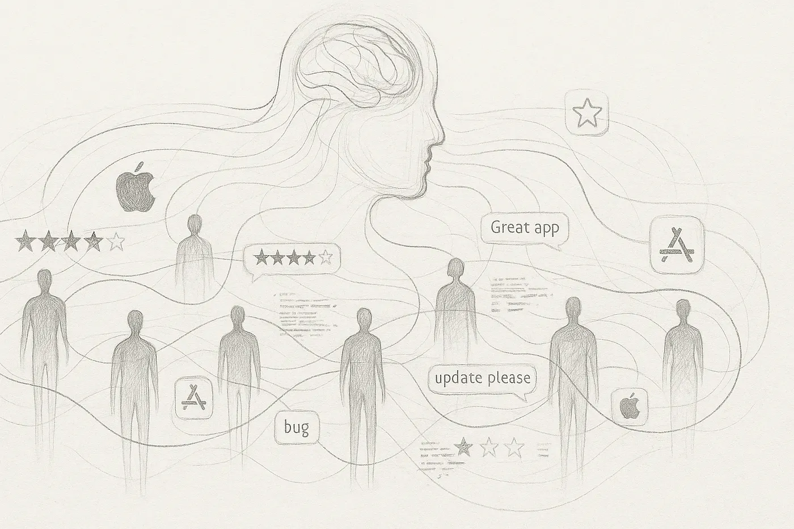
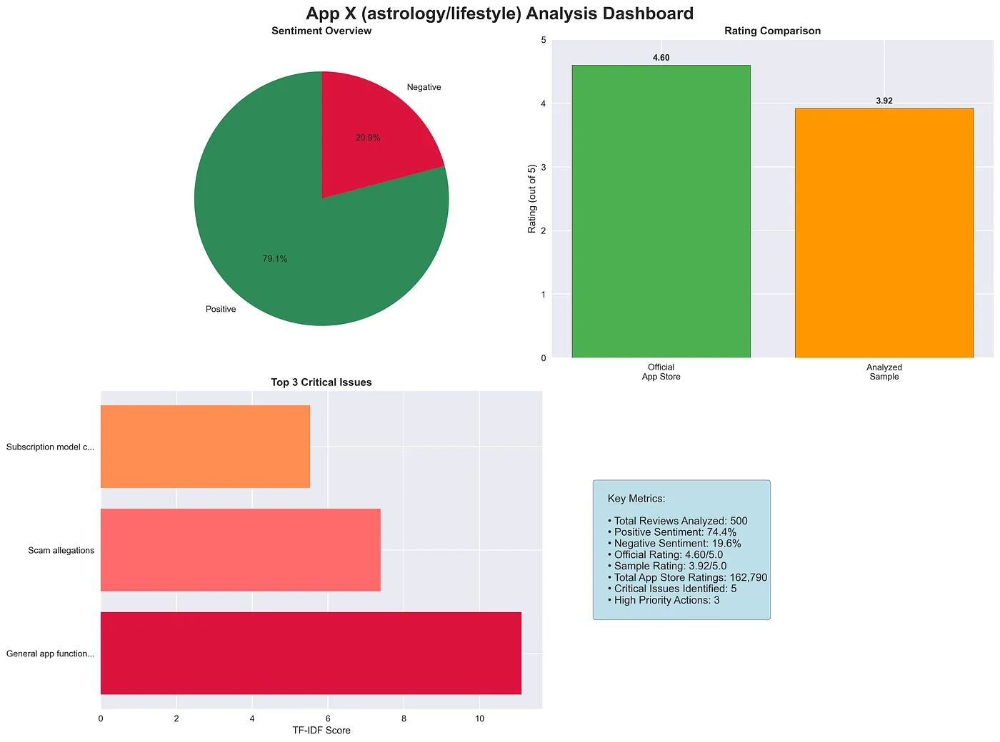
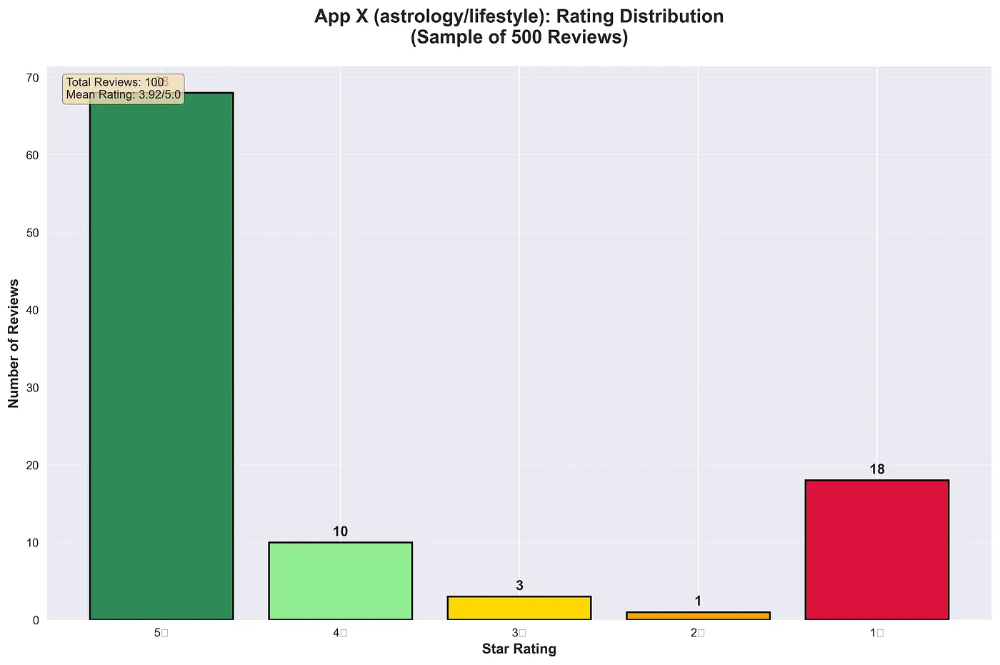
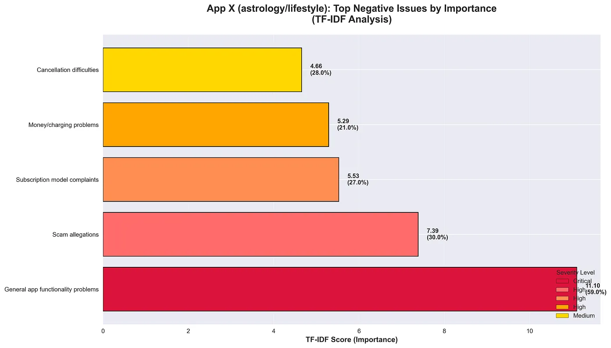
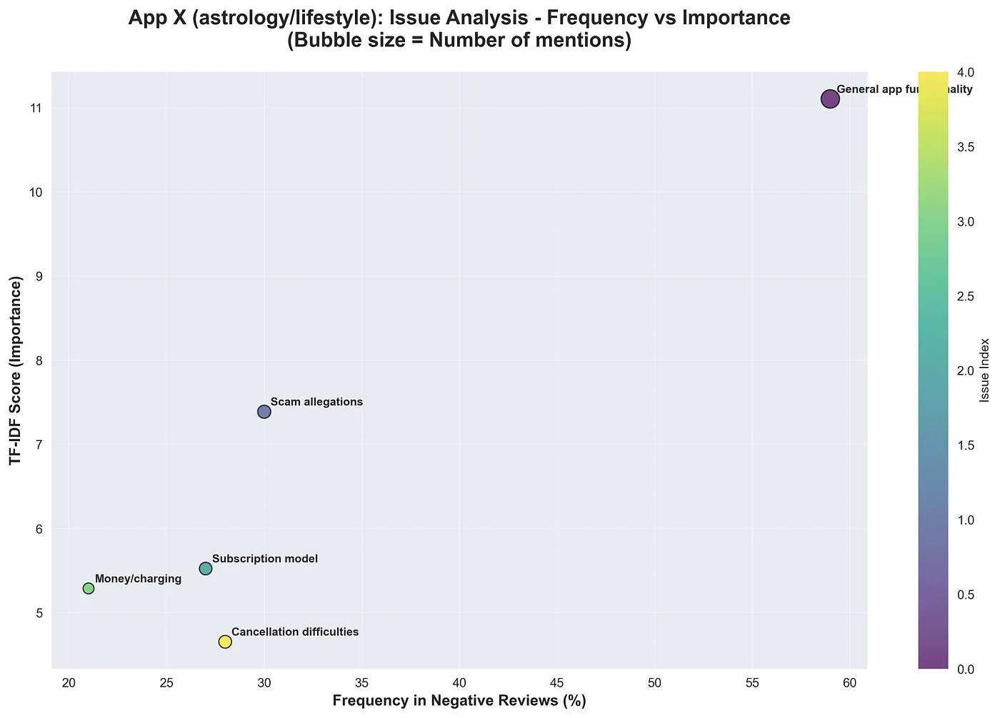
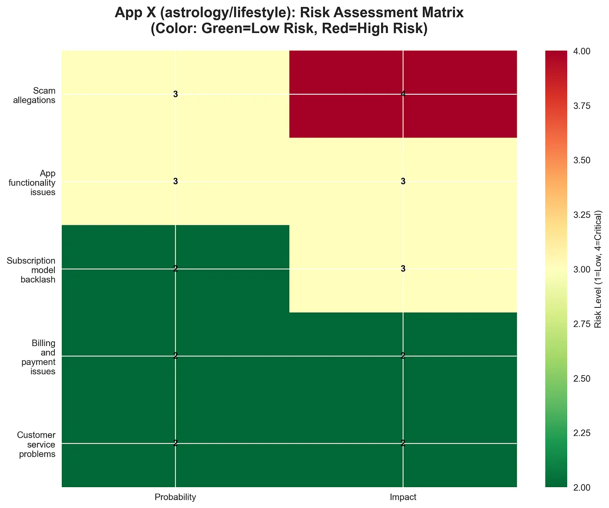
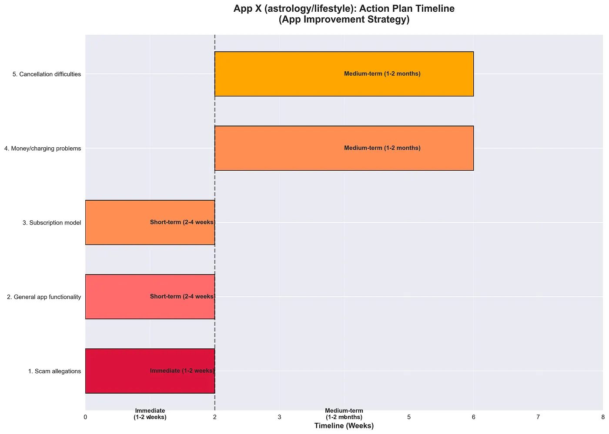

# Building an App Store Review Analysis Pipeline with Python NLP & Data Visualization

App Store reviews are more than star ratings: they are condensed human stories of delight and frustration. Hidden in those comments are signals of emerging trends and shifting collective sentiment. As part of my broader Global Forecasting System (GFS) research, I became interested in how user feedback can reflect social dynamics, not just product performance.

I built an Apple App Store review analysis pipeline using Python, NLP, TF-IDF, VADER, and data visualization to quickly turn hundreds of reviews into structured insights. This experiment shows how qualitative feedback can reveal both product weaknesses and early indicators of broader behavioral patterns, the kind of data that might later feed into predictive models.

All source code for this analysis is available at the end of the article.

## Why App Store Reviews Matter as Social Signals

User reviews on the App Store might seem product-specific, but their significance runs deeper. They function as social signals: snapshots of consumer sentiment and behavior that can echo broader trends.

**Market understanding.** Reviews reveal what features users crave or detest. They highlight emerging consumer preferences, such as demand for a dark mode or AI features, and common pain points. This is free market research that product teams can leverage for strategy.

**Product strategy and improvement.** On a micro level, app developers use reviews to prioritize bug fixes and feature updates. A sudden spike in complaints about login issues or subscription pricing is an early warning system for where the product is failing its users.

**Behavioral insights.** Patterns in language can hint at user psychology. Are users using more anxious language in finance app reviews during an economic downturn? Are health app reviews mentioning pandemic-related terms? Aggregated across apps, reviews can reflect socio-economic undercurrents.

**Reputation and trust.** Reviews are a public conversation about your brand. Negative themes, such as accusations of "scam" or poor customer service, can damage an app's reputation beyond the product itself. Monitoring these helps companies do damage control and maintain trust.

In the context of GFS, these app review signals could be one piece of a larger puzzle. Imagine correlating rising negativity in gig-economy app reviews with broader labor market trends, or analyzing sentiment in travel app reviews as a proxy for consumer confidence. The App Store is a vast, real-time repository of human sentiment. Our challenge is to systematically extract and interpret those signals.


*Fig. 1. Monochrome conceptual sketch showing interconnected human figures linked by flowing data lines and star icons, symbolizing collective intelligence and shared consciousness within digital ecosystems.*

Perhaps most importantly, star ratings alone can be misleading. An app might maintain a high 4.5-star average rating overall, yet hide a pocket of serious discontent in recent reviews. By digging into textual feedback, we uncover nuances that star averages mask. In the case study below, App X, an astrology/lifestyle app, has a high official rating, but the analysis exposed clear friction points that warranted attention. This underscores why a dedicated review analysis system matters for any data-driven product strategy.

## System Architecture: FastAPI, Modular NLP Pipeline, and Why No "All-in-One" Google ADK Agent

Building this analysis system in Python was an exercise in staying modular and scalable despite the rush. Rather than a monolithic script or a single "agent" handling everything, I split the logic into clear components. This makes the system easier to maintain, test, and extend. I chose FastAPI to quickly spin up a web API, allowing the analysis to be triggered via HTTP requests and providing an interface with interactive docs for others to use the tool.

Here is the architecture overview:

**FastAPI application.** The entry point exposes an `/analyze` endpoint that orchestrates the full pipeline. FastAPI provides speed and auto-generated Swagger UI, letting me query an app ID and get JSON results within minutes.

**App info and review fetcher.** This component retrieves app metadata, including name, developer, and category, via the iTunes Lookup API, and user reviews via Apple's RSS feed. Decoupling this logic allows easy expansion to other sources like Google Play without changing the analysis layer.

**Review processing.** The processing layer cleans and normalizes text: it merges title and body, removes duplicates, HTML, URLs, and noise, and tokenizes using regex. For simplicity, I skipped heavy lemmatization, though spaCy or NLTK can be plugged in. The result is a clean corpus ready for analysis.

**Sentiment analysis.** The pipeline uses VADER, a lexicon-based sentiment analyzer, combined with star ratings in a hybrid score:

```text
sentiment = 0.6 * text_sentiment + 0.4 * star_rating
```

This balances cases like a 1-star "good app" review or a 5-star "crashes often" review. Reviews are labeled positive, neutral, or negative with adjustable thresholds.

**Keyword and issue extraction.** TF-IDF identifies key phrases in negative reviews, such as "subscription cost" or "login bug". Keywords map to broader issue categories like Payment or Performance. Each issue is scored by frequency, share of negative reviews, and average rating. Severity blends rules, such as "scam" meaning Critical, with data such as frequency and impact.

**Insights engine.** The final layer outputs a structured JSON report: sentiment breakdown, top issues, emerging trends, and suggested priorities. A rule-based layer assigns timelines, such as Immediate, Short-term, or Long-term, based on severity, turning text feedback into actionable strategy.

The modular structure made development and testing simple. Each part, from fetching and cleaning to sentiment and insights, works independently. I can verify details like whether the cleaner removes URLs correctly or whether the sentiment weighting behaves as expected. This separation also keeps the system easy to extend: adding GPT-based sentiment or Google Play fetching would only require updating one module.

Using a single end-to-end AI might be faster, but it sacrifices reproducibility and measurable outputs. The pipeline's deterministic design ensures consistent, auditable results across thousands of reviews, which is essential for research-level reliability such as in GFS. The implementation uses FastAPI, pandas, NLTK VADER, scikit-learn TF-IDF, and Matplotlib/Seaborn for visualization. It processes around 500 reviews in just a few seconds, and caching could make it even faster.

## Data Collection: Harnessing Apple's RSS Feeds Without a Paid API

Apple does not provide an official public API for reviews that easily gives you all reviews in one go, but it does have an RSS feed that can be leveraged for this purpose. One of my design constraints was zero cost: no third-party services or unofficial scrapers that might break. I opted to use Apple's own endpoints documented for iTunes.

For any App Store app, you can fetch reviews in JSON format by hitting a URL like this:

```text
https://itunes.apple.com/<country_code>/rss/customerreviews/id=<APP_ID>/sortBy=mostRecent/page=<N>/json
```

My fetcher iterates through pages until it reaches the set limit, defaulting to 300 and raised to 500 for App X, or until no more reviews remain. It pauses one second between requests to avoid rate limits. Each review includes stars, title, text, author, version, and date. I store raw data as JSONL for debugging and filter duplicates by review ID.

No API keys or paid access are needed: this is an official public endpoint. App metadata, such as rating, category, and release date, comes from the iTunes Lookup API. With clean, structured JSON and a simple GET request, collection is fast and reliable. The only quirks are adding a User-Agent header and normalizing Apple's inconsistent list/dict responses.

## Data Preprocessing: Cleaning Text and Preparing for NLP

Raw reviews are messy. Typos, emojis, punctuation spam, and HTML artifacts all distort analysis. The preprocessing module cleans this up in several passes.

I merge the title and body so both contribute to sentiment. A word like "Scam!!!" in a title should not be lost. Using `ftfy`, I fix encoding issues. BeautifulSoup strips HTML and special entities. URLs, emails, and mentions are removed. Emojis are dropped here, though the system can keep or translate them. Text is lowercased, whitespace is normalized, and tokenization uses regex. Contractions like "didn't" are preserved.

TF-IDF later filters stopwords automatically, so explicit removal was not needed. I skipped lemmatization for speed, though adding spaCy would improve grouping, for example "crash" versus "crashing". A lightweight language detector confirmed 95% of reviews were English. Reviews under three tokens, such as "ok", are excluded.

The output is a clean list of normalized reviews with tokens, ready for sentiment and keyword analysis. Even this basic pipeline dramatically improves text quality and interpretability.

## NLP Analysis: Sentiment Scoring and Issue Extraction

After cleaning, I ran two analyses: sentiment scoring and issue extraction. For sentiment, I used VADER, which rates text from -1, negative, to +1, positive. Each review's score was blended with its star rating:

```text
sentiment = 0.6 * VADER + 0.4 * normalized_star
```

Thresholds were simple: above 0.2 positive, below -0.2 negative, and everything else neutral. This hybrid model balanced sarcasm and mismatched reviews, such as a 5-star review saying "love it but crashes". Correlation checks showed ratings and text sentiment aligned well, confirming data quality.

For issues, I analyzed negative reviews using a TF-IDF vectorizer with unigrams and bigrams and English stopwords removed. I then mapped top keywords to predefined categories such as Functionality, Payment/Refunds, Cancellations, and Trust/Scam. Each issue was scored by frequency, TF-IDF importance, and severity: Critical, High, Medium, or Low. For example, "scam" terms ranked Critical, "bugs" ranked High, and UI suggestions ranked Low. Emerging problems were detected by comparing recent versus older mentions, such as login errors after updates.

The final output summarized overall sentiment, top five issues, and trends, each with context like impact and recommended urgency: Immediate, Short-term, or Long-term. These results formed the foundation for the visualization stage that followed.

## Data Visualization: Turning Review Text into Product Priorities

Numbers tell part of the story, but visuals make insights immediate. Below are key charts from the App X astrology/lifestyle review analysis, based on approximately 500 reviews, showing sentiment, rating distribution, and top issues.


*Fig. 2. Dashboard summarizing App X review analysis with sentiment pie chart showing 79% positive and 21% negative reviews, a bar chart comparing official App Store rating (4.6) to sample average (3.9), and top three critical issues listed below.*

The dashboard summarizes sentiment, average ratings, and main issues. About 79% of reviews are positive and 21% are negative. Overall satisfaction is strong but not flawless. The sample's average rating, 3.9, is lower than the official App Store rating, 4.6, hinting at a recent dip or bias toward newer, more critical reviews. The top three problem areas highlight where improvement matters most.


*Fig. 3. Bar chart displaying the distribution of 500 App X reviews: 68% five-star, 10% four-star, 3% three-star, 1% two-star, and 18% one-star ratings, illustrating strong polarization between love and dissatisfaction.*

The distribution is polarized: 68% of users give 5 stars and 18% give 1 star, with almost no middle ground. The app clearly delights most users but frustrates a smaller, vocal minority. This imbalance suggests strong value perception mixed with serious friction points for some.


*Fig. 4. Horizontal bar chart ranking the five main negative issues for App X by TF-IDF importance: functionality problems, scam allegations, subscription model complaints, billing issues, and cancellation difficulties.*

The leading complaints cluster around five categories:

1. Functionality issues, such as crashes and lag, representing 59% of negative reviews.
2. Scam allegations, representing 30%.
3. Subscription model concerns, representing 27%.
4. Billing problems, representing 21%.
5. Cancellation difficulties, representing 28%.

Together, they paint a consistent picture: technical reliability and trust in monetization drive user sentiment more than content quality.


*Fig. 5. Scatter plot mapping issue frequency versus TF-IDF importance; functionality and scam issues appear in the upper-right quadrant as both frequent and highly important.*

Each issue's frequency and TF-IDF importance align closely, confirming the prioritization. Functionality and scam-related issues dominate both axes, signaling where attention should go first.


*Fig. 6. Heatmap matrix plotting probability against impact for major issues; scam allegations and functionality issues appear in red high-risk zones, while subscription and billing issues remain green or yellow.*

A heatmap of probability versus impact shows only two red zones: scam allegations, a critical trust risk, and functionality issues, a core experience risk. Others fall in the medium or low range, suitable for gradual optimization.


*Fig. 7. Horizontal timeline chart showing prioritized fixes for App X: scam allegations as immediate (1-2 weeks), functionality and subscription improvements short-term (2-4 weeks), billing and cancellation fixes medium-term (1-2 months).*

The roadmap organizes fixes by urgency:

1. Immediate: address scam perception and communication clarity.
2. Short-term, 2-4 weeks: focus on stability and subscription UX.
3. Medium-term, 1-2 months: improve billing reliability and cancellation flow.

If these actions are executed, most critical issues could be mitigated within one or two release cycles.

To sum up the App X astrology/lifestyle case: after applying this analysis, the team has a clear action list. Fixing critical bugs and mending user trust are the top priorities. The expectation is that doing so will not only reduce negative reviews, improving the app's overall rating and image, but also likely improve user retention and revenue. Happy users stick around and are more willing to pay.

This kind of insight is exactly why I find it valuable to treat app reviews not as a chore to be dealt with, but as a source of guidance. In a matter of hours, we uncovered concrete ways to make thousands of users happier and strengthen the app's market position.

## Conclusion

Building this App Store review analysis system showed how quickly raw feedback can turn into structured insight. In just a few hours, I transformed thousands of words into measurable trends and priorities. For App X, this process surfaced what users value most and where frustration builds, turning subjective reviews into actionable data.

At scale, the same method can reveal broader consumer or market signals. Within the Global Forecasting System context, analyzing sentiment across many apps could highlight shifts in topics like privacy, AI, or trust: early indicators of larger social or economic changes. Reviews are small but powerful traces of user perception. When aggregated, they form quantifiable patterns.

Future improvements could include adding Google Play data, applying topic modeling or aspect-based sentiment, and building an interactive dashboard for continuous monitoring. Each step moves closer to a real-time feedback intelligence system.

Ultimately, the goal is simple: to listen systematically. Reviews are no longer noise. They are structured signals showing what matters to people. Turning those signals into insight helps teams build better products and helps researchers better understand human behavior through data.

The project repository, appstore-insights on GitHub, is open for anyone to explore and contribute.
